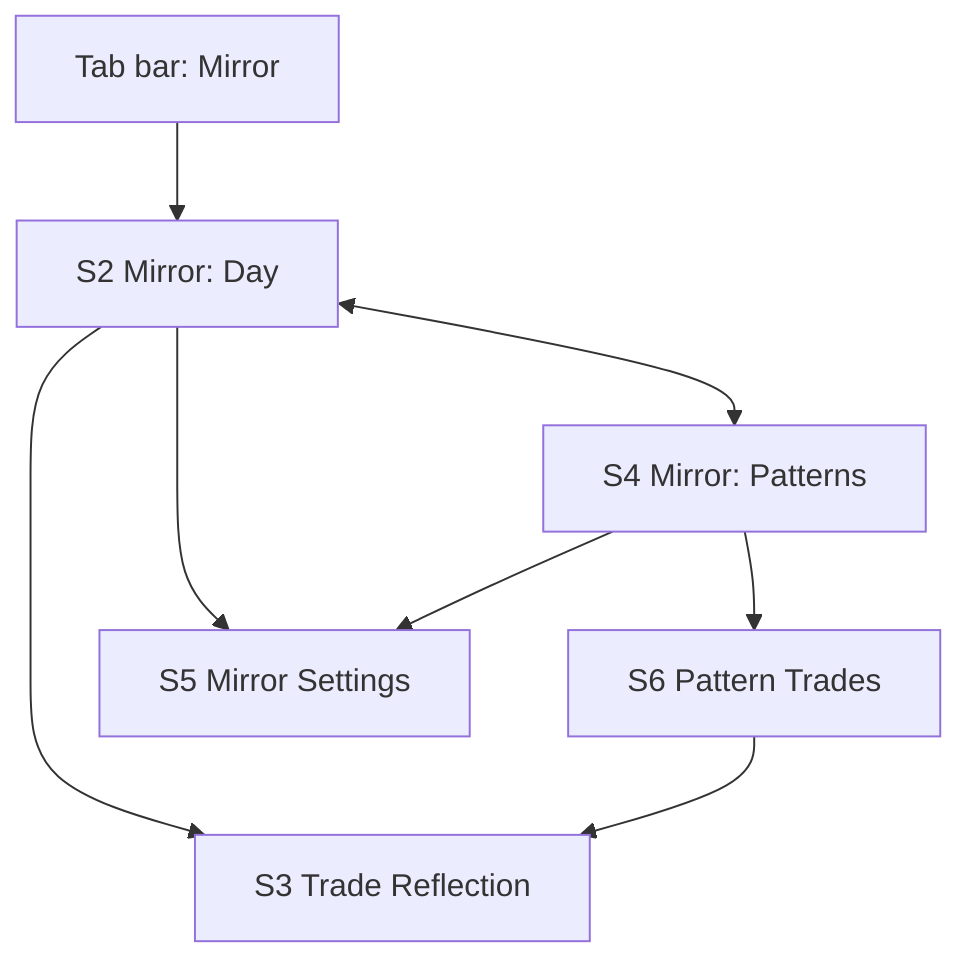
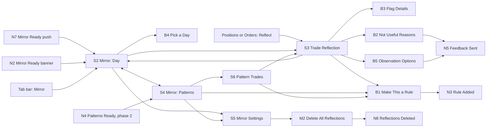

# Sahi Mirror Mobile PRD
*Full PRD: Mirror, a post-market trade review, for the Sahi mobile app on iOS and Android. Use this to design Mirror's app screens in Figma, to build the prototype, and to sign off scope.*

**Product type:** Mobile app, AI feature · **Depth:** Full PRD · **Version:** v2.0 · **Date:** 12 Oct 2026 · **Status:** Draft

**Owner:** Suhas · **Reviewers / sign-off:** Open item
> Scope note: Mirror runs only after the market closes. Nothing from Mirror appears during market hours (9:15 am to 3:30 pm IST): no push, banner, badge, chip, snackbar or screen content for the current day. It describes the trader's own behaviour and never gives a view on any security. The web desktop spec (v1.1) stays the reference for web.sahi.com; this document covers the Sahi app.
>
> Changes: v2.0 rewrote Mirror for the Sahi mobile app (iOS and Android), portrait only. D1 Pattern Trades drawer → S6 Pattern Trades screen. M1 Make This a Rule modal → B1 Make This a Rule bottom sheet. Added N7 Mirror Ready push, N8 Offline banner, B2 Not Useful Reasons, B3 Flag Details, B4 Pick a Day, B5 Observation Options. Keyboard shortcuts removed. Hover on flag chips replaced by tap, which opens B3. Tables replaced by lists. Primary actions moved to a sticky bottom bar. Kept from v1.1: S1 and N1 stay retired.

## 1. Overview
- **Problem / why:** Over 91% of individual F&O traders lost money in FY25 (SEBI study, cited in the Sahi research). Traders repeat the same habits, such as revenge entries, missing stops and oversizing, because nothing shows them the pattern. Most active Sahi traders trade from their phone, so a review that lives only on desktop misses the moment they are most likely to reflect: on the commute or the couch after the close.
- **Concept:** Mirror reflects the trader's day back to them after the close: what they intended, what they did, and where the two split. It never says they were wrong. The loop is Trade (Sahi only records) → Recall (pick the reason with the outcome hidden) → See (plan vs action, one question) → Set (a rule checked after the next close). On the phone the review is built for one thumb and about two minutes.
- **Users / roles:** one role, Trader. Primary: active intraday and F&O traders who use the Sahi app, including Scalper Mode users.
- **Main jobs:** see what really happened today; spot trades that broke their own plan; learn which habits cost them money; set a rule and see whether they kept it.
- **Entry points:** N7 Mirror Ready push after the close; N2 Mirror Ready in-app banner; Mirror in the app tab bar; Reflect on a closed position in Positions or an executed order in Orders after the close; N4 Patterns Ready (phase 2).
- **In scope:** day review, reason recall with the outcome hidden, trade reflection, AI observations, patterns over 30 sessions, rules checked after the close, Mirror settings, the post-close push, offline viewing of saved days.
- **Out of scope / owned elsewhere:** anything shown during market hours; rule enforcement during trading; trade recommendations or price views of any kind; paper trading; ranking or sharing P&L; home-screen widgets and lock-screen live activities; landscape layouts; the order ticket, Orders and Positions screens (owned by Sahi trading, Mirror adds only the Reflect row action); the app tab bar itself (owned by Sahi app, Mirror adds one item).
- **Platforms and frames:** Sahi app on iOS (frame 390×844) and Android (frame 360×800), portrait only. Assumption: built in the same cross-platform stack as the current Sahi app. Platform differences are noted only where behaviour changes (system back, swipe-back, alert style, notification permission).

### 1.1 Goals, non-goals and success metrics
| Goal | Metric | Baseline | Target |
|---|---|---|---|
| Traders break their own plan less | Share of a trader's trades carrying one or more flags, week 1 vs week 4 | Beta weeks 1 to 2 | Proposed: 20% lower by week 4 |
| Insights turn into action | Rules added in B1 per reviewer per month | Beta weeks 1 to 2 | Proposed: 1 or more per reviewer per month |
| Traders come back to reflect | Share of trading days reviewed, among opted-in active F&O traders | Beta weeks 1 to 2 | Proposed: 40% of trading days |
| The push brings people back without nagging | N7 open rate, and share of traders who turn N7 off within 14 days | Beta weeks 1 to 2 | Open item: targets |
| Reflection builds loyalty | 90-day retention of reviewers vs matched non-reviewers | Beta weeks 1 to 2 | Proposed: 10 points higher |
| Guardrail: it never feels like blame | Share of rated observations marked Felt judgemental | Beta weeks 1 to 2 | Proposed: under 5% |

Targets are beta hypotheses, reviewed after week 4.

**Non-goals:** Mirror does not predict prices, recommend trades, rate a trader's skill, rank traders against each other, block orders or show anything during market hours. Raising trade count or app session time is not a goal. The push is not a re-engagement campaign: one per trading day at most, and only when there is something to review.

### 1.2 Users and roles
| Role / persona | Main jobs | Context and constraints |
|---|---|---|
| Trader: active F&O and intraday | Review the day, spot plan breaks, set rules | Reviews on the phone after 3:30 pm, often one-handed, on the move, in short sessions that may be interrupted. Possibly tired or upset after a red day. Already saw the day's P&L while trading |
| Trader: Scalper Mode user | Same jobs at much higher volume | Many trades a day. Worth a look caps the review at 3 trades so it stays near 2 minutes. The All trades list can run to 100 or more rows |
| Trader: new to Mirror | Learn what Mirror does, decide on notifications | Little history: observations show facts only and S4 starts mostly empty. Sees the first-run card and the notification primer once |

### 1.3 Constraints, dependencies and risks
| Risk | Impact | Mitigation or owner |
|---|---|---|
| Feels like blame after a red day | Traders churn, turn off N7 or stop opening Mirror | Mirror principles (Section 10), copy review, Felt judgemental feedback, one-tap Skip today |
| A push lands on the lock screen where others can see it | P&L or habits exposed to people nearby | N7 never contains P&L, flags or instrument names (Section 10.2) |
| A push or banner leaks into market hours (clock drift, delayed delivery, app left open) | Breaks the core promise and may nudge live trading | Server decides the send time; push expires at 9:00 am next day; app checks server time on resume and switches to Before close (Section 10.2) |
| Recall answers fade after week one | Plan vs action comparison weakens | Sahi's guess pre-selected, one tap to confirm, answer rate tracked weekly |
| Trader remembers the outcome from the day | Recall reduces hindsight but cannot remove it | Per-trade P&L and flags stay hidden until the reason is confirmed; the guess is anchored on order origin, not outcome |
| A small chart on a phone hides the context of the trade | Recall feels like guessing | Chart opens on the trade window, not the full session; Full day is one tap away |
| A wrong fact, such as a stop placed outside Sahi | Trust in every observation drops | All facts computed from orders, source orders shown on S3, Wrong fact feedback |
| Observations read as advice | Regulatory exposure | No forward-looking lines; compliance signs off every copy template |
| Fewer orders from rule-following traders | Lower brokerage per trader | Measure retention and lifetime value, not order count |
| A lesson waits a day to meet the next decision | Weaker behaviour change than a live prompt | Rule check-ins after every close, patterns weekly |
| Dependency: order origin (chart, scanner, option chain, watchlist, basket) logged per order, from the app as well as the web | Sahi's guess and context lines need it | Sahi engineering. Open item: confirm the app logs it today |
| Dependency: event calendar (results, RBI policy, expiry) | Event exposure flag needs it | Sahi data team. Open item: source |
| Dependency: Sahi push service, deep links into the app and notification categories | N7 and its deep link need them | Sahi app platform team. Open item: confirm a separate "Mirror" notification category is possible on Android |
| Dependency: a slot in the app tab bar | Main entry point | Sahi app owners. Open item: tab position, or fallback entry under Account |
| Dependency: compliance sign-off of copy templates and push copy | Launch blocker | Sahi compliance |

## 2. Requirements
### 2.1 Functional
| ID | Requirement | Priority | Surfaces |
|---|---|---|---|
| FR-01 | The system shows nothing from Mirror for the current day during market hours (9:15 am to 3:30 pm IST), including push notifications, banners and badges | Must | All |
| FR-02 | The system records each order's origin: chart, scanner, option chain, watchlist or basket, for orders placed in the app and on the web | Must | S3 |
| FR-03 | The system builds the day's Mirror after the close for any day with one or more executed trades | Must | S2, N2, N7 |
| FR-04 | The system computes flags for every trade using the signal definitions in Section 10 | Must | S2, S3, S4, S6 |
| FR-05 | The trader can see a day card with plan kept, trade count and net P&L | Must | S2 |
| FR-06 | The system selects up to 3 Worth a look trades by flag count, keeping one place for a flagged trade that ended in profit | Must | S2 |
| FR-07 | The trader can pick the reason for a trade with exit, P&L and flags hidden, with Sahi's guess pre-selected | Must | S3 |
| FR-08 | The system reveals exit, net P&L, flags and one observation only after the reason is confirmed or skipped | Must | S3 |
| FR-09 | The system asks at most one question per trade, only when the reason and the trade's actions don't match | Should | S3 |
| FR-10 | The trader can skip a day's review in one tap | Must | S2 |
| FR-11 | The trader can open any trading day's Mirror from the last 90 days (Assumption: 90 days) | Should | S2, B4 |
| FR-12 | The trader can see patterns from the last 30 sessions with trade count, how those trades ended and their net P&L | Must | S4, S6 |
| FR-13 | The trader can turn a flag or pattern into a rule, and edit or remove it later | Must | B1, N3, S4 |
| FR-14 | The system checks each rule after every close and shows how many trades kept it | Must | S2, S4 |
| FR-15 | The trader can rate an observation, give a reason, or hide observations like it | Should | S3, S4, B2, B5, N5 |
| FR-16 | The trader can open Reflect on a closed position or executed order after the close | Should | S3 |
| FR-17 | The trader can pause Mirror, turn N7 and N2 off, adjust thresholds within bounds and hide reasons they never use | Must | S5 |
| FR-18 | The trader can delete all reasons, answers and notes | Must | S5, M2, N6 |
| FR-19 | The system nudges the trader weekly when patterns refresh | Could | N4 |
| FR-20 | The system sends at most one Mirror Ready push per trading day, after the build, and only when the day has trades | Must | N7 |
| FR-21 | The trader can tap a Mirror push or link and land on the right day or trade, signing in first if needed | Must | N7, S2, S3 |
| FR-22 | The trader can see what a flag means and their threshold by tapping the flag chip | Must | B3 |
| FR-23 | The trader can view saved days and confirm reasons while offline; answers sync when the connection returns | Should | S2, S3, S4, N8 |

### 2.2 Non-functional
| ID | Area | Requirement | Surfaces |
|---|---|---|---|
| NFR-01 | Timing | Mirror surfaces and data for the current day stay hidden from 9:15 am to 3:30 pm IST, decided by server time, not the phone clock. Assumption: the day's Mirror is ready by 4:00 pm | All |
| NFR-02 | Accuracy | Every number shown, including inside observations, is computed from order records. The AI only phrases computed facts | S2, S3, S4, S6 |
| NFR-03 | Performance | Observations are generated in a batch after the close. Assumption: S2 and S3 show content in under 2 seconds on a mid-range Android phone over 4G; the next Worth a look trade is preloaded | S2, S3 |
| NFR-04 | Privacy | Reasons, answers and notes are private to the trader, never used for marketing, kept while the account is active and deleted within 30 days of a delete request or account closure. Push text never contains P&L, flags or instruments | S3, S5, M2, N7 |
| NFR-05 | Compliance | Every observation carries the label "AI summary of your own trades. Not investment advice." No observation contains a price view, entry suggestion or instrument suggestion | S3, S4 |
| NFR-06 | Accessibility | Assumption: WCAG 2.1 AA, plus VoiceOver and TalkBack support, text scaling to 200% without lost content, touch targets at least 44 pt (iOS) or 48 dp (Android). Flags never rely on colour alone; every chip has a text label. The chart has a text equivalent | All |
| NFR-07 | Localisation | English in MVP; Hindi and Hinglish in phase 2. Rupee amounts use Indian digit grouping, e.g. ₹1,24,500. Times in IST, 12-hour with am and pm | All |
| NFR-08 | Offline | The last 5 viewed days, their trades and their observations are cached on the device. Reasons, answers and notes queue offline and sync on reconnect. Rule changes and settings need a connection | S2, S3, S4, S5, N8 |
| NFR-09 | Device security | Mirror screens follow Sahi's app lock (biometric or PIN) and its screenshot policy | All |
| NFR-10 | Analytics | Events listed in each build sheet's Notes, with platform = ios or android | All |

## 3. Navigation and Information Architecture
Mirror uses Sahi's app shell: the bottom tab bar and a stack per tab. Mirror adds one tab bar item, one row action and one push category.

| Nav item | Goes to | Visible to | Notes |
|---|---|---|---|
| Mirror (tab bar item) | S2 | Trader | Assumption: 4th of 5 items, label "Mirror", outline icon. Open item: position, or a fallback entry under Account if the tab bar is full. Before the close, opens the previous trading day. Never shows a badge during market hours; after the close shows a dot when today's Mirror is ready and not opened |
| Reflect (row action in Positions, closed tab, and in Orders, executed) | S3 | Trader | Shown only once the day's Mirror is built after the close, on executed trades |
| Day and Patterns (segmented control in the Mirror header) | S2 or S4 | Trader | Day is the default |
| Settings (Mirror header icon button) | S5 | Trader | Pushed onto the Mirror stack |
| N7 push and deep links | S2 or S3 | Trader | sahi://mirror/day/{date} opens S2; sahi://mirror/trade/{id} opens S3. If signed out or locked, Sahi's sign-in or app lock comes first, then the target |

**Stack and back behaviour:** S2 and S4 are the roots of the Mirror tab (switched with the segmented control, no back). S3, S5 and S6 are pushed on top. Back (nav bar chevron, iOS edge swipe, Android system back) pops one level. Bottom sheets close on swipe down, scrim tap or Android back. Re-tapping the Mirror tab pops to the root.

## 4. User Flows
### Flow 1: Trade as usual (during market)
**Actor:** Trader · **Starts:** 9:15 am open · **Ends:** 3:30 pm close
- Trader places orders as normal from charts, option chains, scanners, watchlists and baskets, in the app or on the web.
- System records each order, fill, modification and stop, plus the screen the order came from.
- System shows nothing from Mirror during market hours: no push, banner, badge, chip, snackbar or row action.
- If the trader taps Mirror in the tab bar before the close, system opens S2 Mirror: Day for the previous trading day with the note "Today's Mirror opens after 3:30 pm".
- If the trader opens a link to S3 Trade Reflection for today before the close, system shows S3 in its Before close state with Go to Mirror, which opens S2.
- If the app was left open on a Mirror screen overnight and is resumed after 9:15 am, system switches that screen to its Before close state before showing any content.

### Flow 2: Review the day (after close)
**Actor:** Trader · **Starts:** N7 Mirror Ready push, N2 Mirror Ready banner, Mirror tab, or Reflect in Positions or Orders · **Ends:** day marked Reviewed or Skipped on S2
- System builds the day's Mirror after the close for any day with one or more executed trades.
- System sends N7 Mirror Ready push, unless the trader turned it off, notifications are off on the phone, or it is past 9:00 pm.
- Trader taps N7; system opens the app on S2 Mirror: Day for that day.
- If the trader opens the app without tapping the push, system shows N2 Mirror Ready banner on the first screen view; Open Mirror opens S2.
- Trader sees the day card, the rule check-in, up to 3 Worth a look trades and All trades, with Start review in the sticky bottom bar.
- Trader taps Start review; system opens S3 Trade Reflection for the first Worth a look trade, in Recall state.
- System shows the chart up to the entry candle, entry time, size, stop at entry and order origin, keeps exit, P&L and flags hidden, and pre-selects its guess at the reason.
- Trader confirms or changes the reason and taps Confirm reason; system reveals exit, net P&L, flags and one observation with a light haptic, and stays on S3.
- If the trader taps I don't remember, system saves Not answered and reveals the outcome.
- If the trader taps a flag chip, system opens B3 Flag Details.
- If the trader taps thumbs up, system saves it and shows N5 Feedback Sent. If they tap thumbs down, system opens B2 Not Useful Reasons; on a pick, system saves it and shows N5.
- If the reason and the trade's actions don't match, system shows one question; trader taps an answer chip and can add a note; system saves on tap and stays on S3.
- Trader taps Next trade; system opens the next Worth a look trade on S3 in Recall state.
- After the last Worth a look trade, trader taps Done; system returns to S2 marked Reviewed.
- If the day has no flags, S2 shows Followed your plan and hides Start review.
- If the trader taps Skip today on S2, system marks the day Skipped and stays on S2.
- If the trader taps Reflect on a closed position or executed order after the close, system opens S3 for that trade.

### Flow 3: Explore patterns
**Actor:** Trader · **Starts:** Patterns on the Mirror segmented control, or N4 Patterns Ready (phase 2) · **Ends:** trader leaves S4 or opens B1
- Trader taps Patterns; system shows S4 Mirror: Patterns for the last 30 sessions.
- Trader sees the baseline card (trades with no flags), one card per flag shared by 10 or more trades, building patterns, and Your rules.
- Trader taps View trades on a pattern card; system pushes S6 Pattern Trades.
- Trader taps a trade in S6; system pushes S3 for that trade, in Recall state if not yet reviewed, else Revealed.
- Trader goes back from S3; system returns to S6 at the same scroll position.
- If no flag has 10 trades yet, S4 shows Not enough trades yet with the count each flag still needs.

### Flow 4: Set a rule, check it after the next close
**Actor:** Trader · **Starts:** Make this a rule on S3, S4 or S6 · **Ends:** rule saved, then checked after the next close
- Trader taps Make this a rule; system opens B1 Make This a Rule, pre-filled from the flag, e.g. "No new entry for 10 minutes after a loss".
- Trader adjusts the value with the stepper and taps Add rule; system saves the rule, closes B1 and shows N3 Rule Added on the screen the trader came from.
- If a rule for that flag already exists, B1 shows its Duplicate state with Edit existing rule.
- System shows nothing about the rule during market hours.
- After the next close, system checks each trade against the rule, and S2 shows the rule check-in, e.g. "Kept on 8 of 9 trades".
- Trader taps See the trade that broke it; system opens S3 for that trade.
- Trader taps Edit on a rule in S4; system opens B1 in Edit state.
- If the trader taps Remove rule in B1, system deletes the rule, closes B1 and shows N3 in its Removed variant on S4, with Undo.

### Flow 5: Manage Mirror
**Actor:** Trader · **Starts:** Settings on S2 or S4 · **Ends:** trader returns to S2 or S4
- Trader taps Settings; system pushes S5 Mirror Settings.
- Trader changes a toggle, stepper or checkbox; system saves on change and stays on S5.
- If the trader turns on the Mirror Ready notification and the phone has not granted notification permission, system asks the operating system for permission; if denied, the row shows "Off in phone settings" with Open phone settings.
- If the trader turns Mirror off, system stops building Mirror and sending N7 and N2 until it is turned back on, and S2 and S4 show their Paused state.
- Trader taps Delete all reflections; system opens M2 Delete All Reflections.
- Trader taps Delete all; system deletes reasons, answers and notes, closes M2 and shows N6 Reflections Deleted on S5.
- Trader goes back; system returns to the screen that opened S5.

### Flow 6: First run and notification permission
**Actor:** Trader · **Starts:** first open of the Mirror tab · **Ends:** first-run card dismissed
- Trader opens the Mirror tab for the first time; system shows the first-run card at the top of S2.
- Trader reads what Mirror does and taps Turn on notifications; system shows the operating system permission prompt (iOS; Android 13 and later).
- If the trader allows, system turns N7 on and the card closes. If they deny, N7 stays off, the card closes, and S5 shows Off in phone settings.
- If the trader taps Not now, system closes the card for good and leaves N7 off; N2 still shows in the app.

## 5. Surface List
| ID | Name | Type | Platform | Purpose | Release |
|---|---|---|---|---|---|
| S1 | Order Ticket: Intent Row | Screen (existing ticket, new row) | Web desktop | Was: capture the reason at entry. Replaced by recall in S3 | Removed in v1.1 |
| N1 | Post-Fill Tag Strip | Toast | Web desktop | Was: tag fast fills. Replaced by recall in S3 | Removed in v1.1 |
| N2 | Mirror Ready | Banner | iOS and Android | Bring the trader to today's Mirror after the close, inside the app | MVP |
| S2 | Mirror: Day | Screen (Mirror tab root) | iOS and Android | Day card, rule check-in, Worth a look trades, all trades | MVP |
| S3 | Trade Reflection | Screen (pushed) | iOS and Android | One trade: recall with the outcome hidden, then plan vs action | MVP |
| S4 | Mirror: Patterns | Screen (Mirror tab root, segment of S2) | iOS and Android | Recurring flags over 30 sessions, and the trader's rules | MVP |
| D1 | Pattern Trades | Drawer | Web desktop | Replaced by S6 in the app | Replaced in v2.0 |
| M1 | Make This a Rule | Modal - form | Web desktop | Replaced by B1 in the app | Replaced in v2.0 |
| N3 | Rule Added | Snackbar | iOS and Android | Confirm a rule was added, updated or removed | MVP |
| N4 | Patterns Ready | Banner and Push | iOS and Android | Weekly nudge to S4 | Phase 2 |
| S5 | Mirror Settings | Screen (pushed) | iOS and Android | Mirror on or off, notifications, thresholds, reason list, delete | MVP |
| M2 | Delete All Reflections | Modal - confirm (system alert) | iOS and Android | Confirm deleting reasons, answers and notes | MVP |
| N5 | Feedback Sent | Snackbar | iOS and Android | Confirm observation feedback or a hidden observation type | MVP |
| N6 | Reflections Deleted | Snackbar | iOS and Android | Confirm the delete | MVP |
| S6 | Pattern Trades | Screen (pushed) | iOS and Android | The trades behind one pattern | MVP |
| B1 | Make This a Rule | Bottom sheet - form | iOS and Android | Create, edit or remove a rule from a flag | MVP |
| N7 | Mirror Ready | Push | iOS and Android | Bring the trader to today's Mirror after the close, outside the app | MVP |
| B2 | Not Useful Reasons | Bottom sheet - action sheet | iOS and Android | Pick why an observation wasn't useful | MVP |
| B3 | Flag Details | Bottom sheet | iOS and Android | What a flag means and the trader's threshold (replaces hover) | MVP |
| B4 | Pick a Day | Bottom sheet | iOS and Android | Choose any trading day from the last 90 days | MVP |
| B5 | Observation Options | Bottom sheet - action sheet | iOS and Android | Hide observations like this | MVP |
| N8 | Offline | Banner | iOS and Android | Tell the trader they are seeing saved data | MVP |

## 6. Flow Map
| From | Trigger | To | Condition / result |
|---|---|---|---|
| System | Market close, Mirror built, one or more trades today | N7 | Sent once; not sent if Mirror is off, N7 is off, permission is denied, or it is past 9:00 pm |
| System | Market close, Mirror built, one or more trades today | N2 | Shown on the next screen view in the app; not shown if Mirror or N2 is off, or the day was already opened |
| N7 | Tap | S2 | That day's Mirror, after sign-in or app lock if needed |
| N7 | Swipe away | External: phone notification centre | Push cleared; N2 still shows in the app |
| N2 | Open Mirror | S2 | Today's Mirror |
| N2 | Dismiss (close icon) | Stays on current screen | Banner closes for the day |
| Tab bar | Mirror | S2 | Today after the close, else the previous trading day |
| Positions or Orders | Reflect on a row | S3 | After the day's Mirror is built only |
| S2 | Start review or Continue review | S3 | First unreviewed Worth a look trade, Recall state |
| S2 | Trade card or list item tap | S3 | Recall state if not yet reviewed, else Revealed |
| S2 | See the trade that broke it | S3 | That trade, Revealed |
| S2 | Skip today | Stays on S2 | Day marked Skipped |
| S2 | Day strip item | S2 | Mirror for the chosen trading day |
| S2 | Calendar icon | B4 | |
| B4 | Day tap | S2 | Mirror for the chosen day; B4 closes |
| B4 | Swipe down or scrim tap | S2 | Nothing changes |
| S2 or S3 | Flag chip tap | B3 | |
| B3 | Close or swipe down | Previous screen | |
| S3 | Confirm reason or I don't remember | Stays on S3 | Outcome revealed with flags and one observation |
| S3 | Next trade | S3 | Next Worth a look trade, Recall state |
| S3 | Done | S2 | Day marked Reviewed |
| S3 | Back (chevron, edge swipe, system back) | S2 or S6 | Returns to where the trader came from |
| S3 | Go to Mirror (Before close state) | S2 | Previous trading day |
| S3 | Make this a rule | B1 | Pre-filled from the trade's main flag |
| S3 or S4 | Thumbs up | Stays, N5 | Feedback saved |
| S3 or S4 | Thumbs down | B2 | |
| B2 | Reason tap | Previous screen, N5 | Feedback saved |
| S3 or S4 | Observation overflow (⋯) | B5 | |
| B5 | Hide observations like this | Previous screen, N5 | Type hidden; Undo in N5 |
| S2 | Patterns segment | S4 | Patterns for the last 30 sessions |
| S4 | Day segment | S2 | Last viewed day |
| System | Last session of the week ends | N4 | Phase 2 |
| N4 | Open patterns | S4 | |
| S4 | View trades on a pattern card | S6 | Trades behind that pattern |
| S6 | Trade tap | S3 | Recall state if not yet reviewed, else Revealed |
| S6 | Back | S4 | |
| S4 or S6 | Make this a rule | B1 | Pre-filled from the pattern |
| S4 | Edit on a rule | B1 | Edit state |
| B1 | Add rule or Save rule | Previous screen, N3 | Rule saved; checked after the next close |
| B1 | Remove rule | S4, N3 | Rule deleted; Undo in N3 |
| B1 | Cancel, swipe down or scrim tap | Previous screen | Nothing saved |
| S2 or S4 | Settings | S5 | |
| S2 or S4 | Settings link (Paused state) | S5 | |
| S5 | Delete all reflections | M2 | |
| M2 | Delete all | S5, N6 | Reasons, answers and notes deleted |
| M2 | Cancel | S5 | Nothing deleted |
| S5 | Back | S2 or S4 | Changes already saved |
| System | Connection lost | N8 | On any Mirror screen |

## 7. Shared Components
| Component | Used on | Contents | Behaviour and variants |
|---|---|---|---|
| Mirror header | S2, S4 | Large title "Mirror", Settings icon button (right), segmented control Day and Patterns. On S2 only: day strip below | Large title collapses into a small nav bar title on scroll. The segmented control stays pinned under the nav bar. Switching keeps the selected day |
| Day strip | S2 | Horizontal scroll of the last 10 trading days, newest on the right, each with weekday, date and a review status dot with text for screen readers. Calendar icon button at the end opens B4 | Selected day is filled. Today shows "Opens 3:30 pm" and is not selectable during market hours. Default: today after the close, else the previous trading day |
| Trade card | S2 | Instrument, side, size in lots or shares, entry time, review status chip. After review: up to 3 flag chips (+n for more) and net P&L | Before review: flags and P&L hidden, with the line "Hidden until you recall". Tap opens S3. Full-width, stacked |
| Trade list item | S2, S6 | Leading: entry time (S2) or date and time (S6). Title: instrument. Subtitle: side, size, origin (S2) or size (S6). Trailing: net P&L or "Hidden", flag count chip ("2 flags") | Tap opens S3. No swipe actions |
| Flag chip | S2, S3, S4, S6, B1, B3 | Flag name: Revenge entry, Size spike, No stop, Stop widened or removed, Opening rush, Trade burst, Event exposure | Neutral style, never red, so it reads as a fact and not a warning. Tap opens B3 (except inside B1 and B3, where it is read-only) |
| Reason chips | S3, S5 | Setup, Breakout, News, Tip, Gut, Recover loss, Other | Single select, wrapping grid, at least 44 pt tall. Sahi's guess is pre-selected and tagged "Sahi's guess". Reasons hidden in S5 don't appear, except Other |
| Review status chip | S2, S6, Day strip | Not reviewed, Reviewed, Followed plan, Skipped, No trades | Text label always shown with the colour (the day strip uses a dot plus an accessibility label) |
| Observation block | S3, S4 | Label "AI summary of your own trades. Not investment advice.", observation text, thumbs up, thumbs down, overflow (⋯) | Thumbs down opens B2. Overflow opens B5. Any feedback shows N5. Thumbs show their selected state |
| Sticky bottom bar | S2, S3, S6 | One primary button, full width, or a secondary plus a primary side by side | Sits above the tab bar on S2 and above the home indicator on S3 and S6. Hides while the keyboard is open |
| Snackbar | N3, N5, N6 | One line of text, optional Undo | Appears above the sticky bottom bar or tab bar, auto-hides after 5 seconds, swipe to dismiss. Announced to screen readers |

## 8. Build Sheets

### S2 Mirror: Day
**Type:** Screen (Mirror tab root) · **Platform:** iOS and Android, portrait · **Opened from:** N7 push, N2 Open Mirror, Mirror tab, Day segment on S4, Back or Done on S3, Back on S5 · **Roles:** Trader
**Purpose:** Show one trading day back to the trader and start a 2-minute review of the trades worth a look.
**Layout (top to bottom):**
1. Mirror header (shared): large title "Mirror", Settings icon button, segmented control Day and Patterns, day strip with calendar icon
2. Before close note (conditional): "Today's Mirror opens after 3:30 pm. Showing {previous trading day}."
3. First-run card (first visit only)
4. Day card: headline "Plan kept on {kept} of {total} trades", then a row of three values: Trades, Net P&L after charges, Flags; review status chip top right; Skip today below; "Built at {time}" in quiet text
5. Rule check-in (shown when one or more rules were active that day): one row per rule
6. Worth a look: section header "Worth a look" and up to 3 trade cards, stacked
7. All trades: section header "All trades ({count})" and a list
8. Sticky bottom bar: Start review or Continue review (when available), above the tab bar
9. Tab bar (Sahi app)

#### Actions & interactions
| Action | Type / placement | Result | Shown / enabled when |
|---|---|---|---|
| Start review | Primary · Sticky CTA | Push S3 for the first unreviewed Worth a look trade, Recall state | Day has 1 or more Worth a look trades not yet reviewed, none reviewed yet |
| Continue review | Primary · Sticky CTA, replaces Start review | Push S3 for the next unreviewed Worth a look trade | 1 or more Worth a look trades reviewed, 1 or more left |
| Skip today | Tertiary · Day card | Mark the day Skipped; stays on S2 | Day not yet Reviewed or Skipped |
| Trade card tap | Card click · Worth a look | Push S3 for that trade: Recall state if not reviewed, else Revealed | Always |
| Trade list item tap | Row tap · All trades | Push S3 for that trade: Recall state if not reviewed, else Revealed | Always |
| Flag chip tap | Tap · Trade card, after review | Open B3 for that flag | Card reviewed |
| See the trade that broke it | Inline link · Rule check-in row | Push S3 for that trade, Revealed | Rule broken on 1 or more trades; one link per breaking trade, up to 3 |
| Day strip item | Toolbar control · Mirror header | Reload S2 for that trading day | Always, except today during market hours |
| Calendar | Header button · end of day strip | Open B4 Pick a Day | Always |
| Patterns | Segmented control · Mirror header | Show S4 | Always |
| Settings | Header button · Mirror header | Push S5 | Always |
| Turn on notifications | Primary · First-run card | Show the OS permission prompt; on allow turn N7 on; close the card | First visit, N7 permission not yet asked |
| Not now | Tertiary · First-run card | Close the card for good | First visit |
| Pull to refresh | Gesture · Pull-to-refresh | Reload the day | Online |
| Retry | Secondary · Error state | Reload the day | Load error |
| Tab re-tap | Gesture · Tab bar | Scroll to top | Always |

#### Components & content
| Component / field | Type | Content | Purpose |
|---|---|---|---|
| Mirror header | Shared component | See Shared Components | Navigation |
| Day card headline | Read-only value | "Plan kept on {kept} of {total} trades". A trade counts as kept when it has no flags | Lead with process, not P&L |
| Trades | Read-only value | Count of executed trades that day | Context |
| Net P&L after charges | Read-only value | Rupee amount with sign and Indian digit grouping, e.g. −₹3,240. Shown second, in the same style and weight as Trades | Context, never the headline |
| Flags | Read-only value | Count of flags across the day's trades | Context |
| Review status chip | Status chip | Not reviewed, Reviewed, Followed plan, Skipped | Day status |
| Built at | Read-only text | "Built at 3:52 pm" | Freshness |
| Rule check-in row | List item | Rule text, e.g. "No new entry for 10 minutes after a loss". Result, e.g. "Kept on 7 of 8 trades" or "Kept on all 9 trades". Up to 3 links "See the trade that broke it" (with time when more than one) | Accountability after the close |
| Worth a look trade cards | Trade card (shared) | 0 to 3 cards, ordered by flag count, highest first. Flags and P&L hidden until reviewed | The short review list |
| All trades list | List of trade list items (shared) | One item per trade, earliest first. Trailing shows "Hidden" for Worth a look trades not yet reviewed. No pagination; the whole day scrolls | Full day, scannable |
| Origin | Part of list item subtitle | Chart, Scanner, Option chain, Watchlist, Basket, Other | Context for the reason guess |
| First-run card | Banner | Title "Your day, after the close". Body "Mirror shows your day back to you after 3:30 pm. Pick why you took a trade, then see what happened. It never tells you what to trade." Actions: Turn on notifications, Not now. Helper "One notification on days you trade. Never during market hours." | Set expectations once and ask for notification permission in context |

#### States
| Scope | State | When | What the user sees |
|---|---|---|---|
| Screen | Loading | Data loading | Skeleton of the day card, three card placeholders and list rows |
| Screen | Before close | Opened between 9:15 am and 3:30 pm | Before close note; S2 shows the previous trading day; today's chip in the day strip reads "Opens 3:30 pm" |
| Screen | Building | After the close, Mirror not yet built | Day card replaced by "Your Mirror is being built. It's usually ready by 4:00 pm." All trades list still shown, with flags and P&L hidden. No sticky CTA |
| Screen | No trades | No executed trades on the chosen day | "No trades on {date}." Link "Go to your last trading day" reloads S2 for it |
| Screen | Followed your plan | Trades exist, none flagged | Headline "Plan kept on all {total} trades", status chip Followed plan, Worth a look section hidden, no sticky CTA |
| Screen | Reviewed | All Worth a look trades reviewed | Status chip Reviewed; no sticky CTA; cards show flags and P&L |
| Screen | Skipped | Trader tapped Skip today | Status chip Skipped; Start review still shown so the trader can change their mind |
| Screen | Paused | Mirror turned off in S5 | "Mirror is off. Turn it on in Settings to see your days." Settings link pushes S5 |
| Screen | First run | First visit to Mirror | First-run card above the day card |
| Screen | Offline | No connection, day cached | N8 banner under the header; cached day shown; pull to refresh disabled |
| Screen | Offline, not cached | No connection, day never loaded | "You're offline. This day hasn't been saved on your phone." Retry |
| Screen | Load error | Data failed to load | "Couldn't load this day." Retry |
| Screen | Not found | Date in a deep link is not a trading day or older than 90 days | "This day isn't available." Link back to the latest day |
| Screen | Resumed from background | App resumed and the market opened since the last view | Switches to Before close before showing content |
| Screen | No access | N/A: single role; signed-out handling is Sahi's | N/A |
| Section | No rules active | No rules were active that day | Rule check-in hidden |
| Section | Rule kept | Rule kept on every trade | "Kept on all {n} trades", no links |
| Freshness | Last updated | Always after the build | "Built at {time}" under the day card in quiet text |

#### Workflow
- Trader arrives from N7, N2, the tab bar or S3.
- Trader reads the day card headline, then the rule check-in.
- Trader taps Start review in the sticky bar and works through S3.
- After the last trade, S3 returns here and the status becomes Reviewed.
- Or the trader taps Skip today and leaves.
- Trader can open any other trade from the All trades list, or another day from the day strip.

#### Notes
- **Responsive / platform:** at 360 wide the three day-card values stay on one row; with text scaled above 130% they stack. iOS large title collapses on scroll; Android uses a medium top app bar.
- **Analytics:** mirror_day_viewed (source = push, banner, tab, s3), review_started, day_skipped, rule_checkin_link_clicked, day_changed (via = strip or calendar), notif_primer_answered (allowed = true or false).
- **Ownership / dependencies:** trades, orders and P&L come from Sahi's order records, read-only. Flags and Worth a look selection follow Section 10.

### S3 Trade Reflection
**Type:** Screen (pushed) · **Platform:** iOS and Android, portrait · **Opened from:** S2 Start review, Continue review, trade card or list item, See the trade that broke it; S6 trade; Reflect on Positions or Orders after the close; deep link · **Roles:** Trader
**Purpose:** Let the trader recall why they took one trade before seeing how it ended, then show plan vs action without judgement.
**Layout (top to bottom):**
1. Nav bar: Back chevron (left); title "{Instrument}" with subtitle "{Side} · {Size} · {entry time}"; progress "{n} of {total}" pill (right) when opened from Worth a look
2. Chart panel, full width, about a third of the screen height, with a segmented control Trade window and Full day
3. Trade facts: two-column grid of label and value pairs
4. Recall state: recall block with the question, reason chips and helper text
5. Revealed state, top to bottom: flags row; You said vs You did; observation block; question block (conditional); Order history (collapsed)
6. Sticky bottom bar. Recall: I don't remember (tertiary) above Confirm reason (primary, full width). Revealed: Make this a rule (secondary) and Next trade or Done (primary) side by side

#### Actions & interactions
| Action | Type / placement | Result | Shown / enabled when |
|---|---|---|---|
| Reason chip | Segmented chip · Recall block | Select one reason; Sahi's guess is pre-selected | Recall state |
| Confirm reason | Primary · Sticky CTA | Save the reason, reveal the outcome with a light haptic, scroll to the flags row; stays on S3, Revealed state | Recall state, a reason selected |
| I don't remember | Tertiary · Sticky bar, above Confirm reason | Save Not answered, reveal the outcome; stays on S3 | Recall state |
| Trade window / Full day | Segmented control · Chart panel | Switch the chart range | Always; in Recall state both ranges end at the entry candle |
| Chart tap and hold | Gesture · Long-press on chart | Show a crosshair with time and price of that candle | Always |
| Flag chip tap | Tap · Flags row | Open B3 for that flag | Revealed state |
| Answer chip | Segmented chip · Question block | Save the answer on tap; stays on S3 | Question shown |
| Note | Multi-line text input · Question block | Saved 1 second after typing stops | Question shown |
| Thumbs up | Inline action · Observation block | Save positive feedback, show N5 | Revealed state |
| Thumbs down | Inline action · Observation block | Open B2 Not Useful Reasons | Revealed state |
| Overflow (⋯) | Inline action · Observation block | Open B5 Observation Options | Revealed state |
| Order history | Expandable block · below question | Expand to show every order and modification with time | Revealed state |
| Make this a rule | Secondary · Sticky bar left | Open B1 pre-filled from the trade's main flag | Revealed state, 1 or more flags, no rule for that flag yet |
| Rule active | Status chip · Sticky bar left, replaces Make this a rule | None (read-only) | A rule exists for the main flag |
| Next trade | Primary · Sticky bar right | Replace S3 with the next Worth a look trade, Recall state | Opened from Worth a look, more trades left |
| Done | Primary · Sticky bar right | Pop to S2, day marked Reviewed | Opened from Worth a look, last trade |
| Back | Nav bar left; iOS edge swipe; Android system back | Pop to S2 or S6, whichever opened S3 | Always |
| Go to Mirror | Primary · Before close state | Open S2 for the previous trading day | Before close state |

#### Components & content
| Component / field | Type | Content | Purpose |
|---|---|---|---|
| Chart panel | Chart | Candlestick chart of the instrument for that session. Trade window (default): 1-minute candles from 30 minutes before entry to 15 minutes after exit. Full day: 5-minute candles, 9:15 am to 3:30 pm. Recall state: candles end at the entry candle with an entry marker; the area after it shows a hatched mask labelled "Rest of the session shows after you answer". Revealed state: entry and exit markers, a stop line at each level it held, a marker at each stop change | Context without the outcome, then the full picture |
| Chart text equivalent | Accessibility label | e.g. "Chart. Entry at 10:34 am at ₹298. Rest of the session hidden until you answer." Revealed: adds exit and stop changes | Screen reader access |
| Trade facts, always shown | Read-only panel | Entry time, Entry price, Size in lots or shares, Size vs usual (e.g. "2× your usual"), Stop at entry (price, or "None"), Origin | Facts the trader knew at entry |
| Trade facts, Revealed only | Read-only panel | Exit time, Exit price, Holding time, Net P&L after charges. Appear with a short fade | The outcome |
| Recall question | Read-only text | "Why did you take this trade?" | Ask before the outcome |
| Reason chips | Reason chips (shared) | Setup, Breakout, News, Tip, Gut, Recover loss, Other. Sahi's guess pre-selected with the tag "Sahi's guess" | One-tap recall |
| Recall helper | Read-only text | "Your result shows after you answer." | Explain the hidden outcome |
| Flags row | Flag chips (shared), wrapping | 0 to 7 chips. With no flags: "No flags on this trade" | What crossed a threshold |
| You said vs You did | Read-only block, stacked | You said: the confirmed reason, or "Not answered". You did: 1 to 5 facts in time order as a short timeline, e.g. "10:34 am Bought 2 lots at 298", "No stop placed", "11:20 am Exited at 241" | Plan vs action |
| Observation block | Observation block (shared) | AI label, one observation of up to 2 sentences and 35 words, feedback controls. Behaviour spec below | The mirror line |
| Question block | Form | One question, built from the reason and the main flag, e.g. "You picked Setup. This trade had no stop. What happened?" Answer chips: Plan, FOMO, Revenge, Bored, Tip, Other. Note: optional, max 280 characters with a counter from 240, placeholder "Add a note (optional)", sentence-case keyboard. Saved indicator "Saved" | One reflection, only where it matters |
| Order history | Expandable block | One row per order event: time, action, price, quantity, e.g. "10:34:12 am · Buy 2 lots · Filled at 298.00" | Source of every fact |
| Progress | Read-only value | "2 of 3" | Keep the review short |

#### AI behaviour (observation block)
- **Inputs:** the trade's orders, fills and modifications; the reason confirmed at recall; stop-loss and target orders; the trade's flags; the trader's trades with the same flags in the last 30 sessions; the trader's answer, if given.
- **Division of work:** the system computes every fact and number; the model only phrases them. The model receives no market data beyond the trade's own fills.
- **Output:** one observation, max 2 sentences and 35 words. First the facts, then the trader's own history. On a phone that is about 5 lines; it is never truncated.
- **Tone:** neutral, second person, plain English.
- **Never:** predict a price; suggest an entry, exit or instrument; call a trade a mistake or bad; use "should have" or "could have been avoided"; label the trader (e.g. "impulsive"); compare with other traders; say the trader did or didn't do analysis; state a pattern from fewer than 10 similar trades in the last 30 sessions.
- **Good examples:**
    - Revenge entry, loss: "You entered 3 minutes after a ₹820 loss, at 2× your usual size, with no stop. Of your last 14 trades like this, 10 ended in loss."
    - Stop widened, loss: "You picked Breakout and placed a stop at 88, then moved it to 78 while in loss. In 9 of your 12 trades with a widened stop, the loss ran past your first stop."
    - Rule broken, win: "This one made ₹3,310. It also had no stop and was 3× your usual size. Of your trades like this, 5 of 16 ended in profit."
    - Followed plan, loss: "You picked Setup, placed a stop at 290 and exited there. This loss stayed inside your plan."
- **Bad examples (never):** "This loss could have been avoided." · "You did no technical analysis before this trade." · "Nifty looked weak here, so a short would have worked better." · "You trade impulsively."
- **Human in the loop:** observations are read-only. Nothing changes the trader's account; a rule exists only after the trader confirms it in B1.
- **Quality bar:** generated in a batch after the close and cached with the day for offline use. Proposed launch bar: every number matches source orders on a test set of 200 anonymised sessions, and reviewers rate 95% or more of observations neutral in tone.

#### States
| Scope | State | When | What the user sees |
|---|---|---|---|
| Screen | Loading | Data loading | Skeleton chart and panels |
| Screen | Recall | Trade not yet reviewed | Chart up to the entry candle with the hatched mask; facts known at entry; recall block; exit, P&L, flags and observation hidden; sticky bar shows I don't remember and Confirm reason |
| Screen | Revealed | Reason confirmed or I don't remember tapped, or trade reviewed earlier | Full chart and facts, flags, You said vs You did, observation, question if any; sticky bar actions |
| Section | Question shown | Confirmed reason is Setup, Breakout or News, and the trade has a mismatch flag (Section 10) | Question block below the observation |
| Section | Question hidden | Reason is Tip, Gut, Recover loss, Other or Not answered, or no mismatch flag | No question block |
| Section | Answer saved | Answer chip tapped | Chip selected, "Saved" beside it; chip can be changed |
| Section | Keyboard open | Note field focused | Sticky bar hides; the note field scrolls above the keyboard; keyboard Done closes it |
| Section | Note save failed | Note didn't save | Inline "Couldn't save your note. Retry", text kept |
| Section | Followed plan | No flags | Flags row "No flags on this trade"; observation uses the followed-plan form; Make this a rule hidden |
| Section | Not enough history | Fewer than 10 similar trades in 30 sessions | Observation states the facts only, no history sentence |
| Section | Generating | Observation not ready yet | Observation placeholder "Preparing your summary" with a shimmer |
| Section | Observation error | Observation failed to generate | "Summary unavailable." Retry. Facts and flags still shown |
| Section | Hidden type | Trader hid this observation type | Observation block shows "You've hidden summaries like this." Undo link |
| Screen | Offline | No connection, trade cached | N8 banner; Confirm reason works and syncs later with "Will sync when you're online" under the sticky bar |
| Screen | Before close | Opened between 9:15 am and 3:30 pm for today's trade | "Mirror opens after 3:30 pm." Go to Mirror. Nothing else shown |
| Screen | Not found | Trade id in the link doesn't exist or isn't the trader's | "This trade isn't available." Link to S2 |
| Screen | Load error | Data failed to load | "Couldn't load this trade." Retry |
| Action | Last trade | Final Worth a look trade | Next trade replaced by Done |
| Action | Single trade | Opened from a list, S6, a rule link or Reflect | No progress pill; sticky bar shows Make this a rule only, or nothing when no flags |

#### Workflow
- Trader lands in Recall state and sees the trade as it was at entry.
- Trader confirms Sahi's guess or picks another reason, or taps I don't remember.
- System reveals the outcome, flags, You said vs You did and one observation.
- If a question appears, trader taps one answer and can add a note.
- Trader can turn the main flag into a rule through B1.
- Trader taps Next trade until Done returns them to S2.

#### Notes
- **Responsive / platform:** at 360 wide the facts grid keeps two columns; reason chips wrap to three rows. iOS uses edge swipe for Back; Android uses system back. Next trade replaces the screen rather than pushing, so Back always returns to S2 or S6. Light haptic on reveal (iOS impact light, Android tick) unless the phone's haptics are off.
- **Analytics:** recall_shown, reason_confirmed (guess_kept = true or false), recall_skipped, outcome_revealed, chart_range_changed, question_answered (answer), note_added, observation_feedback (value, reason), observation_type_hidden, flag_details_opened (flag), rule_started (source = s3).
- **Accessibility:** chart markers have text equivalents in the trade facts panel and the chart label; chips carry text labels; reveal is announced ("Result shown").
- **Ownership / dependencies:** chart data from Sahi's market data service; order history from Sahi's order records; observation text from the Mirror observation service.

### S4 Mirror: Patterns
**Type:** Screen (Mirror tab root, Patterns segment) · **Platform:** iOS and Android, portrait · **Opened from:** Patterns segment on S2, N4 Open patterns (phase 2), Back from S6, B1 after Remove rule · **Roles:** Trader
**Purpose:** Show which of the trader's habits repeat over the last 30 sessions, how those trades ended, and how their rules are holding.
**Layout (top to bottom):**
1. Mirror header (shared), Patterns selected; no day strip
2. Summary line: "Last 30 sessions: {trades} trades, {flagged} with flags" and "Updated after {last close}" in quiet text
3. Baseline card: "Trades with no flags", with count, how they ended and net P&L
4. Pattern cards: one column, one card per flag shared by 10 or more trades
5. Building patterns: list of flags with fewer than 10 trades
6. Your rules: a list of rule cards

#### Actions & interactions
| Action | Type / placement | Result | Shown / enabled when |
|---|---|---|---|
| View trades | Secondary · Pattern card | Push S6 for that flag | Always on a pattern card |
| Make this a rule | Tertiary · Pattern card | Open B1 pre-filled from the flag | No rule exists for that flag and fewer than 5 rules exist |
| Rule active | Status chip · Pattern card, replaces Make this a rule | None (read-only) | A rule exists for that flag |
| Flag chip tap | Tap · Pattern card title | Open B3 | Always |
| Edit | Row action · Rule card | Open B1 in Edit state | Always on a rule card |
| Thumbs up, Thumbs down, Overflow | Inline action · Pattern card observation | Same as on S3: N5, B2 or B5 | Pattern card has an observation |
| Day | Segmented control · Mirror header | Show S2 for the last viewed day | Always |
| Settings | Header button · Mirror header | Push S5 | Always |
| Pull to refresh | Gesture · Pull-to-refresh | Reload patterns | Online |
| Retry | Secondary · Error state | Reload patterns | Load error |

#### Components & content
| Component / field | Type | Content | Purpose |
|---|---|---|---|
| Summary line | Read-only text | "Last 30 sessions: 142 trades, 61 with flags" | Scope of the patterns |
| Baseline card | Summary card | Title "Trades with no flags". Values: Trades (count), Ended in profit "{won} of {count}", Net P&L after charges | A fair comparison point, and the trader's strengths |
| Pattern card | Card | Flag chip as title. Values: Trades, Ended in loss "{lost} of {count}", Net P&L after charges. A small bar comparing the loss share with the baseline's loss share, both labelled. One AI observation line. View trades. Make this a rule or Rule active | One habit and what it led to |
| Pattern card order | Sort rule | By net P&L after charges, lowest first. 0 to 7 cards | Costliest habits first |
| Building patterns list | List | One row per flag with 1 to 9 trades: "{Flag}" with a progress bar and "{n} of 10 trades" | Explains why a flag has no card yet |
| Your rules | List of rule cards | Each card: rule text; "Added {date}"; Last session e.g. "Kept on 8 of 9 trades"; Since added e.g. "Kept on 41 of 47 trades"; Edit. Newest first. Max 5 | How rules are holding over time |

#### AI behaviour (pattern card observation)
- **Inputs:** the flag; count, wins, losses and net P&L of flagged trades; the same for the baseline; the trader's rule for that flag, if any.
- **Output:** one sentence, max 25 words, comparing the flagged trades with the trader's own baseline, e.g. "Trades after a loss ended in loss 17 of 23 times. Trades with no flags did so 37 of 81 times."
- **Never:** advice, price views, comparisons with other traders, or the phrase "could have saved".
- **States:** shares the observation states of S3: Generating, Error with Retry, Hidden type.

#### States
| Scope | State | When | What the user sees |
|---|---|---|---|
| Screen | Loading | Data loading | Skeleton summary line, baseline card and two card placeholders |
| Screen | Not enough trades yet | No flag has 10 trades in 30 sessions | Baseline card, then "No patterns yet. A pattern appears once 10 trades share a flag." Building patterns list below |
| Screen | No flags | 30 sessions with no flagged trades | Baseline card, then "No flagged trades in your last 30 sessions." |
| Screen | New to Mirror | Fewer than 10 trades in total | "Patterns appear after more trades. You have {n} so far." |
| Screen | Paused | Mirror turned off in S5 | "Mirror is off. Turn it on in Settings to see your patterns." Settings link pushes S5 |
| Screen | Offline | No connection, patterns cached | N8 banner; cached patterns shown; Make this a rule and Edit disabled with "Connect to the internet to change rules" |
| Screen | Load error | Data failed to load | "Couldn't load your patterns." Retry |
| Screen | Before close | Opened between 9:15 am and 3:30 pm | Patterns as of the previous close, with "As of {previous trading day}" |
| Section | No rules | No rules yet | Your rules shows "No rules yet. Add one from any pattern or trade." |
| Section | Rule limit | 5 rules exist | Make this a rule hidden on cards; note above the list "You can have up to 5 rules. Edit or remove one to add another." |
| Section | Rule not yet checked | Rule added after the last close | Last session and Since added show "Checked after the next close" |
| Freshness | Last updated | Always | "Updated after {last close}" in quiet text under the summary line |
| Screen | Not found, No access | N/A: no link parameters; single role | N/A |

#### Workflow
- Trader taps Patterns.
- Trader compares pattern cards with the baseline card.
- Trader taps View trades to see the trades behind a pattern in S6.
- Trader taps Make this a rule to open B1, or Edit to change an existing rule.
- Trader returns to Day.

#### Notes
- **Responsive / platform:** one column at all widths.
- **Analytics:** patterns_viewed, pattern_trades_opened (flag), rule_started (source = s4), rule_edit_opened.
- **Ownership / dependencies:** patterns are recomputed after every close over the last 30 sessions.

### S6 Pattern Trades
**Type:** Screen (pushed) · **Platform:** iOS and Android, portrait · **Opened from:** View trades on an S4 pattern card; Back from S3 when S3 was opened from S6 · **Roles:** Trader
**Purpose:** List the trades behind one pattern so the trader can open any of them.
**Layout (top to bottom):**
1. Nav bar: Back chevron, title "{Flag}"
2. Summary: "{count} trades · {lost} ended in loss · Net P&L {amount}"
3. Trades list, grouped by date with sticky date headers, newest first
4. Load more at the end of the list
5. Sticky bottom bar: Make this a rule, or a Rule active chip with the rule text

#### Actions & interactions
| Action | Type / placement | Result | Shown / enabled when |
|---|---|---|---|
| Trade tap | Row tap · Trades list | Push S3 for that trade: Recall state if not reviewed, else Revealed | Always |
| Load more | Secondary · end of list | Load the next 50 trades | More than 50 trades and more remain |
| Make this a rule | Primary · Sticky CTA | Open B1 pre-filled from the flag | No rule for this flag and fewer than 5 rules |
| Back | Nav bar left; edge swipe; system back | Pop to S4 | Always |

#### Components & content
| Component / field | Type | Content | Purpose |
|---|---|---|---|
| Summary | Read-only text | "23 trades · 17 ended in loss · Net P&L −₹18,400" | The pattern at a glance |
| Date header | Section header | e.g. "Mon 12 Oct" | Group by session |
| Trades list | List of trade list items (shared) | Leading: time. Title: instrument. Subtitle: size and review status chip (Not reviewed, Reviewed, Followed plan). Trailing: net P&L, or "Hidden" for trades not yet reviewed. 10 to 200 rows; 50 at a time | The evidence behind the pattern |
| Rule active | Status chip | "Rule active: {rule text}" | Shows a rule already covers this flag |

#### States
| Scope | State | When | What the user sees |
|---|---|---|---|
| Screen | Loading | Rows loading | Skeleton rows |
| Screen | Load error | Rows failed to load | "Couldn't load these trades." Retry |
| Screen | Offline | No connection | N8 banner; cached rows if any; Load more disabled |
| Section | Rule limit | 5 rules exist | Sticky bar shows "You can have up to 5 rules." instead of Make this a rule |
| Screen | Empty, No results, Not found, No access | N/A: S6 opens only for a pattern with 10 or more trades; single role | N/A |

#### Workflow
- Trader opens S6 from a pattern card.
- Trader scans the trades, newest first.
- Trader opens a trade in S3 and comes back.
- Trader adds a rule or goes back to S4.

#### Notes
- **Analytics:** pattern_trade_opened (flag), rule_started (source = s6).

### B1 Make This a Rule
**Type:** Bottom sheet - form · **Platform:** iOS and Android, portrait · **Opened from:** Make this a rule on S3, S4 or S6; Edit on S4 Your rules · **Roles:** Trader
**Purpose:** Turn one flag into a rule the trader sets for themselves, checked after each close.
**Layout (top to bottom):**
1. Grabber; title "Make this a rule" (Create) or "Edit rule" (Edit); Close icon button
2. Flag chip, read-only
3. Rule sentence in large text, with one value shown inline, e.g. "No new entry for 10 minutes after a loss"
4. Value control under the sentence: stepper (− value +) or time picker, with the allowed range below
5. Helper text: "Mirror shows nothing while you trade. This rule is checked after each close, and the result shows in your next Mirror."
6. Footer: primary Add rule or Save rule, full width; Remove rule (danger text button, Edit only) below it

#### Actions & interactions
| Action | Type / placement | Result | Shown / enabled when |
|---|---|---|---|
| Stepper − and + | Stepper · Value control | Change the value by one step within bounds; buttons disable at the bounds | Rule has a value |
| Value tap | Numeric input · Value control | Open the numeric keypad (decimal for Size spike) to type a value | Rule has a numeric value |
| Time picker | Picker · Value control | Native wheel (iOS) or clock dialog (Android) | Opening rush |
| Add rule | Primary · Footer | Save the rule, close B1, return to the previous screen and show N3 Added | Create state, value valid |
| Save rule | Primary · Footer | Save changes, close B1, return to S4 and show N3 Updated | Edit state, value valid and changed |
| Remove rule | Danger · Footer, below primary | Delete the rule, close B1, return to S4 and show N3 Removed with Undo | Edit state |
| Edit existing rule | Secondary · Duplicate notice | Switch B1 to Edit state for the existing rule | Duplicate state |
| Close (X), swipe down, scrim tap, Android back | Dialog close action · Gesture | Close B1 without saving | Always, except while submitting |

#### Components & content
| Component / field | Type | Content | Purpose |
|---|---|---|---|
| Flag chip | Flag chip (shared), read-only | The flag the rule comes from | Context |
| Rule sentence: Revenge entry | Stepper | "No new entry for [10] minutes after a loss". Whole minutes, 1 to 60. Default 10 | Rule wording per flag |
| Rule sentence: Size spike | Stepper | "Keep size at or under [1.5]× my usual". 1.0 to 5.0, steps of 0.5. Default 1.5 | |
| Rule sentence: No stop | Stepper | "Place a stop within [1] minute of every entry". Whole minutes, 1 to 5. Default 1 | |
| Rule sentence: Stop widened or removed | Read-only text | "Never widen or remove a stop while in loss". No value | |
| Rule sentence: Opening rush | Time picker | "No entries before [9:30 am]". 9:16 am to 10:30 am, 1-minute steps. Default 9:30 am | |
| Rule sentence: Trade burst | Stepper | "No more than [2] entries in 10 minutes". Whole number, 1 to 5. Default 2 | |
| Rule sentence: Event exposure | Read-only text | "Exit before scheduled events". No value | |
| Helper text | Read-only text | As in Layout | Set expectations: no live enforcement |
| Field helper | Inline helper / error area | Shows the allowed range, e.g. "1 to 60 minutes" | Validation |

#### States
| Scope | State | When | What the user sees |
|---|---|---|---|
| Sheet | Create | Opened from Make this a rule | Title "Make this a rule", default value filled, Add rule |
| Sheet | Edit | Opened from Edit | Title "Edit rule", saved value filled, Save rule disabled until a change, Remove rule shown |
| Field | Field error | Typed value outside its range or empty | Value outlined, message e.g. "Enter a number from 1 to 60"; primary disabled |
| Sheet | Keyboard open | Value field focused | Sheet rises above the keyboard; keypad Done closes it |
| Sheet | Submitting | Add rule or Save rule tapped | Primary shows a spinner; controls locked; swipe to dismiss off |
| Sheet | Success | Save succeeded | B1 closes; N3 on the screen below |
| Sheet | Failure | Save failed | Inline "Couldn't save the rule. Try again." Value kept, primary enabled |
| Sheet | Offline | No connection | Primary disabled; helper "Connect to the internet to save rules." |
| Sheet | Duplicate | A rule already exists for this flag (Create) | Notice "You already have a rule for {flag}: {rule text}." Edit existing rule; Add rule hidden |
| Sheet | Rule limit | 5 rules exist (Create) | Notice "You can have up to 5 rules. Edit or remove one on Patterns first." Add rule disabled |
| Sheet | Unsaved changes on leave | N/A: a single value; closing discards without a prompt | N/A |

#### Workflow
- Trader opens B1 from a flag or pattern.
- Trader reads the pre-filled rule and adjusts the value with the stepper if needed.
- Trader taps Add rule; B1 closes and N3 confirms.
- After the next close, the rule check-in on S2 and Your rules on S4 show the result.

#### Notes
- **Responsive / platform:** sheet height fits its content (about half the screen); it never covers the status bar.
- **Analytics:** rule_added (flag, value, source), rule_updated, rule_removed, rule_remove_undone.
- **Ownership / dependencies:** rules live in Mirror. They are never sent to the order system and never block or warn during market hours.

### S5 Mirror Settings
**Type:** Screen (pushed) · **Platform:** iOS and Android, portrait · **Opened from:** Settings on S2 or S4; Settings link in the Paused state of S2 or S4 · **Roles:** Trader
**Purpose:** Let the trader control whether Mirror runs, how it reaches them, what it flags, which reasons it offers, and their reflection data.
**Layout (top to bottom):** grouped list
1. Nav bar: Back, title "Mirror settings"
2. Group "Mirror": Mirror toggle with helper
3. Group "Notifications": Mirror ready notification toggle; In-app banner toggle
4. Group "Flags": one row per flag with a toggle, its description and, when on, a stepper or time value; "Changes apply from the next close. Past days keep their flags." below; Reset to defaults
5. Group "Reasons": checkbox per reason
6. Group "Your data": Delete all reflections (danger) with helper

#### Actions & interactions
| Action | Type / placement | Result | Shown / enabled when |
|---|---|---|---|
| Mirror toggle | Toggle · Mirror group | Turn Mirror building, N7 and N2 on or off; saved on change | Always |
| Mirror ready notification toggle | Toggle · Notifications group | Turn N7 on or off; saved on change. Turning on asks for OS permission if not yet granted | Mirror on |
| Open phone settings | Inline link · Notifications group | External: the phone's notification settings for Sahi | Permission denied |
| In-app banner toggle | Toggle · Notifications group | Turn N2 on or off; saved on change | Mirror on |
| Flag toggle | Toggle · Flags row | Turn a flag on or off; saved on change | Mirror on |
| Threshold stepper | Stepper or Picker · Flags row | Change the threshold by one step; saved 1 second after the last tap | Flag on |
| Reset to defaults | Inline link · Flags group | Restore every flag to on with its default threshold; saved | Any flag differs from default |
| Reason checkbox | Checkbox · Reasons group | Show or hide the reason in S3; saved on change | At least 2 reasons stay checked |
| Delete all reflections | Danger · Your data group | Open M2 | Always |
| Back | Nav bar left; edge swipe; system back | Pop to S2 or S4 | Always |
| Retry | Secondary · Error state | Reload settings | Load error |

#### Components & content
| Component / field | Type | Content | Purpose |
|---|---|---|---|
| Mirror toggle | Toggle | Label "Build my Mirror after each close". Default On. Helper "When off, Mirror stops building your days. Past days stay available." | Pause the feature |
| Mirror ready notification | Toggle | Label "Notify me when my Mirror is ready". Helper "One notification on days you trade, after 3:30 pm. Never during market hours." Default On if permission granted. Denied: value "Off in phone settings" with Open phone settings | Control N7 |
| In-app banner | Toggle | Label "Show 'Mirror ready' banner in the app". Default On | Control N2 |
| Revenge entry row | Toggle and stepper | "New entry within [5] minutes of a loss". Whole minutes, 1 to 30. Default 5 | Threshold |
| Size spike row | Toggle and stepper | "Size at [2]× my 20-day usual or more". 1.5 to 5.0, steps of 0.5. Default 2 | Threshold |
| No stop row | Toggle and stepper | "No stop within [1] minute of a fill". Whole minutes, 1 to 10. Default 1 | Threshold |
| Stop widened or removed row | Toggle | "Stop moved further away, or cancelled, while in loss". No threshold | On or off only |
| Opening rush row | Toggle and time picker | "Entries before [9:30 am]". 9:16 am to 10:30 am. Default 9:30 am | Threshold |
| Trade burst row | Toggle and two steppers | "[3] or more entries within [10] minutes". Entries 2 to 10, default 3. Minutes 5 to 30, default 10 | Threshold |
| Event exposure row | Toggle | "Held into results, RBI policy or the last hour of expiry". No threshold | On or off only |
| Reasons | Checkbox group | Setup, Breakout, News, Tip, Gut, Recover loss; all checked by default. Other is always shown and not listed | Tailor the recall chips |
| Delete all reflections | Danger button | Helper "Deletes your reasons, answers and notes. Trades, orders and rules stay." | Data control |
| Saved indicator | Inline helper | "Saved" beside a row after each save | Confirms auto-save |

#### States
| Scope | State | When | What the user sees |
|---|---|---|---|
| Screen | Loading | Settings loading | Skeleton rows |
| Screen | Load error | Settings failed to load | "Couldn't load your settings." Retry |
| Screen | Offline | No connection | N8 banner; all controls disabled with "Connect to the internet to change settings." |
| Screen | Mirror off | Mirror toggle off | Notifications, Flags and Reasons groups disabled with the note "Turn Mirror on to change these." |
| Field | Permission denied | OS notification permission denied | Notification toggle off and disabled; "Off in phone settings"; Open phone settings |
| Field | Field error | Typed threshold outside its range | Field outlined, message e.g. "Enter 1 to 30 minutes"; last saved value kept |
| Field | Saving | Change being saved | Small spinner beside the row |
| Field | Save failure | Save failed | Control reverts; message "Couldn't save. Try again." |
| Field | Minimum reasons | Trader tries to uncheck the second-last reason | Checkbox stays checked; message "Keep at least 2 reasons." |
| Field | Changes apply | Any threshold or flag change | Note under Flags: "Changes apply from the next close. Past days keep their flags." |
| Screen | Empty, No results, Not found, No access | N/A: settings always exist; single role | N/A |

#### Workflow
- Trader opens S5 from Settings.
- Trader turns Mirror, the notification or the banner on or off, tunes thresholds, or trims the reason list.
- Each change saves on its own.
- Trader can open M2 to delete reflections.
- Trader goes back to S2 or S4.

#### Notes
- **Responsive / platform:** iOS inset grouped list; Android list with section headers. Steppers sit on a second line under the row label so labels never truncate at 360 wide.
- **Analytics:** mirror_toggled, push_toggled, banner_toggled, flag_toggled (flag), threshold_changed (flag, value), thresholds_reset, reason_toggled, delete_all_opened, os_settings_opened.

## 9. Supporting Surfaces
| ID | Surface | Parent | Trigger | Contains | Exit |
|---|---|---|---|---|---|
| N7 | Mirror Ready (push) | System | Mirror built after the close, once per trading day; not sent if the day has no trades, Mirror or N7 is off, permission is denied, or it is past 9:00 pm. Expires at 9:00 am the next trading day | Title "Your Mirror is ready". Body default: "{n} trades worth a look from today. Takes about 2 minutes." No-flag variant: "You followed your plan today." No P&L, flags or instrument names. Category: Mirror. Frequency limit: 1 per day | Tap → S2 for that day (after sign-in or app lock if needed). Swipe away → cleared; N2 still shows in the app |
| N2 | Mirror Ready (banner) | System | Mirror built after the close, once per day, on the next screen view in the app; not shown if Mirror or the banner is off, the day has no trades, or S2 for today was already opened | Default: "Your Mirror for today is ready. {n} trades worth a look." No-flag variant: "Your Mirror is ready. You followed your plan today." Actions: Open Mirror (primary), Dismiss (close icon). Sits under the app's top bar, pushes content down | Open Mirror → S2. Dismiss → closes for the day, stays on the current screen |
| N3 | Rule Added (snackbar) | B1 | Add rule, Save rule or Remove rule succeeded | Added: "Rule added. You'll see how it held after the next close." Updated: "Rule updated." Removed: "Rule removed." with Undo. Auto-hides after 5 seconds | Undo (Removed only) → restores the rule, stays on S4. Otherwise stays on the current screen |
| N4 | Patterns Ready (banner and push, phase 2) | System | After the last session of the week; not shown if Mirror is off | "Your weekly patterns are ready." Actions: Open patterns (primary), Dismiss | Open patterns → S4. Dismiss → closes for the week |
| N5 | Feedback Sent (snackbar) | S3 or S4 | Thumbs up, a B2 reason, or Hide observations like this | Feedback: "Thanks. This helps Mirror improve." Hidden: "Summaries like this are hidden." with Undo. Auto-hides after 5 seconds | Undo → shows that observation type again, stays on the current screen |
| N6 | Reflections Deleted (snackbar) | M2 | Delete all succeeded | "Your reflections are deleted. Backups are cleared within 30 days." Auto-hides after 5 seconds | Stays on S5 |
| N8 | Offline (banner) | Any Mirror screen | Connection lost | "You're offline. Showing saved data." Clears itself on reconnect and shows "Back online" for 2 seconds | No actions |
| M2 | Delete All Reflections (system alert) | S5 | Delete all reflections | Title "Delete all reflections?" Body "This deletes every reason, answer and note you've added in Mirror. Your trades, orders and rules stay. This can't be undone." Actions: Delete all (destructive), Cancel. Progress: "Deleting…" with the actions locked. Failure: "Couldn't delete. Try again." with Retry | Delete all → S5 and N6. Cancel → S5. Failure → stays on M2 |
| B2 | Not Useful Reasons (action sheet) | S3 or S4 | Thumbs down on an observation | Title "What was wrong with this summary?" Options: Wrong fact, Not useful, Felt judgemental. Cancel | Option → saved, sheet closes, N5. Cancel or swipe down → nothing saved |
| B3 | Flag Details (bottom sheet) | S2, S3, S4, S6 | Flag chip tap | Flag chip; definition from Section 10.3; "Your threshold: {threshold}" with "Change in Settings" link; "In your last 30 sessions: {n} trades" | Change in Settings → S5. Close or swipe down → previous screen |
| B4 | Pick a Day (bottom sheet) | S2 | Calendar icon on the day strip | Month calendar for the last 90 days. Trading days with trades are tappable and show a status dot (Not reviewed, Reviewed, Followed plan, Skipped). Holidays, weekends and days older than 90 days are disabled. Today is disabled during market hours | Day tap → S2 for that day. Swipe down → S2 unchanged |
| B5 | Observation Options (action sheet) | S3 or S4 | Overflow (⋯) on an observation | Options: Hide summaries like this, Cancel. Helper "You'll stop seeing this kind of summary for {flag}." | Hide → hidden, sheet closes, N5 with Undo. Cancel → nothing changes |

## 10. Business Rules

### 10.1 Mirror principles
Every screen and every line of copy follows these six rules. A surface or line that breaks one is a bug.
1. **Reflect, don't judge.** Show what happened. Never use "mistake", "bad trade", "should have" or "could have been avoided".
2. **Outcome hidden until you answer.** Nothing appears during market hours, so the reason is recalled after the close with exit, P&L and flags hidden. The outcome is revealed only after the trader answers or taps I don't remember. A push never reveals the outcome either.
3. **Process over P&L.** Trades are picked for review by flags, not by loss. A flagged win is shown. A loss that followed the plan is marked Followed plan.
4. **Only what Sahi can see.** Every fact comes from order records. Mirror never claims the trader did or didn't do analysis.
5. **Their history, not anyone else's.** Comparisons use the trader's own past trades, never other traders or market averages.
6. **Two minutes, then done.** Taps over typing, at most 3 trades a day, one thumb, and Skip today is always one tap.

### 10.2 Timing and notifications
- Nothing from Mirror renders between 9:15 am and 3:30 pm IST on a trading day: no push, banner, badge, row action, chip, snackbar or screen content for the current day.
- Market hours are decided by server time and the exchange calendar, never by the phone's clock or time zone.
- The day's Mirror is built after 3:30 pm for any day with 1 or more executed trades.
- Before the close, S2 and S4 show data up to the previous close; S3 shows its Before close state for today's trades.
- When the app resumes from the background, it checks the server time before rendering any Mirror screen.
- Reflect appears on Positions and Orders rows only once the day's Mirror is built after the close, and only on executed trades.
- N7 is sent at most once per trading day, between the build and 9:00 pm (Assumption: 9:00 pm cut-off). A push not delivered by 9:00 am the next trading day expires.
- N7 and N4 never contain P&L, flag names or instrument names.
- The Mirror tab shows a dot only after the close, when today's Mirror is ready and not yet opened. It never shows a count.

### 10.3 Trades and flags
- A trade is one entry and its exits in the same instrument, from flat to flat. Partial exits belong to the same trade.
- Assumption: a position carried overnight is reviewed on the day it closes.
- Flags are computed only from order records, with the trader's thresholds from S5. Changes apply from the next close; past days keep their flags.
- Assumption: the default thresholds below are starting values. During the beta, each flag is kept only where flagged trades lose clearly more often than the trader's unflagged trades.

| Flag | Definition | Default threshold | Bounds in S5 |
|---|---|---|---|
| Revenge entry | New entry after a realised loss on any position | Within 5 minutes | 1 to 30 minutes |
| Size spike | Position size vs the trader's 20-day median for that instrument type | 2× median or more | 1.5× to 5× |
| No stop | No stop-loss, bracket or GTT stop attached after entry | None within 1 minute of the fill | 1 to 10 minutes |
| Stop widened or removed | Stop-loss moved further from entry, or cancelled, while the position was in loss | Any | On or off only |
| Opening rush | Entry soon after the open | Before 9:30 am | 9:16 am to 10:30 am |
| Trade burst | Several entries in a short window | 3 or more entries within 10 minutes | 2 to 10 entries, 5 to 30 minutes |
| Event exposure | Position held into a scheduled event: company results, RBI policy, last hour of expiry | Any | On or off only |

- **Main flag** of a trade, used for the question and B1 pre-fill, is the first present in this order: Revenge entry, Stop widened or removed, No stop, Size spike, Trade burst, Opening rush, Event exposure.

### 10.4 Day review
- **Plan kept:** a trade with no flags. The day card headline counts these against all trades.
- **Worth a look:** up to 3 flagged trades, ranked by flag count, then by entry time. If any flagged trade ended in profit and none is in the top 3, the highest-ranked profitable flagged trade takes the third place.
- **Hidden outcome:** for a Worth a look trade not yet reviewed, exit, net P&L and flags stay hidden on S2, S3 and S6 until the trader confirms a reason or taps I don't remember.
- **Sahi's guess:** pre-selected from the order's origin, never from the outcome or flags. Assumption: Scanner maps to Breakout; Chart, Option chain, Watchlist and Basket map to Setup. Mapping to be tuned in the beta.
- **Question:** shown only when the confirmed reason is Setup, Breakout or News and the trade has one or more of Revenge entry, Stop widened or removed, No stop, Size spike or Trade burst. One question per trade, built from the reason and the main flag:
    - Revenge entry: "You picked {reason}. You entered {n} minutes after a loss. What happened?"
    - Stop widened or removed: "You picked {reason}. Your stop moved while in loss. What happened?"
    - No stop: "You picked {reason}. This trade had no stop. What happened?"
    - Size spike: "You picked {reason}. Size was {x}× your usual. What happened?"
    - Trade burst: "You picked {reason}. This was one of {n} entries in {m} minutes. What happened?"
- A day is **Reviewed** when every Worth a look trade has a confirmed reason or I don't remember; **Skipped** when the trader taps Skip today; **Followed plan** when it has trades and no flags.
- Assumption: the trader can open any trading day's Mirror from the last 90 days.

### 10.5 Patterns
- A pattern is a flag shared by 10 or more trades in the last 30 exchange trading days.
- Below 10 similar trades, observations state facts only, with no history sentence.
- Patterns and the baseline are recomputed after every close.
- Net P&L is always after brokerage, taxes and charges. It is shown as a fact, never as money the trader "could have saved".

### 10.6 Rules
- A rule comes from one flag and has at most one editable value (B1 lists the wording and bounds).
- Assumption: a trader can have up to 5 rules, and one rule per flag.
- Rules live in Mirror only. They are never sent to the order system and never block, warn or appear during market hours.
- After each close, every trade that day is checked against each rule active at the open. The result is "Kept on {kept} of {total} trades".
- A rule added or edited after the open is first checked on the next trading day. "Since added" counts from the last edit.
- Removing a rule deletes its history; Undo in N3 restores both.

### 10.7 Data, privacy and offline
- Reasons, answers, notes and observation feedback are private to the trader and never used for marketing.
- They are kept while the account is active and deleted within 30 days of Delete all reflections or account closure. Delete all also clears the copies cached on the trader's devices at their next sync.
- Delete all reflections does not affect trades, orders or rules.
- Turning Mirror off stops new builds and notifications; past days stay viewable.
- Hiding an observation type hides that observation template for that flag only.
- The device caches the last 5 viewed days. Cached data is cleared on sign-out.
- Answers made offline sync in the order they were made. If a day was reviewed on another device in the meantime, the earlier answer wins and the later one is dropped. Assumption: earliest answer wins.

### 10.8 Regulation and AI disclosure
- Every observation carries the label "AI summary of your own trades. Not investment advice." Proposed wording, for compliance sign-off.
- Observations describe the trader's own behaviour only: no price views, entries, exits, instruments or recommendations. Proposed position for compliance sign-off: this keeps Mirror outside research analyst rules.
- Compliance approves every copy template, including push copy, once before launch, and each new template before release.
- Mirror is listed in Sahi's AI/ML inventory for the half-yearly exchange disclosure by trading members.

## 11. Roles and Permissions
Not applicable: single role (Trader). Each trader sees only their own trades, reflections and rules.

Assumption: Sahi support staff cannot view a trader's reasons, answers or notes.

## 12. Release Plan
- **MVP (v2.0, app):** S2, S3, S4, S5, S6, B1 to B5, M2, N2, N3, N5, N6, N7, N8 on iOS and Android. English only, portrait, after the close only.
- **Phase 2:** N4 weekly banner and push, Hindi and Hinglish observations, tablet layout.
- **Later:** voice notes on answers, journal export, home-screen widget showing rule streaks (after the close only).
- **Retired:** S1 Order Ticket: Intent Row and N1 Post-Fill Tag Strip (v1.1). D1 and M1 are replaced in the app by S6 and B1; they remain in the web desktop spec.
- **Rollout:** behind a remote feature flag, a 4-week opt-in beta for active F&O traders on both app stores, then a wider release. The app version must support the deep links before the push is enabled.
- **Launch criteria (proposed):**
    - Compliance has signed off every copy template, the AI label, the question templates and the push copy.
    - The AI quality bar in S3 is met on the 200-session test set.
    - Thresholds are calibrated on beta data (Section 10.3).
    - An automated test confirms nothing from Mirror renders, and no push is sent, between 9:15 am and 3:30 pm, including when the phone clock is wrong and when the app is resumed from the background.
    - Delete all reflections works end to end, including backups within 30 days and cached copies on devices.
    - VoiceOver and TalkBack can complete a full review of three trades.
- **After launch:** track the metrics in Section 1.1 weekly during the beta and review them at week 4.

## 13. Open Items
| # | Where | Open item / assumption |
|---|---|---|
| 1 | Header | Open item: reviewers and sign-off owners |
| 2 | 1 Overview | Assumption: built in the same cross-platform stack as the current Sahi app |
| 3 | 1.1 Goals | Assumption: all targets are proposed beta hypotheses, set from beta weeks 1 to 2 baselines |
| 4 | 1.1 Goals | Open item: targets for N7 open rate and N7 opt-out |
| 5 | 1.3 Risks | Open item: confirm Sahi logs each order's origin (chart, scanner, option chain, watchlist, basket) today, in the app and on the web |
| 6 | 1.3 Risks | Open item: source of the event calendar for the Event exposure flag |
| 7 | 1.3 Risks | Open item: confirm a separate Mirror notification category is possible on Android |
| 8 | 3 Navigation | Assumption: Mirror is the 4th of 5 tab bar items. Open item: confirm position, or a fallback entry under Account |
| 9 | NFR-01 | Assumption: the day's Mirror is ready by 4:00 pm |
| 10 | NFR-03 | Assumption: S2 and S3 show content in under 2 seconds on a mid-range Android phone over 4G |
| 11 | NFR-06 | Assumption: accessibility target is WCAG 2.1 AA plus platform screen readers and 200% text |
| 12 | NFR-08 | Assumption: the last 5 viewed days are cached on the device |
| 13 | FR-11, 10.4 | Assumption: day history goes back 90 days |
| 14 | S3 Chart panel | Assumption: Trade window uses 1-minute candles and Full day uses 5-minute candles |
| 15 | 10.2 Timing | Assumption: N7 is not sent after 9:00 pm and expires at 9:00 am the next trading day |
| 16 | 10.3 Trades and flags | Assumption: positions carried overnight are reviewed on the day they close |
| 17 | 10.3 Trades and flags | Assumption: default thresholds are starting values, calibrated in the beta |
| 18 | 10.4 Day review | Assumption: Sahi's guess maps Scanner to Breakout and every other origin to Setup |
| 19 | 10.6 Rules, S4, S6, B1 | Assumption: up to 5 rules, one per flag |
| 20 | 10.7 Data | Assumption: when an answer was made offline and on another device, the earliest answer wins |
| 21 | 10.8 Regulation | Open item: compliance sign-off of the AI label wording and push copy |
| 22 | 10.8 Regulation | Open item: compliance confirmation that behaviour-only observations sit outside research analyst rules |
| 23 | 11 Roles | Assumption: support staff cannot view reasons, answers or notes |
| 24 | 12 Release Plan | Assumption: launch criteria as proposed |

## 14. References
| Reference | Relates to |
|---|---|
| Sahi Mirror PRD v1.1, web desktop (source of this rewrite) | Whole PRD |
| `prototype/index.html` in this repository: clickable prototype of S2 to S6, B1 to B5, M2, N2, N3, N5 to N8 with sample data | Whole PRD |
| ai-trading-investing-experiences.md: Sahi AI research, 8 October 2026 (discipline layer, R1 to R6, guardrails in Section 3) | Whole PRD |
| [Sahi Mirror: Post-Market Trade Review](https://claude.ai/code/artifact/c8ead1c2-4bb2-477b-916b-595956e88b36), concept spec the v1.1 PRD is built from | Whole PRD |
| [Business Standard: F&O net losses widened in FY25 (SEBI study)](https://www.business-standard.com/markets/news/net-losses-of-traders-in-fo-widens-in-fy25-sebi-study-125070701221_1.html) | 1 Overview |
| [SEBI: 93% of F&O traders lost money, FY22 to FY24](https://www.sebi.gov.in/media-and-notifications/press-releases/sep-2024/updated-sebi-study-reveals-93-of-individual-traders-incurred-losses-in-equity-fando-between-fy22-and-fy24-aggregate-losses-exceed-1-8-lakh-crores-over-three-years_86906.html) | 1 Overview |
| [Taxmann: SEBI requires RAs and IAs to disclose AI-tool use](https://taxmann.com/post/blog/sebi-mandates-ias-and-ras-to-disclose-use-of-ai-tools-in-providing-investment-advice-research-services-to-clients) | 10.8 |
| [Mondaq: NSE circular on AI/ML reporting](https://www.mondaq.com/india/new-technology/1770328/nse-circular-on-aiml-reporting-what-trading-members-need-to-know) | 10.8 |
