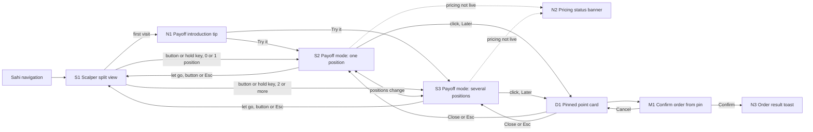

# Sahi Payoff (Desktop) PRD
*Full PRD: the Payoff mode on Sahi's Scalper split view, for Sahi web on desktop browsers and the Sahi Desktop app. Use this to design the screens in Figma and to agree scope with Sahi's product, engineering and compliance leads.*

**Product type:** Web app (desktop), Desktop app · **Depth:** Full PRD · **Version:** v1.5 · **Date:** 14 Oct 2026 · **Status:** Draft

**Owner:** Suhas · **Reviewers / sign-off:** Open item: Sahi product, design, engineering and compliance leads
> Scope note: Payoff was called Premium What-If in the research. This PRD covers desktop only; mobile gets its own PRD. Order actions from a pinned point are specced here for the Later release. Example values come from the research model (Nifty 25,000, IV 12%, range at IV 10% to 15%) and are illustrative, not market data.
>
> Changes in v1.1: the P key toggle is replaced by hold-to-peek. Holding ⌥ Option (Mac) or Alt (Windows) shows Payoff and letting go hides it; the Payoff button on the toolbar still keeps it on until it is clicked again or Esc is pressed (BR-23). Copy for the button, its tooltip, N1 and the Payoff header follows.
>
> Changes in v1.2: Payoff opens on the view the trader already has. It no longer fits the charts to an expiry; the future zone starts in the space right of "Now", and the trader drags, zooms or picks a horizon chip to look further ahead (BR-24). The index chart and the option chart keep their own timeframe, scroll and zoom, e.g. Nifty on 3m and the option on 5m (BR-25). The Payoff button drops its key hint; its tooltip and N1 still teach the key. In the Payoff table, a leg squared off before the point is greyed out and its P&L still counts in the total (BR-12).
>
> Changes in v1.3: both charts drag left into history and right into empty space up to 3:30 pm on the next trading day, with Payoff on or off (BR-27). Past the axis end, the chart is striped and disabled: no shading, no point, no pin (BR-26). Payoff no longer draws the expected-move cone and has no Expected move toggle (FR-14 removed). The hover readout leads with the P&L: the time, then a larger P&L, then the range; the index level moves to the price-axis label and the "If Nifty stays at" line leaves the readout (it stays in the table, the option chart and D1).
>
> Changes in v1.4: the chart toolbar's timeframe and range controls are specified (they are Sahi's existing controls; Payoff doesn't change them). A new timeframe keeps the candle width, so the window grows or shrinks with the candle size; candles start at 9:15 am each session (BR-25). The prototype now runs on real 1-minute data from Zerodha Kite for NIFTY 50 and the NIFTY 19 Oct 22500 Call and Put, up to 12:59 pm on Wed 14 Oct; later times are simulated and other contracts are modelled from the real index. The PRD's worked examples still use the research model (Nifty 25,000).
>
> Changes in v1.5: the crosshair is mirrored between the two charts (BR-28). Hovering the Nifty chart draws a second crosshair on the option chart at the same minute, whatever either timeframe, at the option price that matches the hovered Nifty level; hovering the option chart does the same on Nifty. The other chart scrolls to keep that minute in view. Crosshair time labels show the exact minute.

## 1. Overview
- **Problem / why:** 87.7% of individual F&O traders lost money in FY26, about 97% mainly buy options, and 59% of index option turnover is in contracts expiring that same day (SEBI). Traders read levels on the Nifty chart, but their P&L lives in premium, and delta, time decay and IV move premium in ways they can't see. On expiry day a 50-point Nifty rise by the close can still leave an at-the-money call below what was paid.
- **Users / roles:** One role, a trader with F&O enabled using the Scalper on desktop. Three personas: expiry-day option buyer, option seller, positional option buyer (1.2).
- **Main jobs:** see where each position breaks even now and at every future time; see P&L for any index level at any time up to expiry; for multi-leg books, see each leg and the total; in the Later release, turn a chosen point into a target, a stop or an exit time.
- **Entry points:** the Payoff button on the index chart toolbar in the Scalper split view, which keeps Payoff on, and holding ⌥ Option (Mac) or Alt (Windows) anywhere in the Scalper, which shows Payoff only while the key is held (hold-to-peek).
- **In scope:** index options and index futures on the index loaded in the left chart (Nifty, Bank Nifty, Sensex and any other index the Scalper supports); one or several positions; weekly and monthly expiries; intraday and carry-forward positions; a pre-trade view when nothing is held. · **Out of scope / owned elsewhere:** mobile (separate PRD); sign-in, account and F&O activation (existing Sahi flows); stock options; the option seller terminal's strategy payoff (owned by that terminal); manual IV sliders; order rules for targets, stops and time exits (owned by Orders).
- **Platforms and frames:** Sahi web and the Sahi Desktop app share one layout. Frames: 1440 × 900 primary, 1280 × 800 minimum, 1920 × 1080 large.

### 1.1 Goals, non-goals and success metrics
| Goal | Metric | Baseline | Target |
|---|---|---|---|
| Traders understand what their option is worth at a level and time before they act | Error in a premium-guessing test, with and without Payoff | Open item | Open item |
| More option trades carry a planned exit | Share of option buys with a stop or target set within 5 minutes of entry, Payoff users vs others | Open item | Open item |
| Fewer losing holds into expiry afternoon | Share of long options expiring today still held after 2:30 pm while in loss | Open item | Open item |
| Payoff becomes part of the routine | Share of Scalper sessions with option positions that open Payoff | Open item | Open item |
| Guardrail: no rise in overtrading | Trades per active trader per day, and expiry-day buys of far out-of-the-money strikes | Open item | Assumption: flat or down |
| Traders can trust the estimates | Share of past outcomes that land inside the shown range | Open item | Assumption: 80%, proposed in the research |

**Non-goals:** forecasting where the index will go; recommending strikes, levels or trades; making buying faster (Payoff has no buy button); replacing the seller terminal's strategy payoff; stock options in v1.

### 1.2 Users and roles
| Role / persona | Main jobs | Context and constraints |
|---|---|---|
| Expiry-day option buyer (scalper) | See what a 50-point move does to premium in the next hour; decide whether to hold or exit | Desktop with keyboard and mouse; fast markets; mostly intraday Scalper positions that square off at 3:20 pm |
| Option seller | See breakevens over time and P&L across straddles, strangles and iron condors, weekly and monthly | Holds positions across days; several legs; watches margin |
| Positional option buyer | See how much waiting costs over the days to expiry | Weekly and monthly contracts carried forward |

### 1.3 Constraints, dependencies and risks
**Constraints:** Open item: target date for design and build. In-app estimates are fine, but SEBI's June 2026 consultation on a common advertisement code lists content "based on assumptions/projections" as prohibited in ads, so marketing must not show projected gains. The chart must draw a future zone out to the latest expiry held: about six weeks for next month's monthly, and further for longer-dated contracts. Open item: a cap for long-dated contracts.

**Dependencies:** live option prices and IV per contract (option chain); index futures prices; the exchange contract list with expiry dates and holiday shifts; positions with side, open quantity, average price, product (intraday or carry-forward) and today's realised P&L; Order Defaults (pre-trade quantity); in the Later release, SL/TP orders and a new exit-by-time order.

| Risk | Impact | Mitigation or owner |
|---|---|---|
| IV moves and estimates miss | Traders stop trusting Payoff, as Sensibull's target-date line was called "wrong" | Show a range, label values as model estimates, check the range on past expiry days |
| Payoff makes buying feel safer | More trading and more losses | No buy button, guardrail metrics in 1.1 |
| Hover recompute on large books | Laggy charts in fast markets | NFR-01 budget; engineering owner |
| Chart engine can't draw weeks of future zone | Monthly books can't be shown | Dependency on the Sahi Charts team |
| Stale feed shows wrong values | Wrong decisions | N2 Pricing status banner, greyed values |
| Copy or naming fails compliance review late | Rework before launch | Compliance review of all copy before beta |
| Fewer impulsive trades lower order counts | Short-term revenue dip | Track retention and long-term activity alongside order counts; product owner |

## 2. Requirements
### 2.1 Functional
| ID | Requirement | Priority | Surfaces |
|---|---|---|---|
| FR-01 | The trader can turn Payoff on and off from the index chart toolbar, and can peek at it by holding ⌥ Option (Mac) or Alt (Windows) anywhere in the Scalper; letting go of the key hides it (BR-23) | Must | S1, S2, S3 |
| FR-02 | The system adds a future zone to the index chart that runs to 3:30 pm on the latest expiry among open positions on that index, without moving the view the trader had when Payoff opened (BR-24) | Must | S2, S3 |
| FR-03 | The system ends the future zone at today's 3:20 pm auto square-off when every open position is intraday | Must | S2, S3 |
| FR-04 | The system draws breakeven lines where total open P&L is zero at each moment, and shades the profit side | Must | S2, S3 |
| FR-05 | The system marks each expiry held, and the auto square-off for intraday positions, with a labelled vertical marker | Must | S2, S3 |
| FR-06 | The trader can hover any point in the future zone to see the time, P&L and its range in a readout that leads with the P&L, and the index level on the price axis | Must | S2, S3 |
| FR-07 | With one position, the system shows the premium and its range at the hovered time on the option chart, with the paid line and the flat-case line | Must | S2 |
| FR-08 | With two or more positions, the system shows a table of each contract with side, quantity, average price, value and P&L at the hovered point, status, and a total | Must | S3 |
| FR-09 | The system shows legs past their expiry as Expired, valued at intrinsic value at the hovered level | Must | S3 |
| FR-10 | The system shows today's realised P&L from closed positions as its own row, outside the total | Must | S3 |
| FR-11 | The system leaves out positions on other underlyings and shows how many there are | Must | S2, S3 |
| FR-12 | The system takes expiry dates from the exchange contract list, including holiday shifts | Must | S2, S3 |
| FR-13 | The trader can fit the view to today or to any expiry held with horizon chips; none is picked when Payoff opens (BR-24) | Should | S2, S3 |
| FR-14 | Removed in v1.3: Payoff draws no expected-move cone | — | — |
| FR-15 | With no open position, the system prices the contract on the option chart as a buy of the default order quantity at its last price | Should | S2 |
| FR-16 | On expiry day, when the range is wider than the premium, the system shows time value left instead of the range | Must | S2, S3 |
| FR-17 | The system flags stale or unavailable prices and shows the time of the last update | Must | S2, S3, N2 |
| FR-18 | The trader can move the hovered point with arrow keys, with the index chart focused or while holding the peek key, so Payoff works without a mouse (NFR-04) | Must | S2, S3 |
| FR-19 | The system introduces hold-to-peek once with a tip | Should | S1, N1 |
| FR-20 | Later release: the trader can click in the future zone to pin a point | Must | S2, S3, D1 |
| FR-21 | Later release: from a pin on a held single position, the trader can set a target or a stop at the premium projected there, after confirming | Must | D1, M1, N3 |
| FR-22 | Later release: from a pin, the trader can schedule an exit at the pinned time, after confirming | Must | D1, M1, N3 |
| FR-23 | The system labels every value as a model estimate and never suggests a level, strike or trade | Must | S2, S3, D1 |
| FR-24 | For defined-risk books (spreads, iron condors, iron flies), the table shows max profit and max loss at expiry | Should | S3 |
| FR-25 | The index chart and the option chart keep their own timeframe, scroll and zoom, with Payoff on or off (BR-25) | Must | S1, S2, S3 |
| FR-26 | In the Payoff table, a leg squared off before the hovered point shows its value and P&L greyed out, as disabled, and its P&L still counts in the total (BR-12) | Should | S3 |
| FR-27 | Past the axis end, the charts show a striped, disabled area with the label "After expiry" ("After auto square-off" for intraday-only books, "Expired" once every position has expired) that can't be hovered or pinned (BR-26) | Must | S2, S3 |
| FR-28 | The trader can drag both charts left into history and right into empty space up to 3:30 pm on the next trading day, with Payoff on or off, and further to the axis end when Payoff is on and that is later (BR-27) | Must | S1, S2, S3 |
| FR-29 | Hovering either chart mirrors the crosshair on the other: the same minute, whatever each chart's timeframe, and the matching level, with the other chart scrolling to keep it in view (BR-28) | Should | S1, S2 |

### 2.2 Non-functional
| ID | Area | Requirement | Surfaces |
|---|---|---|---|
| NFR-01 | Performance | The readout, overlays and right pane update within one animation frame of pointer movement on a book of up to 10 legs. Assumption: 16 ms budget, to confirm with engineering | S2, S3 |
| NFR-02 | Accuracy | Values are checked against market prices on past expiry days before launch, and the range covers at least the target share of outcomes. Assumption: 80% | S2, S3 |
| NFR-03 | Freshness | Inputs older than a threshold are flagged. Open item: threshold in seconds | S2, S3, N2 |
| NFR-04 | Accessibility | Every action works by keyboard; the readout is announced to screen readers when the pointer or arrow keys pause; profit and loss use signs and words, never colour alone. Assumption: target WCAG 2.2 AA | All |
| NFR-05 | Compliance | No forecasts or recommendations; every value labelled as a model estimate; all copy reviewed by compliance; no projected gains in marketing | All |
| NFR-06 | Localisation | English; rupees in Indian digit grouping (₹1,23,456); times in IST, 12-hour with am and pm; dates as "Mon 19 Oct" | All |
| NFR-07 | Analytics | Events listed in each build sheet's Notes, using the standard user id only | All |
| NFR-08 | Platforms | Sahi web on current desktop Chrome, Edge, Safari and Firefox (Assumption), and the Sahi Desktop app (Open item: Windows availability); minimum width 1280 px | All |

## 3. Navigation and Information Architecture
Payoff is a mode of the Scalper split view, not a new page. It uses Sahi's existing navigation.

| Nav item | Goes to | Visible to | Notes |
|---|---|---|---|
| Payoff (index chart toolbar button) | S2 or S3 | Traders with F&O enabled | Pressed state while Payoff is on; disabled for instruments without options |
| Hold ⌥ Option (Mac) or Alt (Windows) | S2 or S3 while held | Same | Hold-to-peek: Payoff shows while the key is held and hides when it is let go (BR-23); ignored while typing in an input or when the key is part of another shortcut |
| Esc key | S1 | Same | Turns off Payoff that the button kept on; in the Later release, removes a pin first |

## 4. User Flows
### Flow 1: Check one position before deciding to hold or exit
**Actor:** Trader (expiry-day option buyer) · **Starts:** S1 at 10:15 on Mon 19 Oct, holding Buy 65 NIFTY 19 OCT 25000 CE at ₹69.10, carry-forward · **Ends:** S1
- Trader rests the pointer on the index chart in S1 Scalper split view and holds ⌥ Option (Mac) or Alt (Windows).
- System opens S2 Payoff mode: one position, and switches the option chart to NIFTY 19 OCT 25000 CE if another contract was showing. Both charts keep the view, timeframe and zoom the trader had (BR-24, BR-25).
- System draws the breakeven line and the profit shading in the space right of "Now", with no horizon chip picked; the breakeven label gives the level at the right edge of the view.
- Trader clicks the "Today" chip, or drags the index chart left, to bring the rest of today into view.
- System shows the future zone to 3:30 pm, the "Weekly expiry · Mon 19 Oct" marker and the label "Breakeven 25,069 at expiry".
- Trader hovers the index chart at 25,050 and 11:15.
- System shows the readout: "11:15 am, Mon 19 Oct", then "P&L +₹1,385" in large type, then "Range +₹751 to +₹2,355"; the price axis shows 25,050.
- System shows on the option chart a marker "₹90.40 at 11:15" with the range "₹80.65 to ₹105.33", next to the "Paid ₹69.10" line and the flat-case line.
- Trader moves the pointer to 3:30 pm at 25,050.
- System shows "P&L -₹1,241": a 50-point rise by the close still loses, because the time value has gone.
- If the position is intraday (the Scalper default), system ends the future zone at 3:20 pm with the "Auto square-off · 3:20 pm" marker instead of the expiry marker, and the readout at 25,050 and 3:20 pm shows "P&L -₹1,197".
- Trader drags the index chart further right, past 3:30 pm: system shows the rest of the chart up to 3:30 pm tomorrow striped and labelled "After expiry"; nothing there can be hovered.
- If the range grows wider than the premium in the afternoon, system shows "Time value left" instead of the range.
- If prices go stale, system greys the values and shows N2 Pricing status banner, Stale variant.
- Trader lets go of the key.
- System closes Payoff and returns to S1, restoring the option contract shown before. Had the trader clicked Payoff instead of holding the key, Payoff would stay on until they click it again or press Esc.

### Flow 2: Check a weekly plus monthly book
**Actor:** Trader (option seller) · **Starts:** S1 at 10:15 on Wed 14 Oct, holding Sell 65 NIFTY 19 OCT 24800 PE at ₹68.26, Sell 65 NIFTY 19 OCT 25200 CE at ₹69.29 and Buy 65 NIFTY 27 OCT 25000 CE at ₹224.15, plus one Bank Nifty position · **Ends:** S1
- Trader clicks Payoff on the index chart toolbar on S1.
- System opens S3 Payoff mode: several positions, and replaces the option chart with the Payoff table. The index chart keeps its view; the future zone starts in the space right of "Now" and can be scrolled to 3:30 pm on Tue 27 Oct (BR-24).
- System draws the breakeven lines and profit shading in that space, the horizon chips "Today", "19 Oct" and "27 Oct" with none picked, and the chip "1 position on other charts".
- Trader clicks the "19 Oct" chip.
- System fits the view to Mon 19 Oct and shows the marker "Weekly expiry · Mon 19 Oct" (moved from Tue 20 Oct for a holiday).
- Trader hovers at 25,100 at 11:15 on Fri 16 Oct.
- System updates the table: 24800 PE at ₹12.97, P&L +₹3,594; 25200 CE at ₹56.29, P&L +₹845; 27 OCT 25000 CE at ₹249.31, P&L +₹1,635; total open P&L +₹6,074, range +₹5,406 to +₹6,828; "If Nifty stays at 25,000: +₹3,318".
- Trader clicks the "27 Oct" chip, which brings in the "Monthly expiry · Tue 27 Oct" marker, and hovers at 25,100 at 11:15 on Wed 21 Oct.
- System shows the two 19 Oct legs as Expired, valued at intrinsic value of ₹0 at 25,100, with P&L +₹4,437 and +₹4,504; the monthly call at ₹218.27 with P&L -₹383; total +₹8,558, range +₹6,850 to +₹11,151.
- If a Nifty position was closed earlier today, system shows its P&L in the "Realised today" row above the total.
- Trader presses Esc.
- System returns to S1 and shows the option chart again.

### Flow 3: See a payoff before buying
**Actor:** Trader · **Starts:** S1 at 10:15 on Mon 19 Oct, holding no Nifty position, with NIFTY 19 OCT 25000 CE at ₹69.10 on the option chart · **Ends:** S1
- Trader clicks Payoff on the index chart toolbar on S1, so Payoff stays on while they browse the option chain.
- System opens S2 in its Pre-trade state, with the summary "Not holding · priced as a buy of 65 at ₹69.10 (last price)", taking the quantity from Order Defaults.
- Trader hovers the index chart as in Flow 1.
- System shows the same readout and option chart marker, with no order actions.
- If no contract is loaded on the option chart, system shows "Pick a contract on the option chart to see its payoff" and stays on S2.
- Trader picks a contract from the option chain, and system prices it.
- Trader presses Esc, and system returns to S1.

### Flow 4: Pin a point and set an exit (Later release)
**Actor:** Trader · **Starts:** S2, holding Buy 65 NIFTY 19 OCT 25000 CE at ₹69.10 · **Ends:** S2 with a new order, or S2 unchanged
- Trader clicks the index chart at 25,050 and 11:15.
- System places a pin and opens D1 Pinned point card. If Payoff was showing only because the trader was holding the peek key, the pin keeps Payoff on after the key is let go, until the pin is removed (BR-23).
- Trader clicks "Set target at ₹90.40".
- System opens M1 Confirm order from pin, titled "Set target", showing "NIFTY 19 OCT 25000 CE · Bought 65 at ₹69.10", "Sells 65 at market when the option's price reaches ₹90.40" and "P&L if filled at ₹90.40: +₹1,385 before charges".
- Trader clicks Confirm.
- System creates the target through Sahi's SL/TP orders, closes M1 and D1, returns to S2 and shows N3 Order result toast "Target set at ₹90.40"; the target pill appears on the option chart.
- If the order fails, system keeps M1 open and shows N3 with the reason.
- If the trader clicks "Exit at 11:15" instead, system opens M1 in its Schedule exit mode; on Confirm, it schedules the exit, shows N3 "Exit scheduled for 11:15" and adds an exit marker to both charts.
- If the trader clicks the card's close button or presses Esc, system removes the pin and stays on S2.

## 5. Surface List
| ID | Name | Type | Platform | Purpose | Release |
|---|---|---|---|---|---|
| S1 | Scalper split view | Screen (existing, changed) | Web desktop, Desktop app | Entry point; adds the Payoff button and hold-to-peek | MVP |
| N1 | Payoff introduction tip | Coach mark | Web desktop, Desktop app | Introduces hold-to-peek once | MVP |
| S2 | Payoff mode: one position | Mode within S1 | Web desktop, Desktop app | Breakeven and P&L for one position, or for a contract before buying | MVP |
| S3 | Payoff mode: several positions | Mode within S1 | Web desktop, Desktop app | Breakevens and a per-leg table for books of two or more positions | MVP |
| N2 | Pricing status banner | Banner | Web desktop, Desktop app | Flags stale, closed-market or unavailable prices | MVP |
| D1 | Pinned point card | Popover panel | Web desktop, Desktop app | Holds a pinned point and turns it into a target, stop or exit time | Later |
| M1 | Confirm order from pin | Modal - confirm | Web desktop, Desktop app | Confirms the order a pin creates | Later |
| N3 | Order result toast | Toast | Web desktop, Desktop app | Confirms an order from a pin, or says why it failed | Later |

## 6. Flow Map
| From | Trigger | To | Condition / result |
|---|---|---|---|
| External: Sahi main navigation | Open Scalper | S1 | Existing entry |
| S1 | First Scalper visit after release | S1, N1 | Tip shows once |
| N1 | Try it | S2 or S3 | S2 for zero or one position on the index; S3 for two or more |
| N1 | Got it, Esc or a click outside | S1 | Tip dismissed for good |
| S1 | Payoff button (stays on), or hold ⌥ Option (Mac) or Alt (Windows) (while held) | S2 | Zero or one open position on the charted index |
| S1 | Payoff button (stays on), or hold ⌥ Option (Mac) or Alt (Windows) (while held) | S3 | Two or more open positions on the charted index |
| S2 | Let go of the key (peek), or Payoff button or Esc (kept on) | S1 | Payoff off; previous option contract restored |
| S3 | Let go of the key (peek), or Payoff button or Esc (kept on) | S1 | Payoff off; option chart shown again |
| System | A second position opens while S2 is on | S3 | Count becomes two or more |
| System | Positions close while S3 is on, leaving one or none | S2 | Count becomes one or zero |
| System | Prices stale, market closed or prices unavailable | S2, N2 or S3, N2 | Matching banner variant |
| N2 | Retry | Stays on S2 or S3 | Unavailable variant only |
| S2 | Click in the future zone, or Enter at the focused point | D1 | Later release |
| S3 | Click in the future zone, or Enter at the focused point | D1 | Later release; only "Exit all at" is offered |
| D1 | Set target, Set stop, Exit at, Exit all at | M1 | Later release |
| D1 | Close button or Esc | S2 or S3 | Pin removed |
| System | The pinned time passes while D1 is open | S2 or S3 | Pin removed; Later release |
| M1 | Confirm, order succeeds | S2 or S3, N3 | M1 and D1 close; success toast |
| M1 | Confirm, order fails | M1, N3 | Error toast; modal stays open |
| M1 | Cancel, Close or Esc | D1 | No order; pin kept |
| M1 | Cancel after the position has closed | S2 or S3 | M1 and D1 close; no order |

## 7. Shared Components
| Component | Used on | Contents | Behaviour and variants |
|---|---|---|---|
| Payoff button | S1, S2, S3 | Payoff icon and label "Payoff"; no key hint on the button (the tooltip shows the key) | Toggle: one click keeps Payoff on, the next turns it off; pressed while kept on (by the button or by a pin); highlighted outline while peeking; tooltip "Payoff: breakeven and P&L at any level and time. Hold to peek, or click to keep it on" with the key cap, and "Hide payoff" with an Esc key cap while on; disabled with tooltip "Payoff needs an index with options" |
| Future zone | S2, S3 | The chart area from the "Now" line to the axis end, on the index chart and (S2) the option chart | Light tint to separate it from past candles; opens on the view the trader already has, so at first only the space right of "Now" shows, and dragging, zooming or a horizon chip brings in more (BR-24); past the axis end the chart is striped and disabled (BR-26); times in IST |
| Breakeven line and profit shading | S2, S3 | One line per place where total open P&L is zero; label at the right end, e.g. "Breakeven 25,069 at expiry"; profit side tinted and labelled "Profit", the other side "Loss" | Zero, one or more lines; the label gives the level at the picked chip's time, or at the right edge of the view: "at expiry", "at 3:20 pm" for intraday-only books, or the time, e.g. "at 11:30 am"; the Profit and Loss words are left out when the zone is too narrow to hold them; edge arrow with the level when a line is out of view, e.g. "Breakeven 25,800 ↑"; legend text "Profit at every level shown" or "Loss at every level shown" when no line is in view |
| Expiry marker | S2, S3 | Vertical dashed line with label, e.g. "Weekly expiry · Mon 19 Oct", "Monthly expiry · Tue 27 Oct", "Auto square-off · 3:20 pm" | Sub-label "moved from Tue 20 Oct" when a holiday shifted it; in month-end week one marker "Weekly and monthly expiry · Tue 27 Oct"; hover tooltip names how many legs expire there |
| Disabled area | S2, S3 | Diagonal stripes from the axis end to the right edge, with a thin edge line and a centred label "After expiry", "After auto square-off" or "Expired" | Tied to the time axis, so it moves with the chart; no shading, crosshair, readout point or pin inside it (BR-26) |
| Horizon chips | S2, S3 | "Today", then one chip per expiry held, e.g. "19 Oct", "27 Oct" | Clicking fits both charts from now to that time; none is picked when Payoff opens, and dragging or zooming the index chart clears the pick (BR-24); intraday-only books show "Today" alone |
| Timeframe and range controls (existing) | S1, S2, S3 | Timeframes "1m", "2m", "3m", "5m", "10m" and "15m ▾", whose menu holds "15 minutes", "30 minutes" and "1 hour"; ranges "1D" (last session), "5D" (last five sessions) and "1M ▾" (about a month) on each chart's toolbar | Each chart has its own, e.g. Nifty on 3m and the option on 5m. The picked timeframe and range show in bold; the menu button takes the label of a timeframe picked from it, e.g. "1h ▾". A range is cleared when the trader drags or zooms that chart. Unchanged by Payoff (BR-25) |
| Mirrored crosshair | S1, S2 | A second, blue dashed crosshair on the chart the pointer isn't on, with a blue price tag on its axis, a blue time label and a soft band over the candle that contains that minute | Shows only while that chart has no pointer of its own; a level outside its view is tagged at the edge with an arrow, e.g. "312.40 ↑"; with Payoff off, a future minute gets the time line only; none over the striped disabled area; none on the option chart in S3, where the Payoff table covers it (BR-28) |
| Payoff readout | S2, S3 | Title "11:15 am, Mon 19 Oct"; "P&L" label with the value in large bold type, "+₹1,385" (the biggest line in the card); "Range +₹751 to +₹2,355"; divider; footer "Model estimate, not a forecast". The index level shows on the price-axis label, not in the card | Follows the pointer with an offset and flips side near chart edges; shows "Now" values when the pointer leaves the future zone; "Too uncertain to price" variant on expiry afternoon |
| Mode pill | S2, S3 | "Holding ⌥ · release to hide" (Alt on Windows) while peeking; "Payoff on · Esc to close" while kept on | In the Payoff header, after the model label; tells the trader how Payoff will close |
| Other-charts chip | S2, S3 | "1 position on other charts" or "2 positions on other charts" | Shown only when such positions exist; tooltip lists their underlyings, e.g. "BANKNIFTY" |
| Model label | S2, S3, D1 | "Model estimate, not a forecast" with an info icon | Info tooltip: "Worked out from live option prices, IV and time left. The range shows values if IV moves. Actual prices can differ, especially near expiry." Open item: final wording from compliance |
| Scheduled exit marker (Later release) | S2, S3 | Vertical line on both charts labelled "Exit at 11:15", or "Exit at 11:15, Fri 16 Oct" on a later day | Appears after an exit is scheduled from M1; tooltip "Exits at market at 11:15 if still open"; removed when the exit runs or is cancelled. Open item: cancel or edit from the marker, or only from Sahi's order list |

## 8. Build Sheets
**8.1 Desktop (Sahi web and Sahi Desktop app)**

### S1 Scalper split view
**Type:** Screen (existing, changed) · **Platform:** Sahi web on desktop browsers, Sahi Desktop app · **Opened from:** Scalper in Sahi's main navigation · **Roles:** Trader with F&O enabled
**Purpose:** Trade index options on a split view; this release adds the way into Payoff.
**Layout (top to bottom, left to right):**
1. Top bar (existing): instrument switcher, 1-Tap toggle, Funds pill, P&L pill.
2. Left: index chart, e.g. NIFTY 50, with its toolbar: its own timeframe (e.g. 3m), indicators, drawing tools, and the new Payoff button at the right end of the toolbar.
3. Right: option chart with its own timeframe (e.g. 5m), the Call and Put switcher, order panel and option chain (existing).
4. Position pills on both charts (existing).

#### Actions & interactions
| Action | Type / placement | Result | Shown / enabled when |
|---|---|---|---|
| Payoff | Toolbar control · Index chart toolbar | Keeps Payoff on: opens S2 for zero or one open position on the charted index, S3 for two or more; stays on until clicked again or Esc | The charted instrument has listed options |
| Hold ⌥ Option (Mac) or Alt (Windows) | Keyboard shortcut (hold) · Anywhere in the Scalper | Hold-to-peek: opens S2 or S3 by position count while the key is held; letting go returns to S1 (BR-23) | Focus is not in a text input; no confirm modal open |
| Timeframe | Toolbar control · Each chart's toolbar | Changes that chart's candle size only, keeping the candle width: the window grows or shrinks with it, anchored at its right edge (BR-25) | Always |
| Range (1D, 5D, 1M) | Toolbar control · Each chart's toolbar | Shows the last session, the last five, or about a month up to Now on that chart; a later timeframe change keeps the range | Always |
| Hover either chart | Hover · Index chart or option chart | Mirrors the crosshair on the other chart at the same minute and the matching level; the other chart scrolls, at its own zoom, to keep that minute in view (BR-28) | A contract is on the option chart |
| Hover Payoff | Hover · Index chart toolbar | Tooltip "Payoff: breakeven and P&L at any level and time. Hold to peek, or click to keep it on" with the ⌥ or Alt key cap | Always |
| Try it | Primary · N1 tip | Opens S2 or S3 by position count | First visit after release |
| Got it | Tertiary · N1 tip | Closes N1; stays on S1 | First visit after release |

#### Components & content
| Component / field | Type | Content | Purpose |
|---|---|---|---|
| Payoff button | Toolbar control (toggle) | Payoff icon and label "Payoff"; no key hint (the tooltip shows the key) | Entry point to Payoff |
| Payoff tooltip | Tooltip with key caps, in the style of the 1-Tap tooltip | Off: "Payoff: breakeven and P&L at any level and time. Hold to peek, or click to keep it on" [⌥]. On: "Hide payoff" [Esc] | Teaches hold-to-peek |
| N1 Payoff introduction tip | Coach mark, anchored to the Payoff button | "New: hold ⌥ to see your breakeven and P&L at any Nifty level and time. Let go to hide it." (Alt on Windows). Buttons: Try it, Got it | Introduces the feature once |

#### States
| Scope | State | When | What the user sees |
|---|---|---|---|
| Button | Default | Instrument has options | Payoff button enabled |
| Button | Unavailable | Charted instrument has no listed options | Button disabled; tooltip "Payoff needs an index with options" |
| Button | On | Payoff kept on by the button or by a pin | Pressed state |
| Button | Peeking | The peek key is held | Highlighted outline, not pressed |
| Screen | First visit after release | Feature flag on and tip not seen before | N1 anchored to the Payoff button |
| Key | Typing | Focus in a text input, such as order quantity or search | Holding ⌥ or Alt does nothing; Payoff doesn't show |
| Key | Shortcut chord | ⌥ or Alt pressed together with another key, such as ⌘ ⌥ 1 for 1-Tap or Alt+Tab | Payoff doesn't show; the other shortcut runs (BR-23) |
| Screen | Loading, load error, no access | Existing Scalper behaviour | N/A: unchanged by this release |

#### Workflow
- Trader works in the Scalper as today.
- On the first visit after release, N1 points at the Payoff button once.
- Trader clicks Payoff to keep it on, or holds ⌥ or Alt to peek.
- System opens S2 or S3 depending on how many positions are open on the charted index.

#### Notes
- **Analytics:** payoff_open with source = button, key (hold-to-peek) or tip; payoff_close with duration; payoff_tip_dismissed.
- **Ownership / dependencies:** feature flag for rollout; the tip's seen state is stored per user.

### S2 Payoff mode: one position
**Type:** Mode within S1 · **Platform:** Sahi web on desktop browsers, Sahi Desktop app · **Opened from:** S1 Payoff button, or holding ⌥ or Alt, with zero or one open position on the charted index · **Roles:** Trader with F&O enabled
**Purpose:** Show where one position breaks even over time, and what it is worth at any index level and time up to its expiry.
**Layout (top to bottom, left to right):**
1. Top bar (existing). The Payoff button shows its pressed state.
2. Payoff header across the index chart: position summary, horizon chips, other-charts chip when relevant, model label.
3. Index chart (left): past candles as usual, a "Now" line, then the future zone to the axis end with the breakeven line, profit shading, expiry marker, crosshair and Payoff readout; past the axis end, the striped disabled area.
4. Option chart (right): switched to the held contract; its future zone runs to the same axis end, but it keeps its own timeframe, scroll and zoom (BR-25); paid line, flat-case line, and a marker for the hovered time with the premium, its range and a P&L tag.
5. N2 Pricing status banner across both charts when prices aren't live.

#### Actions & interactions
| Action | Type / placement | Result | Shown / enabled when |
|---|---|---|---|
| Hover future zone | Hover · Index chart | Readout follows the pointer; the option chart marker moves to the hovered time; stays on S2 | Pointer between "Now" and the axis end |
| Hover option chart | Hover · Option chart | Mirrors the crosshair on the index chart: the same minute and the Nifty level that gives the hovered option price; in the future zone, the level whose Payoff value is that price. The readout stays as it is; stays on S2 (BR-28) | Pointer on the option chart |
| Hover past candles | Hover · Index chart | Normal crosshair; readout shows "Now" values; stays on S2 | Pointer left of "Now" |
| Pointer leaves the index chart | Hover | Readout and option chart marker show "Now" values; stays on S2 | Always |
| Horizon chip | Toolbar control · Payoff header | Fits both charts from now to the chip's time; stays on S2 | Always; none picked on open; the picked chip stays highlighted until the trader drags or zooms the index chart |
| Scroll or zoom | Scroll · Index chart or option chart | Standard zoom and pan of that chart only; left into history, right to 3:30 pm on the next trading day or the axis end, whichever is later (BR-27); on the index chart it clears the picked chip; stays on S2 | Always |
| Hover disabled area | Hover · Index chart | No crosshair and no point; the readout shows "Now" values; stays on S2 | Pointer past the axis end |
| Arrow keys | Keyboard shortcut · Index chart | Tab focuses the index chart with the point one candle after "Now" at the current level; left and right move it one candle; up and down move it 5 points; Shift with up or down moves 25 points; readout and option chart marker follow; stays on S2 | Index chart focused, or the peek key held |
| Hover expiry marker | Hover · Index chart | Tooltip, e.g. "Weekly expiry · Mon 19 Oct · moved from Tue 20 Oct for a holiday" | Marker shown |
| Hover breakeven label | Hover · Index chart | Tooltip "Breakeven: the Nifty level where this position's P&L is zero at each time" | Line shown |
| Hover model label info | Hover · Payoff header | Model label tooltip (see Components) | Always |
| Click future zone, or Enter at the focused point | Click or Keyboard shortcut · Index chart | MVP: nothing. Later release: places a pin and opens D1 | Later release only |
| Let go of ⌥ or Alt | Keyboard shortcut (release) | Turns Payoff off; returns to S1 and restores the option contract shown before | Payoff opened by holding the key, and no pin placed |
| Esc or Payoff | Keyboard shortcut or Toolbar control | Turns Payoff off; returns to S1 and restores the option contract shown before | Payoff kept on by the button or by a pin |

#### Components & content
| Component / field | Type | Content | Purpose |
|---|---|---|---|
| Position summary | Read-only text · Payoff header | Held: "Buy 65 NIFTY 19 OCT 25000 CE at ₹69.10" or "Sell 65 NIFTY 19 OCT 25000 CE at ₹69.10". Pre-trade: "Not holding · priced as a buy of 65 at ₹69.10 (last price)" | Says what is being priced |
| Horizon chips | Segmented control · Payoff header | "Today" plus the position's expiry date if later, e.g. "Today", "27 Oct". None picked when Payoff opens. Intraday or expiring today: "Today" only | Fits the view |
| Other-charts chip | Status chip · Payoff header | "1 position on other charts"; tooltip lists underlyings | Positions elsewhere aren't silently ignored |
| Model label | Read-only text with info icon · Payoff header | "Model estimate, not a forecast". Tooltip: "Worked out from live option prices, IV and time left. The range shows values if IV moves. Actual prices can differ, especially near expiry." | Trust and compliance |
| "Now" line | Chart overlay (vertical line) | Label "Now" | Splits past from future |
| Future zone | Chart region | From now to 3:30 pm on the expiry date, or 3:20 pm today for intraday; at first only the part already in view shows | Room to hover future times |
| Breakeven line | Chart overlay (line) | Label at the right end, e.g. "Breakeven 25,069 at expiry" | Where P&L is zero at each time |
| Profit shading | Chart overlay (band) | Profit side tinted and labelled "Profit"; the other side labelled "Loss" | Which side makes money, at a glance |
| Expiry marker | Chart overlay (vertical line) | "Weekly expiry · Mon 19 Oct", "Monthly expiry · Tue 27 Oct" or "Auto square-off · 3:20 pm" | Where the position ends |
| Payoff readout | Read-only panel (hover card) | Line 1 "11:15 am, Mon 19 Oct". Line 2 "P&L +₹1,385", the value in large bold type. Line 3 "Range +₹751 to +₹2,355". Divider, then footer "Model estimate, not a forecast". The level, 25,050, is on the price-axis label | The answer for the hovered point |
| Paid line | Chart overlay (dashed line) · Option chart | "Paid ₹69.10"; sold: "Sold at ₹69.10"; pre-trade: "Last price ₹69.10" | Reference for P&L |
| Flat-case line | Chart overlay (dashed line) · Option chart | Premium over time if the index stays at its current level; label "If Nifty stays at 25,000" | The cost of waiting |
| Hovered-time marker | Chart overlay (point with range bar) · Option chart | "₹90.40 at 11:15"; range "₹80.65 to ₹105.33" | Premium at the hovered point |
| P&L tag | Read-only value · Option chart | "+₹1,385 on 65" | P&L for the full quantity |

#### States
| Scope | State | When | What the user sees |
|---|---|---|---|
| Screen | Loading | First values being worked out | Overlays fade in; readout "Pricing your position…" |
| Screen | Pre-trade | No open position on the charted index; a contract is on the option chart | Summary "Not holding · priced as a buy of 65 at ₹69.10 (last price)"; paid line labelled "Last price"; no order actions |
| Screen | Empty | No open position and no contract on the option chart | Message on the index chart "Pick a contract on the option chart to see its payoff"; no overlays |
| Screen | Opened | Payoff turns on | Both charts keep their view, timeframe and zoom; the future zone shows in the space right of "Now"; no chip picked (BR-24) |
| Screen | First run | First time this trader opens Payoff | Hint in the future zone "Move your pointer into the shaded area to see P&L at any level and time. Drag the chart or pick a date above to look further ahead."; it goes after the first hover |
| Position | Bought call | Long call | One breakeven line above the index, rising toward strike plus premium; profit above it |
| Position | Bought put | Long put | One breakeven line below the index, falling toward strike minus premium; profit below it |
| Position | Sold call or put | Short option | The same line a buyer would see; profit shading on the other side |
| Position | Several fills | Same contract bought in parts | One position at the average price and total quantity |
| Position | Monthly | Expiry more than one week away | Chips "Today" and the expiry; the view opens where it was and the expiry chip fits it; flatter breakeven line |
| Position | Expiring today | Expiry date is today | Future zone ends at 3:30 pm today; chip "Today" only |
| Position | Intraday | Product is intraday | Future zone ends at 3:20 pm today; marker "Auto square-off · 3:20 pm" |
| Position | Expired today | After 3:30 pm on expiry day | Summary "Expired · settled at ₹X · P&L ₹Y"; no future zone or readout; everything right of "Now" is striped and labelled "Expired"; gone the next session |
| Readout | Too uncertain | On expiry day, the range is wider than the premium | Range replaced by "Too uncertain to price. Time value left: ₹X. Worth at expiry at this level: ₹Y" |
| Readout | Past candles | Pointer left of "Now" | Title "Now · 11:15 am, Mon 19 Oct", then "P&L -₹X"; no marker on the option chart |
| Overlay | Past the axis end | The trader drags right beyond 3:30 pm on expiry day, or beyond 3:20 pm for intraday | Striped disabled area labelled "After expiry" or "After auto square-off"; no point or pin |
| Overlay | Breakeven out of view | Line outside the visible price range | Edge arrow with the level, e.g. "Breakeven 25,800 ↑" |
| Overlay | No breakeven in view | P&L has the same sign everywhere visible | Legend text "Loss at every level shown" or "Profit at every level shown" |
| Contract | Switched | Another contract was on the option chart | Option chart shows the held contract; the earlier one returns on exit |
| Pricing | Stale | An input is older than the threshold | Values greyed; N2 Stale variant |
| Pricing | Market closed | Outside 9:15 am to 3:30 pm, weekend or holiday | "Now" is the last close; future zone starts at the next session's 9:15 am; N2 Market closed variant |
| Pricing | Unavailable | Option prices or IV not loading | Overlays hidden; N2 Unavailable variant with Retry |
| Account | Session expired | The Sahi session ends while Payoff is on | Existing Sahi sign-in prompt; after sign-in the Scalper opens with Payoff off (Assumption) |
| Access | No access, not found | N/A: Payoff opens only from S1, which already handles these | N/A |

#### Workflow
- Trader holds ⌥ or Alt to peek, or clicks Payoff to keep it on.
- System prices the position, or the contract on the option chart if nothing is held, and draws the overlays.
- Trader hovers future times and levels on the index chart and reads the readout and the option chart marker.
- Trader drags or zooms to look further ahead, or fits the view to today or to the expiry with the horizon chips.
- If prices aren't live, system flags it with N2 and greys the values.
- Trader lets go of the key, or, if Payoff was kept on, presses Esc or the button, and returns to S1.

#### Notes
- **Responsive / platform:** at 1280 px the horizon chips wrap under the position summary; the readout sizes to its content (196 to 250 px) and flips to the left of the pointer near the right edge.
- **Analytics:** payoff_hover (sampled, with time to expiry and distance from the current level), payoff_horizon_change, payoff_close with duration, payoff_pretrade_open.
- **Ownership / dependencies:** positions service (open quantity, average price, product), option chain (live prices and IV), contract list (expiry dates and holiday shifts), Order Defaults (pre-trade quantity).
- **Accessibility:** the readout is announced politely when the pointer or arrow keys pause; values use plus and minus signs and the words "Profit" and "Loss", never colour alone.

### S3 Payoff mode: several positions
**Type:** Mode within S1 · **Platform:** Sahi web on desktop browsers, Sahi Desktop app · **Opened from:** S1 Payoff button, or holding ⌥ or Alt, with two or more open positions on the charted index · **Roles:** Trader with F&O enabled
**Purpose:** Show where a multi-leg book breaks even over time, and what each leg and the total are worth at any index level and time up to the latest expiry held.
**Layout (top to bottom, left to right):**
1. Top bar (existing). The Payoff button shows its pressed state.
2. Payoff header across the index chart: book summary, horizon chips, other-charts chip when relevant, model label.
3. Index chart (left): past candles, a "Now" line, then the future zone to the latest expiry with breakeven lines, profit shading, one expiry marker per expiry held, crosshair and Payoff readout; past the latest expiry, the striped disabled area.
4. Payoff table (right, in place of the option chart while Payoff is on): title line, rows grouped by expiry, then the Realised today row, the total and the flat case.
5. N2 Pricing status banner across both panes when prices aren't live.

#### Actions & interactions
| Action | Type / placement | Result | Shown / enabled when |
|---|---|---|---|
| Hover future zone | Hover · Index chart | Readout follows the pointer; the table recalculates for that point; stays on S3 | Pointer between "Now" and the axis end |
| Hover past candles | Hover · Index chart | Normal crosshair; table shows "Payoff now"; stays on S3 | Pointer left of "Now" |
| Pointer leaves the index chart | Hover | Table shows "Payoff now"; stays on S3 | Always |
| Horizon chip | Toolbar control · Payoff header | Fits the index chart from now to that time; stays on S3 | Always; none picked on open |
| Scroll or zoom | Scroll · Index chart | Standard zoom and pan; left into history, right to 3:30 pm on the next trading day or the latest expiry, whichever is later (BR-27); clears the picked chip; stays on S3 | Always |
| Hover table row | Hover · Payoff table | Draws that leg's strike as a dotted line on the index chart; stays on S3 | Always. Priority: Should |
| Scroll table | Scroll · Payoff table | Rows scroll; title, Realised today, total and flat case stay pinned | More than 8 legs |
| Hover expiry marker | Hover · Index chart | Tooltip, e.g. "Weekly expiry · Mon 19 Oct · 2 legs expire" | Marker shown |
| Arrow keys | Keyboard shortcut · Index chart | Tab focuses the index chart with the point one candle after "Now" at the current level; left and right move it one candle; up and down move it 5 points; Shift with up or down moves 25 points; readout and table follow; stays on S3 | Index chart focused, or the peek key held |
| Click future zone, or Enter at the focused point | Click or Keyboard shortcut · Index chart | MVP: nothing. Later release: places a pin and opens D1 with "Exit all at" only | Later release only |
| Let go of ⌥ or Alt | Keyboard shortcut (release) | Turns Payoff off; returns to S1 with the option chart shown again | Payoff opened by holding the key, and no pin placed |
| Esc or Payoff | Keyboard shortcut or Toolbar control | Turns Payoff off; returns to S1 with the option chart shown again | Payoff kept on by the button or by a pin |

#### Components & content
| Component / field | Type | Content | Purpose |
|---|---|---|---|
| Book summary | Read-only text · Payoff header | "3 positions · 2 expiries" | Says what is being priced |
| Horizon chips | Segmented control · Payoff header | "Today" plus one chip per expiry held, e.g. "19 Oct", "27 Oct". None picked when Payoff opens | Fits the view |
| Other-charts chip | Status chip · Payoff header | "1 position on other charts"; tooltip lists underlyings | Positions elsewhere aren't silently ignored |
| Model label | Read-only text with info icon · Payoff header | "Model estimate, not a forecast". Tooltip: "Worked out from live option prices, IV and time left. The range shows values if IV moves. Actual prices can differ, especially near expiry." | Trust and compliance |
| Breakeven lines | Chart overlay (lines) | Zero, one or more lines, each labelled at the right end with its level at the axis end | Where the book's P&L is zero at each time |
| Profit shading | Chart overlay (band) | Profit areas tinted and labelled "Profit"; others "Loss" | Which areas make money |
| Expiry markers | Chart overlay (vertical lines) | One per expiry held, e.g. "Weekly expiry · Mon 19 Oct" (sub-label "moved from Tue 20 Oct"), "Monthly expiry · Tue 27 Oct" | Where legs end; lines bend at each marker |
| Payoff readout | Read-only panel (hover card) | "11:15 am, Fri 16 Oct"; "Total P&L +₹6,074" with the value in large bold type; "Range +₹5,406 to +₹6,828"; divider; footer "Model estimate, not a forecast". The level, 25,100, is on the price-axis label; the flat case stays in the table | The answer at the pointer |
| Table title | Read-only text · Payoff table | "Payoff at Nifty 25,100 · 11:15, Fri 16 Oct", or "Payoff now" | Ties the table to the hovered point |
| Payoff table | Table · Right pane | Columns in order: Contract, Side, Qty, Avg, Value at point, P&L at point, Status. Grouped by expiry, then strike ascending. Not sortable in MVP (Assumption) | Each leg at the point |
| Group header row | Table row | "19 Oct · Weekly · 2 legs", "27 Oct · Monthly · 1 leg" | Separates expiries |
| Leg row | Table row | e.g. "NIFTY 19 OCT 24800 PE · Sell · 65 · ₹68.26 · ₹12.97 · +₹3,594 (range +₹2,724 to +₹4,024) · Live" | One leg; futures rows show Side "Buy fut" or "Sell fut" and no range |
| Status chip | Status chip | Values: Live, Expires today, Expired, Squared off, Settled | Each leg's state at the point |
| Squared-off values | Table cells, greyed out (disabled colour) | Value and P&L of a leg squared off before the point, in the disabled text colour, with no range line. Tooltip on the P&L: "Squared off at 3:20 pm. This is the P&L the square-off books at this Nifty level, and it still counts in the total." | The leg is no longer open at the point, but its P&L is still part of the book |
| Realised today row | Table row (pinned) | "Realised today +₹1,200" | Closed positions' P&L, outside the total |
| Total row | Table row (pinned) | "Total open P&L +₹6,074", second line "Range +₹5,406 to +₹6,828" | The book at the point |
| Flat-case row | Table row (pinned) | "If Nifty stays at 25,000: +₹3,318" | The cost or gain of waiting |
| Max profit and loss row | Table row (pinned) | "Max profit at expiry ₹X · Max loss at expiry ₹Y" | Defined-risk books only (Should) |

#### States
| Scope | State | When | What the user sees |
|---|---|---|---|
| Screen | Loading | First values being worked out | Table rows as skeletons; readout "Pricing your positions…" |
| Screen | Opened | Payoff turns on | The index chart keeps its view, timeframe and zoom; the future zone shows in the space right of "Now"; no chip picked (BR-24) |
| Screen | First run | First time this trader opens Payoff | Hint in the future zone "Move your pointer into the shaded area to see P&L at any level and time. Drag the chart or pick a date above to look further ahead."; it goes after the first hover |
| Book | Long straddle or strangle | Bought call and put, same expiry | Two breakeven lines moving apart over time; loss between them |
| Book | Short straddle or strangle | Sold call and put, same expiry | The same two lines; profit between them |
| Book | Iron condor or iron fly | Four legs, same expiry | Two lines; profit between them; max profit and loss row |
| Book | Vertical spread | Bull call or bear put spread | One line; max profit and loss row |
| Book | Unrelated legs | Options with no named strategy | Zero, one or two lines from the combined P&L |
| Book | With futures | Index futures held | Futures rows in the table; no decay on those rows |
| Book | Weekly plus monthly | Expiries 19 Oct and 27 Oct | Future zone to 27 Oct; marker at 19 Oct; lines bend there |
| Book | Two weeklies | Expiries 19 Oct and 3 Nov | Future zone to 3 Nov; marker at 19 Oct |
| Book | Calendar spread | Sold weekly, bought monthly, same strike | Two lines until the weekly expiry, then one; the widest ranges |
| Book | Month-end week | Weekly and monthly are the same contract | One marker, "Weekly and monthly expiry · Tue 27 Oct" |
| Row | Expired | Hovered time is past the leg's expiry | Status Expired; value is intrinsic value at the hovered level |
| Row | Squared off | Intraday leg in a book with carry-forward legs, hovered after 3:20 pm today | Status Squared off; value at 3:20 pm at the hovered level; value and P&L greyed out as disabled, no range line; the P&L still counts in the total |
| Row | Expires today | Leg expires today | Status Expires today; "Too uncertain to price" replaces the range when it is wider than the premium |
| Book | All intraday | Every leg intraday | Future zone ends at 3:20 pm today; chip "Today" only |
| Table | Realised row hidden | Nothing closed today | Row not shown |
| Table | Large book | More than 8 legs | Rows scroll; title and footer rows stay pinned |
| Overlay | Breakeven out of view | Line outside the visible price range | Edge arrow with the level, e.g. "Breakeven 25,800 ↑" |
| Overlay | No breakeven in view | P&L has the same sign everywhere visible | Legend text "Profit at every level shown" or "Loss at every level shown" |
| Book | Expired today | After 3:30 pm on expiry day | Those rows show Settled with final P&L; gone the next session |
| Pricing | Stale | An input is older than the threshold | Values greyed; N2 Stale variant |
| Pricing | Market closed | Outside 9:15 am to 3:30 pm, weekend or holiday | "Now" is the last close; future zone starts at the next session's 9:15 am; N2 Market closed variant |
| Pricing | Unavailable | Option prices or IV not loading | Overlays and table values hidden; N2 Unavailable variant with Retry |
| Account | Session expired | The Sahi session ends while Payoff is on | Existing Sahi sign-in prompt; after sign-in the Scalper opens with Payoff off (Assumption) |
| Access | No access, not found | N/A: Payoff opens only from S1 | N/A |

#### Workflow
- Trader turns Payoff on from S1 with two or more positions on the charted index.
- System replaces the option chart with the Payoff table and draws the overlays in the view the trader already had; they run to the latest expiry.
- Trader hovers future points; the table and readout update for each.
- Trader drags, zooms or uses the horizon chips to look ahead and past the first expiry; legs past their expiry show Expired, and intraday legs past 3:20 pm show Squared off, greyed out.
- If positions open or close so that one or none remains, system switches to S2.
- Trader turns Payoff off and returns to S1 with the option chart back.

#### Notes
- **Responsive / platform:** at 1280 px the table hides the Avg column first, then Side (shown in the Contract cell as "S" or "B").
- **Analytics:** payoff_open with leg_count and expiry_count, payoff_hover (sampled), payoff_horizon_change, payoff_row_hover, payoff_close.
- **Ownership / dependencies:** positions service (open legs, realised P&L today, product), option chain (prices and IV), contract list (expiries and holiday shifts).
- **Accessibility:** the table is a real data table with column headers; the title line is announced when the hovered point changes and pauses.

### D1 Pinned point card
**Type:** Popover panel · **Platform:** Sahi web on desktop browsers, Sahi Desktop app · **Opened from:** a click in the future zone of the index chart on S2 or S3, or Enter at the focused point (Later release) · **Roles:** Trader with F&O enabled
**Purpose:** Hold one point still so the trader can read it and turn it into a target, a stop or an exit time for what they already hold.
**Layout (top to bottom):**
1. Pin on the index chart at the chosen level and time, with a dashed line down to the time axis.
2. Card anchored beside the pin: header line with the point, and a close button.
3. Values: premium and its range (one position only), P&L, P&L range, flat case.
4. Note on how the offered orders work.
5. Actions: up to two buttons, stacked.
6. Model label.

#### Actions & interactions
| Action | Type / placement | Result | Shown / enabled when |
|---|---|---|---|
| Set target at ₹90.40 | Primary · Card button | Opens M1 in Set target mode | Opened from S2 with a held position; projected premium above the current price for a bought option, or below it for a sold option |
| Set stop at ₹40.30 | Primary · Card button | Opens M1 in Set stop mode | Opened from S2 with a held position; projected premium below the current price for a bought option, or above it for a sold option |
| Exit at 11:15 | Secondary · Card button | Opens M1 in Schedule exit mode | Opened from S2 with a held position; for an intraday position, pinned time before the auto square-off |
| Exit all at 11:15 | Primary · Card button | Opens M1 in Schedule exit mode for every leg still open at that time | Opened from S3 |
| Drag the pin | Drag and drop · Index chart | Moves the pin; card values and button prices update; stays on D1 | Always |
| Click elsewhere in the future zone | Click · Index chart | Moves the pin there; stays on D1 | Always |
| Hover the chart | Hover · Index chart | The hover readout still follows the pointer; the card and the right pane keep the pin's values (Assumption); stays on D1 | Always |
| Arrow keys | Keyboard shortcut · Pin focused | Move the pin one candle, or 5 points; Shift with up or down moves 25 points; stays on D1 | Pin focused |
| Close | Dialog close action · Card header | Removes the pin; returns to S2 or S3 | Always |
| Esc | Keyboard shortcut | Same as Close | Always |

#### Components & content
| Component / field | Type | Content | Purpose |
|---|---|---|---|
| Pin | Chart overlay (marker) · Index chart | Dot at the pinned level and time, with a dashed line to the time axis | Marks the point |
| Header | Read-only text · Card | "Pinned · Nifty 25,050 at 11:15, Mon 19 Oct" | Names the point |
| Premium | Read-only value · Card | "Premium ₹90.40 (₹80.65 to ₹105.33)". One position only | Option value at the pin |
| P&L | Read-only value · Card | One position: "P&L +₹1,385". Several: "Total P&L +₹6,074" | Result at the pin |
| Range | Read-only value · Card | "Range +₹751 to +₹2,355" | P&L if IV moves |
| Flat case | Read-only value · Card | "If Nifty stays at 25,000: -₹450" | The cost of waiting |
| Order note | Read-only text · Card | With a target or stop button: "Targets and stops trigger on the option's price, not on Nifty. Time decay moves the Nifty level where they trigger." With an exit button only: "An exit at a time closes at the market price then, wherever Nifty is." Open item: final wording from compliance | Sets expectations |
| Replace helper | Inline helper · Card | "Replaces your target at ₹85.00" or "Replaces your stop at ₹45.00" | Shown only when one exists |
| Buttons | Buttons · Card | Labels carry the pin's values: "Set target at ₹90.40" (pin at 25,050, 11:15) or "Set stop at ₹40.30" (pin at 24,950, 11:15), then "Exit at 11:15"; from S3, "Exit all at 11:15". A later day adds the date: "Exit at 11:15, Fri 16 Oct" | Turn the point into an order |
| Pre-trade message | Read-only text · Card | "Actions appear for positions you hold" | Explains why there are no buttons |
| Right pane while pinned | Existing component | S2: the option chart marker stays at the pinned time. S3: table title "Payoff at Nifty 25,100 · 11:15, Fri 16 Oct · Pinned" | Ties the right pane to the pin |
| Model label | Read-only text with info icon · Card | "Model estimate, not a forecast". Tooltip: "Worked out from live option prices, IV and time left. The range shows values if IV moves. Actual prices can differ, especially near expiry." | Trust and compliance |

#### States
| Scope | State | When | What the user sees |
|---|---|---|---|
| Card | Target offered | One held position; projected premium above the current price (bought) or below it (sold) | "Set target at ₹90.40" (Primary) and "Exit at 11:15" (Secondary) |
| Card | Stop offered | One held position; projected premium below the current price (bought) or above it (sold) | "Set stop at ₹40.30" (Primary) and "Exit at 11:15" (Secondary) |
| Card | At the current price | Projected premium within one tick of the current price | Only "Exit at 11:15", as Primary |
| Card | Existing target or stop | The position already has one | Replace helper under the button |
| Card | Several positions | Opened from S3 | Total values, no premium line; only "Exit all at 11:15" |
| Card | Pre-trade | No position held | Values only; "Actions appear for positions you hold" |
| Card | At auto square-off | Intraday position pinned at the auto square-off time | "Exit at" hidden; helper "Auto square-off closes this position at 3:20 pm" |
| Card | Too uncertain | Expiry day; the range is wider than the premium | Range replaced by "Too uncertain to price. Time value left: ₹X. Worth at expiry at this level: ₹Y"; buttons still shown |
| Card | Pinned time passes | The clock reaches the pinned time while the card is open | Pin and card close; returns to S2 or S3 |
| Pricing | Stale or unavailable | N2 shows its Stale or Unavailable variant | Values greyed; buttons disabled with tooltip "Prices aren't live" |
| Pricing | Market closed | N2 shows its Market closed variant | Open item: whether these orders can be set outside market hours |
| Orders | Order service unavailable | Orders can't be placed | Buttons disabled with tooltip "Orders are unavailable right now" |

#### Workflow
- Trader clicks a point in the future zone on S2 or S3, or presses Enter at the focused point.
- System places a pin and opens D1 with the values at that point.
- Trader drags the pin or clicks elsewhere to adjust it; values and button prices update.
- Trader picks Set target, Set stop, Exit at or Exit all at, and system opens M1.
- Trader closes the card or presses Esc to remove the pin and return to S2 or S3.

#### Notes
- **Responsive / platform:** the card has a fixed width and flips to the left of the pin near the right edge, and above it near the bottom.
- **Analytics:** payoff_pin_place, payoff_pin_move, payoff_pin_action_click with the action, payoff_pin_close.
- **Ownership / dependencies:** order rules belong to Orders (BR-20 to BR-22); Payoff only prefills.
- **Accessibility:** focus moves into the card when it opens; Tab moves through the buttons; Esc closes it and returns focus to the chart at the pin.

### M1 Confirm order from pin
**Type:** Modal - confirm · **Platform:** Sahi web on desktop browsers, Sahi Desktop app · **Opened from:** D1 buttons "Set target at", "Set stop at", "Exit at" and "Exit all at" (Later release) · **Roles:** Trader with F&O enabled
**Purpose:** Show the exact order a pin creates, and place it only after the trader confirms.
**Layout (top to bottom):**
1. Title and close button.
2. Position line.
3. Order line (one line per leg for Exit all).
4. P&L line.
5. Note on how the order triggers.
6. Replace helper, when an order of the same kind exists.
7. Footer buttons: Cancel, Confirm.

#### Actions & interactions
| Action | Type / placement | Result | Shown / enabled when |
|---|---|---|---|
| Confirm | Primary · Footer button | Places the order. Success: closes M1 and D1, returns to S2 or S3 and shows N3 success. Failure: stays on M1 and shows N3 error | The order is valid (see States) |
| Cancel | Secondary · Footer button | Closes M1; returns to D1 with the pin kept | Always, except while submitting |
| Close | Dialog close action · Header | Same as Cancel | Always, except while submitting |
| Esc | Keyboard shortcut | Same as Cancel | Always, except while submitting |

#### Components & content
| Component / field | Type | Content | Purpose |
|---|---|---|---|
| Title | Dialog title | "Set target", "Set stop" or "Schedule exit" | Names the action |
| Position line | Read-only text | "NIFTY 19 OCT 25000 CE · Bought 65 at ₹69.10" or "Sold 65 at ₹69.10". Exit all: "3 legs open at 11:15, Fri 16 Oct" | What it acts on |
| Order line: target | Read-only text | Bought: "Sells 65 at market when the option's price reaches ₹90.40". Sold: "Buys back 65 at market when the option's price falls to ₹X" | The exact order |
| Order line: stop | Read-only text | Bought: "Sells 65 at market if the option's price falls to ₹40.30". Sold: "Buys back 65 at market if the option's price rises to ₹X" | The exact order |
| Order line: exit | Read-only text | One position: "Sells 65 at market at 11:15, Mon 19 Oct, if the position is still open" (sold: "Buys back 65…"). Exit all: one line per leg, e.g. "Buy back 65 NIFTY 19 OCT 24800 PE", "Buy back 65 NIFTY 19 OCT 25200 CE", "Sell 65 NIFTY 27 OCT 25000 CE" | The exact order |
| P&L line | Read-only value | Target: "P&L if filled at ₹90.40: +₹1,385 before charges". Stop: "P&L if filled at ₹40.30: -₹1,872 before charges". Exit: "P&L depends on prices at 11:15. Payoff estimate at Nifty 25,050: +₹1,385 (range +₹751 to +₹2,355)" | What it means in rupees |
| Trigger note | Read-only text | Target or stop: "Targets and stops trigger on the option's price, not on Nifty. Time decay moves the Nifty level where they trigger." Exit: "Cancelled if you exit before then." Open item: final wording from compliance | Sets expectations |
| Replace helper | Inline helper | "Replaces your current target at ₹85.00" or "Replaces your current stop at ₹45.00" | Shown only when one exists |

#### States
| Scope | State | When | What the user sees |
|---|---|---|---|
| Modal | Default | Opened from D1 | Content for the chosen mode; Confirm enabled |
| Modal | Submitting | After Confirm | Confirm shows progress; both buttons and Esc disabled |
| Modal | Success | Order accepted | M1 and D1 close; S2 or S3 with N3 success; the target or stop pill appears on the option chart (S2), or the scheduled exit marker on both charts |
| Modal | Failure | Order rejected or timed out | M1 stays open with its content; N3 error with the reason; Confirm enabled to retry |
| Modal | Price already crossed | Since the pin, the option's price has reached or passed the target or stop price | Message "The option is already at or past ₹90.40. Move the pin to pick a new price."; Confirm disabled |
| Modal | Time passed | The exit time is now in the past | Message "11:15 has passed. Pick a later time."; Confirm disabled |
| Modal | Position closed | The position closed while M1 was open | Message "This position is closed, so there's nothing to set."; Confirm hidden; Cancel closes M1 and D1 and returns to S2 or S3 |
| Modal | Market closed | Outside market hours | Open item: whether these orders can be set outside market hours, and the message if not |
| Account | Session expired | The Sahi session ends while M1 is open | Existing Sahi sign-in prompt; no order placed |

#### Workflow
- Trader picks an action on D1.
- System opens M1 with the exact order and what it means in rupees.
- Trader confirms, or cancels back to D1.
- System places the order through Orders and shows N3.
- On success, the pin goes away and the new order shows on the charts.

#### Notes
- **Analytics:** payoff_order_confirm_open with the mode, payoff_order_confirm, payoff_order_result with success or the error code, payoff_order_cancel.
- **Ownership / dependencies:** Orders owns order types, validation and Market Price Protection, and builds the new exit-by-time order (BR-21); Payoff only prefills M1.
- **Accessibility:** focus stays inside the modal; initial focus on Cancel so Enter can't place an order by accident (Assumption).

## 9. Supporting Surfaces
| ID | Surface | Parent | Trigger | Contains | Exit |
|---|---|---|---|---|---|
| N1 | Payoff introduction tip (Coach mark) | S1 | First Scalper visit after release, with the feature flag on and the tip not seen before | Anchored to the Payoff button. Copy "New: hold ⌥ to see your breakeven and P&L at any Nifty level and time. Let go to hide it." (Alt on Windows; the index name follows the charted index). Buttons: Try it (Primary), Got it (Tertiary) | Try it: S2 or S3 by position count. Got it, Esc or a click outside: S1, and the tip doesn't show again (Assumption for Esc and click outside) |
| N2 | Pricing status banner (Banner) | System, on S2 and S3 | Prices not live | Stale: "Prices are delayed. Payoff values as of 11:02:15." Market closed: "Market closed. Values use the last close; future times start at 9:15 am on Thu 15 Oct." Unavailable: "Payoff can't load option prices right now." with Retry (Secondary) | Stale and Market closed clear on their own when prices are live. Retry stays on S2 or S3 and clears the banner if prices load. Only Market closed has a close icon (Assumption) |
| N3 | Order result toast (Toast) | M1 (Later release) | An order from a pin succeeds or fails | Success: "Target set at ₹90.40", "Stop set at ₹40.30", "Exit scheduled for 11:15" (a later day adds the date: "Exit scheduled for 11:15, Fri 16 Oct"). Error: "Couldn't set target: {reason}", "Couldn't set stop: {reason}", "Couldn't schedule exit: {reason}", with {reason} as the order service returns it | Success closes after 4 seconds (Assumption); error stays until closed; close icon on both; no navigation |

## 10. Business Rules
| ID | Rule | Surfaces |
|---|---|---|
| BR-01 | Payoff is available when the left chart shows an index with listed options. It includes every open option and futures position on that index, across all expiries and both products (intraday and carry-forward). Positions on other underlyings are left out and counted in the Other-charts chip | S1, S2, S3 |
| BR-02 | A position is one contract with non-zero open quantity. Fills in the same contract merge at the average price. A partly exited position counts at its open quantity, and the exited part's P&L is realised. Zero or one position opens S2; two or more open S3. Open item: whether a single futures position uses S2 or S3 (proposal: S3 with a one-row table, because the right chart shows options) | S2, S3 |
| BR-03 | The future zone ends at 3:30 pm on the latest expiry date among open positions on the charted index. When every open position is intraday, it ends at today's auto square-off. In a book with both intraday and carry-forward positions, the latest carry-forward expiry sets the end. Pre-trade, it ends at the expiry of the contract on the option chart | S2, S3 |
| BR-04 | Intraday Scalper positions are squared off at 3:20 pm. Open item: Sahi's FAQs give both 3:20 pm and 3:15 pm; the marker and the axis end use the confirmed time | S2, S3, D1 |
| BR-05 | Expiry dates come from the exchange contract list, never from a weekday rule. Today, Nifty weeklies expire on Tuesday and the monthly on the last Tuesday, Sensex weeklies on Thursday, and Bank Nifty has monthly contracts only. An expiry that falls on a trading holiday moves to the previous trading day, e.g. Tue 20 Oct 2026 to Mon 19 Oct (Dussehra) and Tue 24 Nov 2026 to Mon 23 Nov (Guru Nanak Jayanti) | S2, S3 |
| BR-06 | There is one expiry marker per distinct expiry date held: "Weekly expiry · {date}", "Monthly expiry · {date}", or "Weekly and monthly expiry · {date}" in the month-end week, when they are one contract. A holiday shift adds "moved from {original date}" | S2, S3 |
| BR-07 | A breakeven line joins, at each moment in the future zone, the index levels where the total open P&L of the included positions is zero. It leaves out today's realised P&L, and charges (Assumption, as most payoff tools do). Profit shading covers levels where total open P&L is above zero. A buyer and a seller of the same contract see the same line, with the shading flipped | S2, S3 |
| BR-08 | Each option leg is valued at the hovered level and time from its live price and implied volatility, with IV held at its current level. Futures legs move point for point with the index. Values use the full open quantity, with lot sizes from the contract list (Nifty: 65). Open item: pricing model (the research used Black-Scholes on a trading-time clock, priced off index futures or a synthetic forward) | S2, S3, D1 |
| BR-09 | The range shows P&L if IV moves up or down from its current level. Open item: method and width. The research examples use IV 10% and 15% around a current 12%; the proposal is to set the width from past expiry days so that about 80% of outcomes land inside | S2, S3, D1 |
| BR-10 | On a contract's expiry day, when the range is wider than the premium at the point, the range is replaced by "Too uncertain to price. Time value left: ₹X. Worth at expiry at this level: ₹Y" | S2, S3, D1 |
| BR-11 | At any point past a leg's expiry, the leg shows Expired and is valued at its intrinsic value at the hovered level (decided 13 Oct). After 3:30 pm on expiry day, positions that expired that day show their settled P&L, then drop off at the next session | S2, S3 |
| BR-12 | In a book that also holds carry-forward legs, an intraday leg shows Squared off after the auto square-off, valued at the square-off time at the hovered level (Assumption). Its value and P&L show greyed out, as disabled, with no range, and its P&L still counts in the total | S3 |
| BR-13 | Left of the "Now" line, Payoff shows no projected values; the readout and the right pane show current P&L | S2, S3 |
| BR-14 | With no open position on the charted index, Payoff prices the contract on the option chart as a buy of the default order quantity (Order Defaults) at its last traded price, or one lot when no default is set (Assumption). Pre-trade never offers order actions | S2, D1 |
| BR-15 | The future zone shows trading hours only (9:15 am to 3:30 pm on trading days), with a separator at each new day, as past candles do (Assumption). Open item: how decay over nights, weekends and holidays is counted (the research counted trading minutes only: 375 a session, 252 sessions a year) | S2, S3 |
| BR-16 | In the future zone, the hovered time snaps to the index chart's candle interval and the level to the nearest 5 index points (Assumption). P&L shows in whole rupees, premiums to 2 decimals and index levels in whole points. Order prices from a pin round to the contract's tick size (₹0.05) | S2, S3, D1, M1 |
| BR-17 | Overlays, the readout and the right pane recompute as prices update, at most once a second while the pointer is still, so lines don't jitter (Assumption). The "Now" line moves with the clock | S2, S3 |
| BR-18 | When any input (index, futures, option price or IV) is older than the threshold, values are greyed and N2 shows the time of the last update. Open item: threshold in seconds. Outside market hours, "Now" is the last close and the future zone starts at the next session's 9:15 am | S2, S3, N2 |
| BR-19 | Payoff never ranks or suggests levels, strikes or trades, and never opens a new position: it has no buy button, and the Later-release actions only close or protect positions already held. Every value carries "Model estimate, not a forecast". In-app copy and marketing go through compliance, and marketing never shows projected gains (SEBI consultation on a common advertisement code, 23 Jun 2026) | All |
| BR-20 | Later release: a target or stop from a pin is offered only on a held single position (S2). The projected premium against the current price decides which one, not profit or loss: for a bought option, above the current price is a target and below is a stop; for a sold option, the reverse. Neither is offered within one tick of the current price. It uses Sahi's existing SL/TP orders, which cover the full position quantity and go out as market orders when triggered, and it replaces an existing target or stop after confirmation | D1, M1 |
| BR-21 | Later release: exit at a time is a new order type owned by Orders. It closes the open quantity at market at the pinned time, with Market Price Protection, and is cancelled if the position is closed earlier. From S3, "Exit all at" closes every leg still open at that time; legs that expire or square off before then are left alone. It is not offered for an intraday position at the auto square-off time. Open item: leg order and margin handling for multi-leg exits | D1, M1 |
| BR-22 | Later release: targets and stops trigger on the option's price, not on the index level, and D1 and M1 say so. Open item: whether Sahi can trigger on the index level instead, which would match the pinned point exactly | D1, M1 |
| BR-23 | Hold-to-peek: holding ⌥ Option (Mac) or Alt (Windows) shows Payoff (S2 or S3 by position count) and letting go hides it. The peek starts after the key has been held alone for about 140 ms (Assumption), so a shortcut that starts with the same key (⌘ ⌥ 1 for 1-Tap, Alt+Tab) runs as before and doesn't open Payoff. While the key is held, the arrow keys move the point and Enter pins it; any other key ends the peek. The peek ends when the window loses focus, and doesn't start while focus is in a text input or a confirm modal (M1) is open. Clicking the Payoff button keeps Payoff on until it is clicked again or Esc is pressed. In the Later release, a pin placed while peeking keeps Payoff on after the key is let go, until the pin is removed. Open item: on Windows, a lone Alt press can move focus to the browser menu bar; confirm the web app can suppress it on every supported browser, and pick a fallback key if not | S1, S2, S3, N1, D1 |
| BR-24 | Turning Payoff on, by the button, the peek key or N1, doesn't move or rescale the time axis of either chart: the view the trader had stays, and the future zone shows in whatever space lies right of "Now". The charts can then scroll as far as BR-27 allows; past the axis end (BR-03) the chart is disabled (BR-26). A horizon chip fits the charts from now to its time; none is picked on open, and dragging or zooming the index chart clears the pick. Turning Payoff off returns each chart to the view it had before. The price scale may shift a little to make room for the Payoff header (Assumption). Open item: whether the future zone needs a minimum width on open (today it is the chart's right margin) | S2, S3 |
| BR-25 | The index chart and the option chart each keep their own timeframe, e.g. Nifty on 3m and the option on 5m, and scroll and zoom on their own, with Payoff on or off. A new timeframe keeps the candle width: the window grows or shrinks with the candle size, anchored at its right edge; with a range picked (1D, 5D, 1M) the window stays on that range. Candles start at 9:15 am each session, so 2m, 10m, 30m and 1h candles never run across the night, and the last one of a day can be shorter. A horizon chip moves both charts to the same window; after that each moves on its own. The hovered point snaps to the index chart's candles, and the option chart shows its marker only when that time is in its view | S1, S2, S3 |
| BR-26 | Past the axis end (BR-03), the index chart, and in S2 the option chart, show a disabled area: diagonal stripes tied to the time axis, a thin edge line at the axis end, and a centred label, "After expiry", "After auto square-off" for an intraday-only book, or "Expired" when every position has already expired (then the area starts at "Now"). Inside it there is no shading, crosshair, readout point or pin, and the readout shows "Now" values. It applies to every position, bought or sold, one or several, and to pre-trade | S2, S3 |
| BR-27 | Both charts drag left back to the first candle loaded and right into empty space up to 3:30 pm on the next trading day, with Payoff on or off. With Payoff on, they drag as far as the axis end when that is later. With Payoff off, the space right of "Now" is empty | S1, S2, S3 |
| BR-28 | Mirrored crosshair. Hovering one chart draws a second crosshair on the other at the same minute, not snapped to either chart's candles, so it holds whatever each timeframe; the candle that contains that minute is highlighted. Its level matches the hovered one: up to Now, the option's actual price at that minute, moved by what the model says the option gains or loses between Nifty's actual level then and the hovered level (on Nifty's actual level it is the option's actual price); at Now, the live prices; after Now with Payoff on, the Payoff value at the snapped point (BR-16), so it passes through the option chart's marker. Hovering the option chart inverts this to find the Nifty level. With Payoff off, a future minute gets the time line only; nothing is mirrored over the striped area (BR-26), onto the option chart in S3, or with no contract loaded; the option chart's OI panel mirrors time only. When the minute is outside the other chart's view, that chart scrolls the least needed to keep it in view, at its own zoom, clearing that chart's range button or a picked horizon chip. Crosshair time labels show the exact minute, except at the snapped Payoff point. The arrow-key point mirrors too | S1, S2 |

## 11. Roles and Permissions
Not applicable: single role. Every trader who can use the Scalper with F&O enabled can use Payoff; sign-in, F&O activation and Scalper access stay with existing Sahi flows.

## 12. Release Plan
**MVP (first design pass and first release)**
- Surfaces: S1 (changed), N1, S2, S3, N2.
- Requirements: FR-01 to FR-13, FR-15 to FR-19, FR-23 to FR-29; NFR-01 to NFR-08.

**Later**
- Surfaces: D1, M1, N3, and the scheduled exit marker.
- Requirements: FR-20 to FR-22.
- Needs Orders to build exit at a time (BR-21) and to confirm BR-20 and BR-22.

**Waiting for confirmation before build**
- Pricing model (BR-08), range method (BR-09), freshness threshold (BR-18), auto square-off time (BR-04), decay over nights and weekends (BR-15), single futures layout (BR-02), compliance wording (Model label, order notes), Windows availability of the Sahi Desktop app (NFR-08), the hold-to-peek key on Windows browsers (BR-23), the future zone's width on open (BR-24), how much history the charts load for dragging left (BR-27).

**Launch criteria**
1. Accuracy: on a back-test of past expiry days, the range covers at least the target share of outcomes (NFR-02).
2. Performance: NFR-01 holds on a 10-leg book in Chrome and in the Sahi Desktop app, on a reference machine. Open item: reference machine.
3. Dates: expiry markers match the exchange contract list for every contract listed at launch, holiday shifts included.
4. Compliance sign-off on all copy: Model label, readout, N1, N2.
5. Usability: 8 to 10 expiry-day buyers complete the research's prototype tasks (find the breakeven at 12:00, decide whether to hold or exit at 1:30, read a weekly plus monthly book). Open item: pass bar.
6. Analytics events in each build sheet fire correctly.
7. Keyboard and screen reader checks pass at the target level (NFR-04).

**Rollout**
- Behind a feature flag: internal users, then a beta for a share of active desktop Scalper users, then all desktop users. Open item: beta share and length.
- The flag can turn Payoff off without a release (Assumption).
- Mobile follows with its own PRD.

**Measurement after launch**
- Track the 1.1 metrics for Payoff users against similar traders who don't use it. Open item: comparison method and review cadence.
- Watch the guardrails (trades per trader per day, expiry-day buys of far out-of-the-money strikes); a breach pauses the rollout (Assumption).
- Check the range every week: the share of outcomes that landed inside it (NFR-02).

## 13. Open Items
| # | Where | Open item / assumption |
|---|---|---|
| 1 | Header | Open item: reviewers and sign-off (Sahi product, design, engineering and compliance leads) |
| 2 | 1.1 | Open item: baselines for all six metrics, and targets for the first four goals |
| 3 | 1.3 | Open item: target date for design and build |
| 4 | 1.3 | Open item: a cap on the future zone for long-dated contracts |
| 5 | NFR-03, BR-18, N2 | Open item: how old an input can be before values show as stale, in seconds |
| 6 | NFR-08 | Open item: whether the Sahi Desktop app is on Windows (the listing found is for Mac) |
| 7 | 7 Model label, D1 Order note, M1 Trigger note | Open item: final wording from compliance |
| 8 | 7 Scheduled exit marker | Open item: whether a scheduled exit can be cancelled or edited from the marker, or only from Sahi's order list |
| 9 | D1 States, M1 States | Open item: whether targets, stops and timed exits can be set outside market hours, and the message if not |
| 10 | BR-02 | Open item: whether a single futures position uses S2 or S3 (proposal: S3 with a one-row table) |
| 11 | BR-04 | Open item: auto square-off time, 3:20 pm or 3:15 pm (Sahi's FAQs differ) |
| 12 | BR-08 | Open item: pricing model |
| 13 | BR-09 | Open item: method and width of the range |
| 14 | BR-15 | Open item: how decay over nights, weekends and holidays is counted |
| 15 | BR-21 | Open item: leg order and margin handling when exiting several legs |
| 16 | BR-22 | Open item: whether Sahi can trigger orders on the index level instead of the option's price |
| 17 | 12 Launch criteria | Open item: reference machine for the performance check |
| 18 | 12 Launch criteria | Open item: pass bar for the usability test |
| 19 | 12 Rollout | Open item: beta share and length |
| 20 | 12 Measurement | Open item: comparison method and review cadence |
| 21 | 1.1 | Assumption: guardrail target is flat or down |
| 22 | 1.1, NFR-02 | Assumption: the range should cover 80% of outcomes (proposed in the research) |
| 23 | NFR-01 | Assumption: updates within 16 ms on a book of up to 10 legs |
| 24 | NFR-04 | Assumption: accessibility target is WCAG 2.2 AA |
| 25 | NFR-08 | Assumption: supported browsers are current desktop Chrome, Edge, Safari and Firefox |
| 26 | S2 States, S3 States | Assumption: after a session expires and the trader signs in again, Payoff is off |
| 27 | S3 Components | Assumption: the Payoff table isn't sortable in the MVP |
| 28 | D1 Actions | Assumption: while a pin is placed, the hover readout follows the pointer but the card and the right pane keep the pin's values |
| 29 | M1 Notes | Assumption: initial focus on Cancel |
| 30 | 9 N1 | Assumption: Esc or a click outside dismisses the tip for good |
| 31 | 9 N2 | Assumption: only the Market closed variant can be closed |
| 32 | 9 N3 | Assumption: the success toast closes after 4 seconds |
| 33 | BR-07 | Assumption: breakevens leave out charges |
| 34 | BR-12 | Assumption: a squared-off intraday leg keeps its value at the square-off time, at the hovered level |
| 35 | BR-14 | Assumption: pre-trade uses one lot when no default quantity is set |
| 36 | BR-15 | Assumption: the future zone shows trading hours only, with a separator at each new day |
| 37 | BR-16 | Assumption: the hovered point snaps to the candle interval and to 5 index points |
| 38 | BR-17 | Assumption: values recompute at most once a second while the pointer is still |
| 39 | 12 Rollout | Assumption: the feature flag can turn Payoff off without a release |
| 40 | 12 Measurement | Assumption: a guardrail breach pauses the rollout |
| 41 | BR-23 | Open item: whether a lone Alt press can be suppressed on every supported Windows browser, and a fallback peek key if not |
| 42 | BR-23 | Assumption: the peek starts after the key is held alone for about 140 ms |
| 43 | BR-24 | Open item: whether the future zone needs a minimum width when Payoff opens, since it starts as the chart's right margin |
| 44 | BR-24 | Assumption: the price scale may shift a little to make room for the Payoff header; the time axis never moves |
| 45 | BR-27 | Open item: how many days of history each chart loads for dragging left (the prototype has five sessions of sample data; Kite or Sahi's feed would give about 15 days) |

## 14. References
| Reference | Relates to |
|---|---|
| [Payoff: Research](https://claude.ai/code/artifact/db924cf6-6005-4d30-8c76-5a615ebfd113), 12 Oct 2026, with its Scenarios tab (13 Oct): model, worked example, existing tools, validation plan, every position combination and the 13 Oct decisions | 1, 1.1, S2, S3, BR-03 to BR-12 |
| Suhas's flow sketch, shared in chat on 13 Oct 2026: hot key, breakeven line on the index chart, hover readout, one position's P&L on the option chart, a table for several positions | S1, S2, S3 |
| Suhas's direction, 13 Oct 2026: hold Option (Mac) or Alt (Windows) to peek, let go to hide; the toolbar button keeps Payoff on | BR-23, S1, N1 |
| Suhas's review notes, 14 Oct 2026: the two charts can be on different timeframes; don't extend the chart to expiry when Payoff opens; remove the key hint from the Payoff button; grey out a squared-off leg's P&L | BR-12, BR-24, BR-25, S1, S3 |
| Suhas's review notes, 14 Oct 2026 (second set): stripes past expiry, drag to 3:30 pm tomorrow, remove the expected-move indicator, a readout that leads with the P&L (frame with title, P&L, range and footer) | FR-06, FR-14, BR-26, BR-27, S2, S3 |
| Suhas's direction, 14 Oct 2026 (third set): mirror the hovered crosshair, time and level, onto the other chart whatever the timeframe; follow by scrolling; both ways; exact minute with the candle highlighted | FR-29, BR-28 |
| Market data for the prototype: 1-minute candles for NIFTY 50 and the NIFTY 19 Oct 22500 Call and Put from Zerodha Kite (Kite MCP), Tue 29 Sep to 12:59 pm on Wed 14 Oct 2026, in `prototype/payoff/data/` with its handover note | Prototype, BR-25 |
| [Payoff clickable prototype](https://claude.ai/artifact/59eswEh3yuRh4PwFtFLLnT) (source in `prototype/payoff/` of this repo): hold-to-peek, S1 to S3, N1, N2, D1, M1 and N3 on sample data | S1, S2, S3, D1, M1, BR-23 |
| [F&O problem bank](https://claude.ai/artifact/KJd28U4GEHTEycdmDBcjpc): P002 No way to see the premium at an index level before setting a stop; P013 No time-based exit; P080 Premium doesn't move with the index, and nobody explains why; P121 Frozen or delayed data looks live; P134 Time decay is invisible until it's lost | P002: S2, D1. P013: D1, M1. P080: S2, S3. P121: N2. P134: flat-case line on S2 and S3 |
| [SEBI study: Profitability of Individual Traders, FY25 to FY26](https://www.sebi.gov.in/sebi_data/attachdocs/aug-2026/1787233506209.pdf) and [SEBI press release 50/2026, reproduced by TaxGuru](https://taxguru.in/?p=1072039) | 1, 1.1 |
| [Agarwal, Ghosh, Prabhala and Zhao (2025), retail trading on expiry days](https://www.cfr-cologne.de/download/workingpaper/cfr-25-09.pdf) | 1.2 |
| [SEBI consultation paper on a common advertisement code, 23 Jun 2026](https://www.sebi.gov.in/sebi_data/attachdocs/jun-2026/1782210871344.pdf) | 1.3, NFR-05, BR-19 |
| [Sahi FAQ: auto square-off time for Scalper positions](https://www.sahi.com/faq/options-scalper/is-there-an-auto-square-off-time-for-options-scalper-positions) (3:20 pm) and [Sahi FAQ: how orders and positions are managed in the Scalper](https://faq.sahi.com/support/solutions/articles/1060000149409-how-are-orders-and-positions-managed-in-sahi-scalper-) (after 3:15 pm; SL/TP orders cover the position quantity and go out as market orders) | BR-04, BR-20 |
| [Sahi FAQ: pills on the option and index charts](https://www.sahi.com/faq/options-scalper/what-are-the-pills-i-am-seeing-on-the-option-and-index-chart) | S1, S2, M1 |
| [Sahi FAQ: changing the option loaded in the second chart](https://www.sahi.com/faq/options-scalper/how-do-i-change-the-option-loaded-in-second-chart) | S2 |
| [Sahi FAQ: default order quantities](https://www.sahi.com/faq/options-scalper/how-do-i-configure-default-order-quantities-on-sahi) | BR-14 |
| [Sahi FAQ: stop-loss and take-profit after you exit a position](https://sahi.com/faq/options-scalper/what-happens-to-my-stoploss-or-take-profit-order-once-i-exit-my-position) | BR-20 |
| [Sahi: What's New (Expected Move, kill switch timeframes)](https://www.sahi.com/blogs/what-s-new-on-sahi) | FR-14 (the expected-move cone, removed in v1.3) |
| [Sahi: Option Seller Terminal](https://www.sahi.com/blogs/the-option-seller-terminal-is-here-charts-greeks-payoff-one-screen) | 1 out of scope; the terminal also uses the word payoff |
| [Sahi: Nifty expiry day scalping guide](https://www.sahi.com/blogs/nifty-expiry-day-strategies-scalping-guide) | FR-22 |
| [Sahi: Nifty lot size 2026](https://www.sahi.com/blogs/nifty-lot-size-2026-bank-nifty-sensex) | BR-08 |
| [Sahi Desktop on the Mac App Store](https://apps.apple.com/in/app/sahi-desktop/id6747080299?mt=12) | NFR-08 |
| [Trading holidays in India](https://onetradejournal.com/learn/trading-holidays-india) and [weekly expiry days](https://onetradejournal.com/glossary/weekly-expiry) | BR-05 |
| Existing tools: [Groww Advance Payoff](https://groww.in/updates/advance-payoff-options-strategy), [Tradejini NxtOption What If](https://www.tradejini.com/blogs/plan-trades-better-with-nxtoption-what-if), [Robinhood Simulated Returns](https://www.robinhood.com/us/en/support/articles/simulated-returns/), [OptionStrat profit calculator](https://optionstrat.com/blog/options-profit-calculator-tutorial), [thinkorswim Risk Profile](https://tickertape.tdameritrade.com/amp/trading/thinkorswim-options-risk-profile-tool-18671), [TradingView Option Scenario Grid v2](https://www.tradingview.com/script/O2I2T8hB-Option-Scenario-Grid-v2-Time-Target/) | S2, S3 |
| [TradingQnA: Sensibull payoff graphs wrong on target date](https://tradingqna.com/t/sensibull-payoff-graphs-wrong-on-target-date/92019) | 1.3, BR-09 |
| [FYERS Community: Smart Exit based on time](https://fyers.in/community/t/smart-exit-based-on-time/16672) | FR-22, BR-21 |
| [Fernandes et al., uncertainty displays and transit decisions, CHI 2018](https://mucollective.northwestern.edu/project/uncertainty-bus) and [LeClerc and Joslyn, uncertainty estimates in weather decisions, AMS 2011](https://ams.confex.com/ams/91Annual/webprogram/Paper182589.html) | BR-09 |
