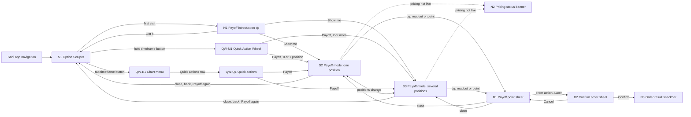

# Sahi Payoff (Mobile) PRD
*Full PRD: Payoff on the Option Scalper in the Sahi app for iOS and Android, opened from the Quick Action Wheel slot that used to hold Clean View. Use this to design the screens in Figma, to build the prototype, and to agree scope with Sahi's product, engineering and compliance leads.*

**Product type:** Mobile app · **Depth:** Full PRD · **Version:** v1.0 · **Date:** 9 Nov 2026 · **Status:** Draft

**Owner:** Suhas · **Reviewers / sign-off:** Open item: Sahi product, design, engineering and compliance leads
> Scope note: this PRD adapts the desktop Payoff PRD v1.7 to the Sahi app, as that PRD planned ("mobile gets its own PRD"). It also changes the Quick Action Wheel PRD v1.4: the wheel's seventh action, Clean View, becomes Payoff in every placement of the placement PRD v1.1. Payoff never forecasts, recommends or opens a trade. Example values come from the research model used in the desktop PRD (Nifty 25,000, IV 12%, range at IV 10% to 15%) and are illustrative, not market data. The prototype runs on real Kite data (Nifty 50 near 22,665 on Wed 14 Oct 2026), so its numbers differ from the examples here.
>
> IDs: surfaces that do the same job as on desktop keep the desktop IDs (S1, S2, S3, N1, N2, N3). Desktop D1 Pinned point card → B1 Payoff point sheet. Desktop M1 Confirm order from pin → B2 Confirm order sheet. Surfaces owned by the Quick Action Wheel PRD v1.4 keep their IDs with a QW- prefix: QW-M1 Quick Action Wheel, QW-Q1 Quick actions, QW-B1 Chart menu, QW-S2 Quick wheel settings, QW-N1 Invitation, QW-T1 Tutorial.
>
> Changes from desktop v1.7: hold-to-peek with ⌥ or Alt → wheel slot 7 and the Quick actions row (a phone has no modifier key, and holding the chart is the crosshair). Payoff toolbar button → none; the wheel slot is the switch. Hover → the Payoff point, which the trader taps, drags or long-presses into place and which stays where it is left. Hover readout → a readout docked in the chart's top-left corner, away from the finger. Pinned point card (D1) → B1 Payoff point sheet with steppers, because on a phone the point is always pinned. Payoff table → Payoff list. Arrow keys → steppers in B1 and screen-reader adjustable controls. Mirrored crosshair → the option chart's marker follows the point. Opening view: the index chart scrolls so the rest of the session is in view, keeping its timeframe and candle width (BR-24). Added: Offline banner, haptic ticks, Android back, background and resume, text size and small-phone rules.
>
> Changes to the Quick Action Wheel PRD v1.4: slot 7 Clean View → Payoff in QW-M1, QW-Q1, QW-S2, QW-N1 and QW-T1. Clean View is removed from the wheel concept (BR-33).

## 1. Overview
- **Problem / why:** 87.7% of individual F&O traders lost money in FY26, about 97% mainly buy options, and 59% of index option turnover is in contracts expiring that same day (SEBI). Traders read levels on the Nifty chart, but their P&L lives in premium, and delta, time decay and IV move premium in ways they can't see. On expiry day a 50-point Nifty rise by the close can still leave an at-the-money call below what was paid. Desktop Payoff answers "what is my position worth at this level and time"; most scalpers also trade from their phone, where today there is no way to ask that question at all.
- **Users / roles:** one role, a trader with F&O enabled using the Option Scalper in the Sahi app. Personas: expiry-day option buyer, option seller, positional option buyer (1.2).
- **Main jobs:** see where a position breaks even now and at every future time; see P&L for any index level at any time up to expiry, with one thumb; for books of several legs, see each leg and the total; in the Later release, turn a point into a target, a stop or an exit time.
- **Entry points:** slot 7 "Payoff" in QW-M1 Quick Action Wheel, opened by holding a chart's timeframe button (or the anchor of whichever placement ships); the "Payoff" row in QW-Q1 Quick actions, reached from the Quick actions row in QW-B1 Chart menu or from the wheel's fallback; "Show me" on N1 Payoff introduction tip.
- **In scope:** the wheel and Quick actions changes; index options and index futures on the index loaded in the top chart (Nifty, Bank Nifty, Sensex and any other index the Scalper supports); one or several positions; weekly and monthly expiries; intraday and carry-forward positions; a pre-trade view when nothing is held; touch, haptics, screen readers, text size, offline and resume. · **Out of scope / owned elsewhere:** desktop (desktop PRD v1.7); the wheel's gesture, geometry, label fit and placements (Quick Action Wheel PRD v1.4 and placement PRD v1.1); sign-in, F&O activation and the order panel (existing Sahi flows); stock options; the option seller terminal's strategy payoff; manual IV sliders; landscape layouts; widgets and live activities; order rules for targets, stops and timed exits (owned by Orders).
- **Platforms and frames:** Sahi app on Android and iOS, portrait only. Frames: Android 412 × 915 (the reference phone the Sahi screenshots came from), Android 360 × 800 (small), iPhone 390 × 844 and iPhone 430 × 932. Assumption: built in the same stack as the current Sahi app and drawn by the same chart engine as the Option Scalper.

### 1.1 Goals, non-goals and success metrics
| Goal | Metric | Baseline | Target |
|---|---|---|---|
| Traders understand what their option is worth at a level and time before they act | Error in a premium-guessing test on a phone, with and without Payoff | Open item | Open item |
| More option trades carry a planned exit | Share of option buys from the app with a stop or target set within 5 minutes of entry, Payoff users vs others | Open item | Open item |
| Fewer losing holds into expiry afternoon | Share of long options expiring today still held after 2:30 pm while in loss, app traders | Open item | Open item |
| Payoff becomes part of the mobile routine | Share of app Option Scalper sessions with option positions that open Payoff | Open item | Open item |
| The wheel slot earns its place | Payoff picks per 100 wheel opens, and the share of Payoff opens that come from the wheel rather than Quick actions | Open item | Open item |
| Reading a point is quick with one thumb | Median time from Payoff opening to the first point move, and the share of sessions that move the point at all | Open item | Open item |
| Guardrail: no rise in overtrading | Trades per active app trader per day, and expiry-day buys of far out-of-the-money strikes | Open item | Assumption: flat or down |
| Traders can trust the estimates | Share of past outcomes that land inside the shown range | Open item | Assumption: 80%, proposed in the research |

**Non-goals:** forecasting where the index will go; recommending strikes, levels or trades; making buying faster (Payoff adds no buy button, and the existing order panel is unchanged); replacing the seller terminal's strategy payoff; stock options; a phone version of hold-to-peek; landscape; keeping Clean View somewhere else in the wheel.

### 1.2 Users and roles
| Role / persona | Main jobs | Context and constraints |
|---|---|---|
| Expiry-day option buyer (scalper) | See what a 50-point move does to premium in the next hour; decide whether to hold or exit | Phone in one hand, often on the move; fast markets; mostly intraday Scalper positions that square off at 3:20 pm; the thumb covers what it touches; seconds matter |
| Option seller | See breakevens over time and P&L across straddles, strangles and iron condors, weekly and monthly | Checks the book away from the desk, between other tasks; several legs; watches margin; reads more than it taps |
| Positional option buyer | See how much waiting costs over the days to expiry | Weekly and monthly contracts carried forward; checks in a few times a day; less practised with the Scalper's gestures |

### 1.3 Constraints, dependencies and risks
**Constraints:** Open item: target date for design and build. In-app estimates are fine, but SEBI's June 2026 consultation on a common advertisement code lists content "based on assumptions/projections" as prohibited in ads, so marketing must not show projected gains, app store screenshots included. A phone shows about a fifth of the candles a desktop shows (the reference index chart is about 350 px wide), so the future zone must be scrolled into view on open (BR-24). The thumb hides the point it touches, so values can't sit under the finger (BR-30). Every target is at least 48 dp on Android and 44 pt on iOS.

**Dependencies:** everything the desktop PRD lists (live option prices and IV per contract; index futures prices; the exchange contract list with expiry dates and holiday shifts; positions with side, open quantity, average price, product and today's realised P&L; Order Defaults; in the Later release, SL/TP orders and a new exit-by-time order); the Quick Action Wheel shipping in the app with slot 7 (QW PRD v1.4); the mobile chart engine drawing a future zone, overlays and a draggable point; platform haptics (Android haptic feedback, iOS selection and impact feedback).

| Risk | Impact | Mitigation or owner |
|---|---|---|
| IV moves and estimates miss | Traders stop trusting Payoff, as Sensibull's target-date line was called "wrong" | Show a range, label values as model estimates, check the range on past expiry days |
| Payoff makes buying feel safer | More trading and more losses | No new buy button, guardrail metrics in 1.1 |
| The wheel ships late, or a placement without slot 7 | Payoff has no main entry | QW-Q1 row from QW-B1 still works; Open item: a direct entry in the chart menu if the wheel slips |
| Gesture clashes on a small chart (pan, point drag, long-press crosshair, pinch, the wheel's hold, Android's back swipe) | Wrong action or a moved chart instead of a moved point | One rule set (BR-29), a 48 dp point target, the point never under the price axis, usability test on phones |
| The finger hides the point and its values | Traders misread the level or time | Docked readout away from the finger, level and time tags on the axes, B1 steppers for fine moves |
| Slow redraw on mid-range Android phones while dragging | Laggy point, missed haptic ticks | NFR-01 budget on a reference device; overlays redrawn only when the view changes; engineering owner |
| Crowded small screens (360 wide, 200% text) | Readout covers the chart or truncates | BR-35 sizes, chips scroll sideways, the readout grows downward and can be collapsed |
| Stale feed or a dropped connection shows wrong values | Wrong decisions | N2 Pricing status banner with Stale, Offline and Unavailable variants; values greyed |
| Copy or naming fails compliance review late | Rework before launch | Compliance review of all copy before beta |
| Fewer impulsive trades lower order counts | Short-term revenue dip | Track retention and long-term activity alongside order counts; product owner |
| Traders miss Clean View | Complaints, cluttered charts | Hide all drawings stays in Drawing Tools; indicators hide from the legend; track feedback in beta (BR-33) |

### 1.4 How desktop Payoff maps to the phone
| Desktop v1.7 | Phone | Why |
|---|---|---|
| Hold ⌥ Option or Alt to peek, let go to hide | No peek. Slot 7 of the wheel turns Payoff on and off; Quick actions is the tap route | A phone has no modifier key; holding the chart already means crosshair, and holding the timeframe button already opens the wheel |
| Payoff button on the index chart toolbar | The wheel slot and the Quick actions row; a close button in the Payoff bar | The mobile chart header has no free toolbar; the user asked for Payoff in the slot Clean View had |
| Hover anywhere in the future zone | The Payoff point: tap to place it, drag it, or long-press and slide; it stays where it is left | Touch has no hover, and a value that vanishes on lift is hard to read on a phone. Robinhood's simulated returns also keep the point after the finger lifts |
| Readout follows the pointer | Readout docked in the top-left corner of the index chart, away from the future zone and the finger | The thumb covers anything next to it |
| Arrow keys move the point | B1 steppers (level ±5 points, time ± one candle) and screen-reader adjustable controls | Fine moves without precise dragging; accessibility |
| Pinned point card (D1) | B1 Payoff point sheet | The point is always pinned, so its details and (Later) order actions live in a sheet |
| Payoff table (S3) | Payoff list in the bottom card, legs as list items | Tables don't fit 360 px; the list keeps the same rows |
| Horizon chips in the Payoff header | Horizon chips in the Payoff bar, scrolling sideways | Same job; Groww's Advance Payoff also picks dates from a row |
| Opens on the view the trader had | Keeps timeframe and candle width but scrolls so the rest of the session is in view | The right margin of a phone chart is about 6 candles wide, too narrow to place a point |
| Mirrored crosshair between the charts | The option chart's marker and card follow the point | Long-press on either chart stays the existing crosshair; mirroring it is an Open item |

## 2. Requirements
### 2.1 Functional
| ID | Requirement | Priority | Surfaces |
|---|---|---|---|
| FR-01 | The trader can turn Payoff on and off from slot 7 "Payoff" of the Quick Action Wheel on either chart, in every placement; Payoff replaces Clean View in that slot, and the wheel's settings, invitation and tutorial show Payoff where they showed Clean View (BR-32, BR-33) | Must | S1, QW-M1, QW-S2, QW-N1, QW-T1, S2, S3 |
| FR-02 | The trader can turn Payoff on and off from the "Payoff" row in Quick actions, reached from the Quick actions row in the chart menu | Must | QW-B1, QW-Q1, S2, S3 |
| FR-03 | The trader can close Payoff with the close button in the Payoff bar and, on Android, with system back (BR-23) | Must | S2, S3 |
| FR-04 | The system introduces Payoff once with a tip anchored to the index chart's timeframe button | Should | S1, N1 |
| FR-05 | On open, the system keeps each chart's timeframe and candle width and scrolls the charts so the rest of the session is in view where the zoom allows; on close it restores the views (BR-24) | Must | S2, S3 |
| FR-06 | The system adds a future zone to the index chart that runs to 3:30 pm on the latest expiry among open positions on that index, or to today's 3:20 pm auto square-off when every position is intraday (BR-03) | Must | S2, S3 |
| FR-07 | The system draws breakeven lines where total open P&L is zero at each moment, shades the profit side, and marks each expiry held and the auto square-off with a labelled vertical marker | Must | S2, S3 |
| FR-08 | The system shows a Payoff point in the future zone from the moment Payoff opens, at the end of the session at the current level when that is in view (BR-28), and a docked readout with the level and time, the P&L in large type and its range | Must | S2, S3 |
| FR-09 | The trader can move the point by tapping in the future zone, dragging the point, or long-pressing and sliding into the future zone; the point snaps to the index chart's candles and to 5 index points (BR-16, BR-29) | Must | S2, S3 |
| FR-10 | The trader can open B1 Payoff point sheet from the readout or the point, and move the point there with level and time steppers | Must | S2, S3, B1 |
| FR-11 | With one position, the system shows on the option chart the premium at the point's time as a marker with a range bar, a point card in the readout's style, the paid line and the flat-case line | Must | S2 |
| FR-12 | With two or more positions, the system replaces the option chart with the Payoff list: legs grouped by expiry with side, quantity, average price, value and P&L at the point and status, then Realised today, the total with its range and the flat case | Must | S3 |
| FR-13 | The trader can tap a leg in the Payoff list to draw its strike on the index chart | Should | S3 |
| FR-14 | The trader can fit the view to today or to any expiry held with horizon chips; none is picked when Payoff opens | Should | S2, S3 |
| FR-15 | The system gives a selection haptic when a dragged point crosses a breakeven line or an expiry marker (BR-31) | Should | S2, S3 |
| FR-16 | With no open position on the charted index, the system prices the contract on the option chart as a buy of the default order quantity at its last price | Should | S2, B1 |
| FR-17 | On expiry day, when the range is wider than the premium, the system shows time value left instead of the range | Must | S2, S3, B1 |
| FR-18 | The system shows legs past their expiry as Expired, valued at intrinsic value at the point's level, and an intraday leg in a mixed book as Squared off after 3:20 pm, greyed, still counted in the total | Must | S3 |
| FR-19 | The system shows today's realised P&L from closed positions as its own row, outside the total | Must | S3 |
| FR-20 | The system leaves out positions on other underlyings and shows how many there are | Must | S2, S3 |
| FR-21 | The system takes expiry dates from the exchange contract list, including holiday shifts | Must | S2, S3 |
| FR-22 | The system flags stale, closed-market, unavailable and offline prices with the time of the last update, and greys the values | Must | S2, S3, N2 |
| FR-23 | The system labels every value as a model estimate and never suggests a level, strike or trade | Must | S2, S3, B1 |
| FR-24 | For defined-risk books (spreads, iron condors, iron flies), the Payoff list shows max profit and max loss at expiry | Should | S3 |
| FR-25 | The index chart and the option chart keep their own timeframe, scroll and zoom with Payoff on; both pan into empty space up to 3:30 pm on the next trading day, or to the axis end when that is later; past the axis end the chart is striped and disabled (BR-25 to BR-27) | Must | S2, S3 |
| FR-26 | The system keeps Payoff in step with positions: a buy or sell placed while Payoff is on, a square-off or an expiry switches between Pre-trade, one position (S2) and several (S3) without closing Payoff | Must | S2, S3 |
| FR-27 | The wheel's slot 7 shows Payoff's state (Off or On), and its readout pill says "Show payoff" or "Hide payoff" with the scope "Both charts" | Must | QW-M1 |
| FR-28 | While the Payoff list covers the option chart (S3), wheel actions that target the option chart are unavailable, except Payoff | Must | QW-M1, S3 |
| FR-29 | Payoff stays on when the app goes to the background and comes back within the same Scalper session, and refreshes prices on return | Should | S2, S3 |
| FR-30 | The Payoff point, the readout and the Payoff list work with TalkBack and VoiceOver (NFR-04) | Must | S2, S3, B1 |
| FR-31 | Later release: from B1, for a held single position, the trader can set a target or a stop at the premium projected at the point, after confirming | Must | B1, B2, N3 |
| FR-32 | Later release: from B1, the trader can schedule an exit at the point's time, after confirming; with several positions only "Exit all at" is offered | Must | B1, B2, N3 |

### 2.2 Non-functional
| ID | Area | Requirement | Surfaces |
|---|---|---|---|
| NFR-01 | Performance | While the point is dragged, the point, readout, option chart marker and Payoff list update within one frame on a book of up to 10 legs; overlays redraw only when the view, prices or positions change. Assumption: 16 ms budget on a reference mid-range Android phone (Open item: the device) | S2, S3 |
| NFR-02 | Accuracy | Values are checked against market prices on past expiry days before launch, and the range covers at least the target share of outcomes. Assumption: 80% | S2, S3, B1 |
| NFR-03 | Freshness | Inputs older than a threshold are flagged. Open item: threshold in seconds, the same as desktop | S2, S3, N2 |
| NFR-04 | Accessibility | Target WCAG 2.2 AA (Assumption). Touch targets at least 48 × 48 dp (Android) and 44 × 44 pt (iOS). The point is an adjustable control for TalkBack and VoiceOver; the readout is announced politely when the point settles; profit and loss use signs and words, never colour alone; text scales to 200% without losing the readout or list values (BR-35) | All |
| NFR-05 | Compliance | No forecasts or recommendations; every value labelled as a model estimate; all copy reviewed by compliance; no projected gains in marketing or app store screenshots | All |
| NFR-06 | Localisation | English; rupees in Indian digit grouping (₹1,23,456); times in IST, 12-hour with am and pm; dates as "Mon 19 Oct"; the minus sign is U+2212 in values | All |
| NFR-07 | Analytics | Events listed in each build sheet's Notes, using the standard user id only, with no prices or positions in the payload beyond the counts named | All |
| NFR-08 | Platforms | Sahi app on Android and iOS at the versions the Option Scalper supports (Open item: minimum OS versions); portrait only; phones from 360 to 430 pt wide; tablets show the phone layout (Assumption) | All |
| NFR-09 | Battery and data | With Payoff on and the point still, values recompute at most once a second (BR-17); in the background nothing recomputes | S2, S3 |
| NFR-10 | Haptics | Haptics follow the phone's system setting and Sahi's own haptics setting; at most one selection haptic every 50 ms | S2, S3, QW-M1 |

## 3. Navigation and Information Architecture
Payoff is a mode of the Option Scalper (S1), not a new screen. It uses the Sahi app's existing navigation and the Option Scalper's top bar; no tab bar item is added.

| Nav item | Goes to | Visible to | Notes |
|---|---|---|---|
| Slot 7 "Payoff" in QW-M1 Quick Action Wheel (hold a chart's timeframe button, slide, release) | S2 or S3; S1 when Payoff is already on | Traders with F&O enabled | Same slot from either chart and in every placement; acts on both charts (BR-32) |
| "Payoff" row in QW-Q1 Quick actions | S2 or S3; S1 when Payoff is already on | Same | QW-Q1 opens from the Quick actions row in QW-B1 Chart menu (tap a timeframe button) and from the wheel's fallback |
| "Show me" on N1 Payoff introduction tip | S2 or S3 | Same, once | First Scalper visit after release |
| Close button (×) in the Payoff bar | S1 | Same | Accessible name "Close payoff" |
| Android system back | B1 closes first; otherwise S1 | Same | iOS has no system back here; the close button and the wheel do the same job |
| Tap the readout or the Payoff point | B1 | Same | B1 is a sheet over the bottom card; the index chart stays visible |
| Close the Option Scalper (× in the top bar) | Existing exit | Same | Turns Payoff off; it doesn't reopen next time (BR-34) |

## 4. User Flows
### Flow 1: Check one position from the wheel
**Actor:** Trader (expiry-day option buyer) · **Starts:** S1 at 10:15 am on Mon 19 Oct, holding Buy 65 NIFTY 19 OCT 25000 CE at ₹69.10, carry-forward, with the index chart on 5m · **Ends:** S1
- Trader holds the "5m" timeframe button on the index chart in S1 Option Scalper.
- System opens QW-M1 Quick Action Wheel; slot 7 reads "Payoff" with the caption "Off".
- Trader slides onto Payoff; system highlights the slot and the readout pill says "Both charts · Show payoff".
- Trader lets go; system gives a success haptic and opens S2 Payoff mode: one position. The option chart switches to NIFTY 19 OCT 25000 CE if another contract was showing.
- System keeps both charts on their timeframe and candle width and scrolls them so 3:30 pm today is in view, with Now about a sixth of the way across the index chart (BR-24).
- System draws the future zone, the breakeven line labelled "Breakeven 25,069", the profit shading and the "Weekly expiry · Mon 19 Oct" marker, and places the Payoff point at 3:30 pm at 25,000 (BR-28).
- System shows the readout: "Nifty 25,000 · 3:30 pm today", then "P&L −₹4,492" in large type, then "Worth ₹0.00 at expiry" in place of the range.
- Trader drags the point to 25,050 and 11:15 am; system gives a selection haptic when the point crosses the breakeven line.
- System shows "Nifty 25,050 · 11:15 am today", "P&L +₹1,385" and "Range +₹751 to +₹2,355"; the option chart's marker moves to 11:15 am with its card "P&L +₹1,385" and "Premium ₹90.40 · ₹80.65 to ₹105.33".
- Trader taps the future zone at 3:30 pm and 25,050; system moves the point there and shows "P&L −₹1,241": a 50-point rise by the close still loses, because the time value has gone.
- If the position is intraday (the Scalper default), system ends the future zone at 3:20 pm with the "Auto square-off · 3:20 pm" marker, and the point at 25,050 and 3:20 pm shows "P&L −₹1,197".
- If the range grows wider than the premium in the afternoon, system shows "Too uncertain to price · time value left ₹X" instead of the range.
- If prices go stale, system greys the values and shows N2 Pricing status banner, Stale variant.
- Trader taps the close button in the Payoff bar (or holds "5m" and releases on Payoff, now captioned "On", or presses Android back).
- System closes Payoff, returns to S1, puts each chart back on the view it had and restores the option contract shown before.

### Flow 2: Check a weekly plus monthly book from Quick actions
**Actor:** Trader (option seller) · **Starts:** S1 at 10:15 am on Wed 14 Oct, holding Sell 65 NIFTY 19 OCT 24800 PE at ₹68.26, Sell 65 NIFTY 19 OCT 25200 CE at ₹69.29 and Buy 65 NIFTY 27 OCT 25000 CE at ₹224.15, plus one Bank Nifty position · **Ends:** S1
- Trader taps the "5m" timeframe button on the index chart; system opens QW-B1 Chart menu.
- Trader taps the Quick actions row; system opens QW-Q1 Quick actions.
- Trader taps the "Payoff" row (trailing "Off"); system closes QW-Q1 and opens S3 Payoff mode: several positions.
- System replaces the option chart with the Payoff list titled "Nifty 25,000 · 3:30 pm today", with the header "3 positions · 2 expiries" and the chip "1 position on other charts".
- System draws two breakeven lines with the profit shading between them, the horizon chips "Today", "19 Oct" and "27 Oct" with none picked, and the Payoff point at 3:30 pm today at 25,000.
- Trader taps the "19 Oct" chip; system fits the index chart to now through Mon 19 Oct and shows "Weekly expiry · Mon 19 Oct" with the sub-label "moved from Tue 20 Oct".
- Trader drags the point to 25,100 at 11:15 am on Fri 16 Oct.
- System updates the readout to "Total P&L +₹6,074", "Range +₹5,406 to +₹6,828", and the list: 24800 PE ₹12.97, P&L +₹3,594; 25200 CE ₹56.29, P&L +₹845; 27 OCT 25000 CE ₹249.31, P&L +₹1,635; total +₹6,074; "If Nifty stays at 25,000: +₹3,318".
- Trader taps the "27 Oct" chip and drags the point to 25,100 at 11:15 am on Wed 21 Oct.
- System shows the two 19 Oct legs as Expired, valued at ₹0 at 25,100, with P&L +₹4,437 and +₹4,504; the monthly call at ₹218.27 with P&L −₹383; total +₹8,558, range +₹6,850 to +₹11,151.
- Trader taps the 24800 PE row; system draws a dotted line at 24,800 on the index chart labelled "24800 PE"; tapping the row again removes it.
- If a Nifty position was closed earlier today, system shows its P&L in the "Realised today" row above the total.
- Trader presses Android back; system closes Payoff and returns to S1 with the option chart shown again.

### Flow 3: See a payoff before buying
**Actor:** Trader · **Starts:** S1 at 10:15 am on Mon 19 Oct, holding no Nifty position, with NIFTY 19 OCT 25000 CE at ₹69.10 on the option chart · **Ends:** S2 holding the call, or S1
- Trader holds the option chart's "5m" button and releases on Payoff in QW-M1.
- System opens S2 in its Pre-trade state; the position chip reads "Not holding · as a buy of 65" and the paid line "Last price ₹69.10", taking the quantity from Order Defaults.
- Trader moves the point as in Flow 1; system shows the same readout and option chart card, with no order actions.
- If no contract is loaded on the option chart, system shows "Pick a contract on the option chart to see its payoff" on the index chart and stays on S2.
- Trader switches the option chart to NIFTY 19 OCT 25100 CE with the existing contract switcher; system prices the new contract and keeps the point where it was.
- Trader taps the option chart, and system shows the existing order panel; the trader buys with "Buy at Mkt".
- System keeps Payoff on and switches S2 from Pre-trade to the held position: the chip reads "Bought 65 at ₹X" and the paid line "Paid ₹X" (BR-36).
- Trader taps the close button, and system returns to S1.

### Flow 4: Fine-tune the point in the sheet
**Actor:** Trader · **Starts:** S2 with the point at 25,050 and 11:15 am · **Ends:** S2
- Trader taps the readout; system opens B1 Payoff point sheet over the option chart, with the index chart still visible and live above it.
- System shows "Nifty level" with "25,050" between − and + buttons, "Time" with "11:15 am, Mon 19 Oct" between ‹ and › buttons, then "P&L +₹1,385", "Range +₹751 to +₹2,355", "Premium ₹90.40 (₹80.65 to ₹105.33)" and "If Nifty stays at 25,000: −₹450".
- Trader taps + five times; system moves the point up 5 points per tap to 25,075 and updates the values and the index chart.
- Trader holds ›; system moves the point one candle every 150 ms until the trader lets go or the point reaches the axis end.
- If the trader steps past the axis end or before the first candle after Now, system stops the stepper and disables that button.
- Trader swipes the sheet down (or taps the close button, or presses Android back); system closes B1 and stays on S2 with the point where B1 left it.

### Flow 5: First visit after release
**Actor:** Trader · **Starts:** S1, first Scalper visit after Payoff is released, having seen QW-N1 Invitation before · **Ends:** S2, S3 or S1
- System shows N1 Payoff introduction tip anchored to the index chart's timeframe button: "New in your quick wheel: Payoff. Hold 5m and slide to Payoff to see your breakeven and P&L at any Nifty level and time."
- Trader taps "Show me"; system closes N1 and opens S2 or S3 by position count, with the first-run hint in the future zone: "Drag the ring or tap the shaded area to see P&L at any level and time. Pick a date above to look further ahead."
- System removes the hint after the trader's first point move.
- If the trader taps "Got it", taps outside N1 or presses Android back, system closes N1 for good and stays on S1.
- If QW-N1 Invitation hasn't been seen yet, system shows QW-N1 instead, whose copy lists Payoff, and N1 waits for the next visit (Assumption).

### Flow 6: Set a target from the point (Later release)
**Actor:** Trader · **Starts:** S2, holding Buy 65 NIFTY 19 OCT 25000 CE at ₹69.10, point at 25,050 and 11:15 am · **Ends:** S2 with a new order, or S2 unchanged
- Trader taps the readout; system opens B1 with "Set target at ₹90.40" (Primary) and "Exit at 11:15 am" (Secondary) under the values.
- Trader taps "Set target at ₹90.40".
- System opens B2 Confirm order sheet titled "Set target", showing "NIFTY 19 OCT 25000 CE · Bought 65 at ₹69.10", "Sells 65 at market when the option's price reaches ₹90.40" and "P&L if filled at ₹90.40: +₹1,385 before charges".
- Trader taps "Set target"; system creates the target through Sahi's SL/TP orders, closes B2 and B1, returns to S2 and shows N3 Order result snackbar "Target set at ₹90.40"; the target pill appears on the option chart.
- If the order fails, system keeps B2 open and shows N3 with the reason.
- If the trader taps "Exit at 11:15 am" instead, system opens B2 in its Schedule exit mode; on confirm it schedules the exit, shows N3 "Exit scheduled for 11:15 am" and adds an exit marker to both charts.
- If the trader taps Cancel, system returns to B1 with nothing placed.

## 5. Surface List
| ID | Name | Type | Platform | Purpose | Release |
|---|---|---|---|---|---|
| S1 | Option Scalper | Screen (existing, changed) | Android, iOS | Where Payoff lives; gains the wheel slot, the Quick actions row and N1 | MVP |
| QW-M1 | Quick Action Wheel | Overlay (existing, changed) | Android, iOS | Slot 7 becomes Payoff in every placement | MVP |
| QW-Q1 | Quick actions | Bottom sheet (existing, changed) | Android, iOS | Row 7 becomes Payoff | MVP |
| QW-B1 | Chart menu | Bottom sheet (existing, unchanged) | Android, iOS | Tap route to QW-Q1 through its Quick actions row | MVP |
| QW-N1 | Invitation | Coach mark (existing, copy changed) | Android, iOS | The wheel's first-run invitation; its copy names Payoff instead of Clean View | MVP |
| QW-T1 | Tutorial | Overlay (existing, changed) | Android, iOS | The step that showed Clean View shows Payoff | MVP |
| QW-S2 | Quick wheel settings | Screen (existing, changed) | Android, iOS | Lists Payoff as a fixed action with no choices, where it listed Clean View | MVP |
| N1 | Payoff introduction tip | Coach mark | Android, iOS | Introduces Payoff in the wheel once | MVP |
| S2 | Payoff mode: one position | Mode within S1 | Android, iOS | Breakeven and P&L for one position, or for a contract before buying | MVP |
| S3 | Payoff mode: several positions | Mode within S1 | Android, iOS | Breakevens and a per-leg list for books of two or more positions | MVP |
| B1 | Payoff point sheet | Bottom sheet | Android, iOS | Details of the point and steppers to move it; in the Later release, order actions | MVP (order actions Later) |
| N2 | Pricing status banner | Banner | Android, iOS | Flags stale, closed-market, unavailable or offline prices | MVP |
| B2 | Confirm order sheet | Bottom sheet - confirm | Android, iOS | Confirms the order a point creates | Later |
| N3 | Order result snackbar | Snackbar | Android, iOS | Confirms an order from a point, or says why it failed | Later |

## 6. Flow Map
| From | Trigger | To | Condition / result |
|---|---|---|---|
| External: Sahi app navigation | Open the Option Scalper | S1 | Existing entry |
| S1 | First Scalper visit after release | S1, N1 | QW-N1 already seen and N1 not seen before |
| N1 | Show me | S2 or S3 | S2 for zero or one position on the charted index; S3 for two or more |
| N1 | Got it, tap outside or Android back | S1 | Tip dismissed for good |
| S1 | Hold a timeframe button (or the anchor of the shipped placement) | QW-M1 | Existing wheel gesture |
| QW-M1 | Release on Payoff (caption Off) | S2 | Zero or one open position on the charted index; success haptic |
| QW-M1 | Release on Payoff (caption Off) | S3 | Two or more open positions on the charted index; success haptic |
| QW-M1 | Release on Payoff (caption On) | S1 | Payoff off; views and contract restored |
| QW-M1 | Release anywhere else, or on a disabled slot | S1, S2 or S3 | Existing wheel cancel; nothing changes |
| S1 | Tap a timeframe button | QW-B1 | Existing chart menu |
| QW-B1 | Tap the Quick actions row | QW-Q1 | Existing tap route |
| S1 | First Scalper visit with the wheel, QW-N1 not seen | QW-N1 | Wheel PRD's invitation, which names Payoff; N1 waits for the next visit |
| QW-N1 | Existing route to the tutorial (QW PRD v1.4) | QW-T1 | The Clean View step shows Payoff |
| S1 | Existing route to the wheel settings (QW PRD v1.4) | QW-S2 | Payoff listed as a fixed action |
| QW-Q1 | Tap Payoff (Off) | S2 or S3 | By position count; QW-Q1 closes |
| QW-Q1 | Tap Payoff (On) | S1 | Payoff off |
| S2 | Close button, Android back, or Payoff in QW-M1 or QW-Q1 | S1 | Payoff off; previous option contract and both views restored |
| S3 | Close button, Android back, or Payoff in QW-M1 or QW-Q1 | S1 | Payoff off; option chart shown again; index view restored |
| System | A second position opens while S2 is on | S3 | Count becomes two or more |
| System | Positions close while S3 is on, leaving one or none | S2 | Count becomes one or zero |
| System | Prices stale, market closed, prices unavailable or the phone offline | S2, N2 or S3, N2 | Matching banner variant |
| N2 | Retry | Stays on S2 or S3 | Unavailable variant only |
| S2 | Tap the readout, or tap the Payoff point without moving it | B1 | Always |
| S3 | Tap the readout, or tap the Payoff point without moving it | B1 | Always; only "Exit all at" is offered in the Later release |
| B1 | Close button, swipe down or Android back | S2 or S3 | Point kept where B1 left it |
| B1 | Set target, Set stop, Exit at, Exit all at | B2 | Later release |
| System | The point's time passes while B1 is open | B1 | Point moves to the first candle after Now; values update |
| B2 | Confirm, order succeeds | S2 or S3, N3 | B2 and B1 close; success snackbar |
| B2 | Confirm, order fails | B2, N3 | Error snackbar; sheet stays open |
| B2 | Cancel, swipe down or Android back | B1 | No order |
| B2 | Cancel after the position has closed | S2 or S3 | B2 and B1 close; no order |
| N3 | Closes after 4 seconds, or swiped away | S2 or S3 | Later release; error variant stays until swiped away |
| QW-T1 | Finish or skip (QW PRD v1.4) | S1 | Existing tutorial exit |
| QW-S2 | Back (QW PRD v1.4) | S1 | Existing settings exit |
| S2 | Close the Option Scalper | External: Sahi app navigation | Payoff off |
| S3 | Close the Option Scalper | External: Sahi app navigation | Payoff off |

## 7. Shared Components
| Component | Used on | Contents | Behaviour and variants |
|---|---|---|---|
| Wheel slot 7 "Payoff" | QW-M1, S2, S3 | Payoff icon (a bent expiry line with a dashed curve above it), label "Payoff", state caption "Off" or "On" | Replaces Clean View in every placement; acts on both charts from either chart's wheel; readout pill "Both charts · Show payoff" or "Both charts · Hide payoff"; greyed with caption "No options" when the top chart has no listed options (BR-32) |
| Payoff bar | S2, S3 | A strip at the top of the index chart's pane: horizon chips on the left, the close button (×) on the right | Always shown while Payoff is on; chips scroll sideways when they don't fit; the close button has the accessible name "Close payoff" and a 48 dp target |
| Horizon chips | S2, S3 | "Today", then one chip per expiry held, e.g. "19 Oct", "27 Oct" | Tapping one fits the index chart (and, in S2, the option chart) from now to that time; none is picked when Payoff opens; dragging or pinching the index chart clears the pick; intraday-only books and positions expiring today show "Today" alone |
| Future zone | S2, S3 | The chart area from the "Now" line to the axis end, on the index chart and, in S2, the option chart | Light tint to separate it from past candles; trading hours only, with a dashed separator at each new session; times in IST |
| "Now" line | S2, S3 | Vertical line with the label "Now" at the top | Moves with the clock; the Payoff point can't go left of it |
| Breakeven line and profit shading | S2, S3 | One line per place where total open P&L is zero; label at the right end of the view, e.g. "Breakeven 25,069"; profit side tinted and labelled "Profit", the other side "Loss" | Zero, one or more lines; the label gives the level at the right edge of the view; words are left out where the zone is too narrow; an edge arrow with the level when a line is out of view, e.g. "Breakeven 25,800 ↑"; legend text "Profit at every level shown" or "Loss at every level shown" when no line is in view; tapping a label shows the tooltip "Breakeven: the Nifty level where your P&L is zero at each time" |
| Expiry marker | S2, S3 | Vertical dashed line with a label at the top, e.g. "Weekly expiry · Mon 19 Oct", "Monthly expiry · Tue 27 Oct", "Auto square-off · 3:20 pm" | Sub-label "moved from Tue 20 Oct" when a holiday shifted it; in month-end week one marker "Weekly and monthly expiry · Tue 27 Oct"; tapping the label shows how many legs expire there; labels shorten to "Expiry · 19 Oct" when the zone is narrow |
| Disabled area | S2, S3 | Diagonal stripes from the axis end to the right edge, a thin edge line and a centred label "After expiry", "After auto square-off" or "Expired" | Tied to the time axis; no shading, point or tap target inside it; a tap there does nothing (BR-26) |
| Payoff point | S2, S3 | A ring at the point's level and time with dashed crosshair lines across the pane, a level tag on the price axis (e.g. "25,050") and a time tag on the time axis (e.g. "11:15 am") | Always shown while Payoff is on; tap, drag or long-press to move it (BR-29); 48 dp touch target; snaps to candles and 5 points (BR-16); pulses once when it moves by a tap, chip or stepper; an edge indicator "Point · 3:30 pm →" when scrolled out of view, which scrolls it back when tapped |
| Payoff readout | S2, S3 | Line 1 "Nifty 25,050 · 11:15 am today" (or with the date: "11:15 am, Fri 16 Oct"); line 2 "P&L" with the value in large bold type, "+₹1,385" (S3: "Total P&L"); line 3 "Range +₹751 to +₹2,355"; footer "Model estimate ⓘ" and a chevron | Docked at the top-left of the index chart's pane, under the Payoff bar and the legend; moves to the top-right when the point is in the left half of the pane, and below the point's level when the point is in the top third (BR-30); tap opens B1; "Too uncertain to price · time value left ₹X" and "Worth ₹X at expiry" replace the range when they apply |
| Model label | S2, S3, B1 | "Model estimate" with an info icon in the readout; "Model estimate, not a forecast" in B1 | Tapping the icon shows: "Worked out from live option prices, IV and time left. The range shows values if IV moves. Actual prices can differ, especially near expiry." Open item: final wording from compliance |
| Position chip | S2 | Held: "Bought 65 at ₹69.10" or "Sold 65 at ₹69.10". Pre-trade: "Not holding · as a buy of 65" | In the option chart's header, under the timeframe button; says what is being priced |
| Other-charts chip | S2, S3 | "1 position on other charts" or "2 positions on other charts" | Shown only when such positions exist; tapping it lists their underlyings, e.g. "BANKNIFTY" |
| Timeframe button (existing) | S1, S2, S3 | "5m" with the menu glyph, on each chart's header | Tap opens QW-B1 Chart menu; hold opens QW-M1. Unchanged by Payoff, except that it is hidden on the option chart while the Payoff list covers it (S3) |
| Snackbar (existing) | S2, S3, N3 | Sahi's snackbar at the bottom, above the order panel | Used for N3 and for "Payoff needs an index with options" |

## 8. Build Sheets
**8.1 Mobile (Sahi app on Android and iOS)**

### S1 Option Scalper
**Type:** Screen (existing, changed) · **Platform:** Sahi app, Android and iOS, portrait · **Opened from:** the Option Scalper entry in the Sahi app (existing) · **Roles:** Trader with F&O enabled
**Purpose:** Trade index options on a split chart; this release puts Payoff in the Quick Action Wheel's seventh slot and in Quick actions, and introduces it once.
**Layout (top to bottom):**
1. Top bar (existing): close (×), rotate, AI, clock, "P&L" pill, "Positions" pill, "Orders" pill, more (⋮).
2. Index chart card: header with the index name and "Spot" (e.g. "NIFTY50 Spot") and its switcher, last price and change, link-timeframes button, timeframe button ("5m"); the chart with its price axis on the right and time axis below.
3. Divider with a drag handle (existing): resizes the two cards.
4. Option chart card: header with the contract (e.g. "19 Oct 25000 Call") and its switcher, last price and change, timeframe button; the chart.
5. Order panel (existing), shown after a tap on the option chart: "1-Tap Market" and "Limit/Trigger" tabs, pin button, "Buy at Mkt", quantity stepper ("65 · 1 lot"), "Sell at Mkt", margins.
6. N1 Payoff introduction tip, anchored to the index chart's timeframe button, on the first visit after release.

#### Actions & interactions
| Action | Type / placement | Result | Shown / enabled when |
|---|---|---|---|
| Hold timeframe button | Long-press · Index or option chart header | Opens QW-M1 Quick Action Wheel for that chart, with slot 7 "Payoff" | Existing wheel rules (QW PRD v1.4); the anchor follows the shipped placement |
| Release on Payoff | Gesture · QW-M1 slot 7 | Turns Payoff on: S2 for zero or one open position on the charted index, S3 for two or more; success haptic | Slot enabled (BR-32) |
| Tap timeframe button | Tap · Chart header | Opens QW-B1 Chart menu (existing); its Quick actions row opens QW-Q1 | Always |
| Tap Payoff row | Row tap · QW-Q1 | Same as releasing on Payoff; QW-Q1 closes | Always |
| Show me | Primary · N1 tip | Closes N1; opens S2 or S3 by position count | First visit after release |
| Got it | Tertiary · N1 tip | Closes N1 for good; stays on S1 | First visit after release |
| Long-press the chart | Long-press · Either chart | Existing crosshair; unchanged with Payoff off | Always |
| Tap the option chart | Tap · Option chart | Existing order panel opens; unchanged | Always |

#### Components & content
| Component / field | Type | Content | Purpose |
|---|---|---|---|
| Wheel slot 7 | Wheel sector (QW-M1) | Payoff icon, label "Payoff", caption "Off" | Entry point; replaces Clean View |
| Quick actions row 7 | List item (QW-Q1) | Payoff icon, title "Payoff", subtitle "Breakeven and P&L at any level and time", trailing "Off" | Tap route to the same action |
| N1 Payoff introduction tip | Coach mark | "New in your quick wheel: Payoff. Hold 5m and slide to Payoff to see your breakeven and P&L at any Nifty level and time." Buttons: Show me, Got it. "5m" and "Nifty" follow the chart's timeframe and index | Introduces Payoff once |

#### States
| Scope | State | When | What the user sees |
|---|---|---|---|
| Slot | Off | Payoff is off | Slot 7 "Payoff", caption "Off"; QW-Q1 trailing "Off" |
| Slot | Unavailable | The top chart shows an instrument without listed options | Slot greyed with caption "No options"; releasing on it gives a warning haptic and the snackbar "Payoff needs an index with options"; QW-Q1 row disabled with the same subtitle |
| Screen | First visit after release | Feature flag on, QW-N1 seen, N1 not seen | N1 anchored to the index chart's timeframe button; the rest of the screen dimmed except the button |
| Screen | Clean View chip | N/A: Clean View no longer exists (BR-33) | No "Clean view" chip on either chart |
| Screen | Loading, load error, no access | Existing Option Scalper behaviour | N/A: unchanged by this release |

#### Workflow
- Trader works in the Option Scalper as today.
- On the first visit after release, N1 points at the index chart's timeframe button once.
- Trader holds a timeframe button and releases on Payoff, or taps through to Quick actions and taps Payoff.
- System opens S2 or S3 by how many positions are open on the charted index.

#### Notes
- **Responsive / platform:** on Android, a hold that starts within the system back-gesture strip can trigger back; that is a wheel concern (placement PRD v1.1, PL-07) and doesn't change here.
- **Analytics:** wheel_action with action = payoff_on or payoff_off and placement (existing event, new values); payoff_open with source = wheel, quick_actions or tip; payoff_tip_shown; payoff_tip_action with show_me or got_it.
- **Ownership / dependencies:** the wheel's gesture, geometry, label fit and fallback are owned by the Quick Action Wheel PRD v1.4 and the placement PRD v1.1; this PRD owns slot 7's content and behaviour. Feature flag for rollout; N1's seen state is stored per user.

### QW-M1 Quick Action Wheel (slot 7)
**Type:** Overlay (existing, changed) · **Platform:** Sahi app, Android and iOS · **Opened from:** holding a chart's timeframe button, or the anchor of the shipped placement (V1 to V6) · **Roles:** Trader with F&O enabled
**Purpose:** Turn Payoff on and off from the gesture the trader already uses for timeframes, drawings and indicators.
**Layout (top to bottom):** unchanged from the Quick Action Wheel PRD v1.4 and the placement PRD v1.1: the seven sectors (Timeframe A, Timeframe B, Trend, Fib, VWAP, EMA 20, Payoff) around the anchor, and the readout pill outside the wheel away from the hand. Only slot 7 changes.

#### Actions & interactions
| Action | Type / placement | Result | Shown / enabled when |
|---|---|---|---|
| Slide onto Payoff | Gesture · Slot 7 | Highlights the slot; selection haptic; readout pill "Both charts · Show payoff" (or "Both charts · Hide payoff" when on) | Wheel open |
| Release on Payoff | Gesture · Slot 7 | Off: turns Payoff on and opens S2 or S3; On: turns it off and returns to S1. Success haptic | Slot enabled |
| Release on Payoff while unavailable | Gesture · Slot 7 | Nothing changes; warning haptic; snackbar "Payoff needs an index with options"; stays on S1 | Slot greyed |
| Release elsewhere | Gesture | Existing cancel; Payoff unchanged | Always |

#### Components & content
| Component / field | Type | Content | Purpose |
|---|---|---|---|
| Slot 7 icon | Icon | A line flat then rising (the payoff at expiry) with a dashed curve above it (the payoff before expiry) | Recognisable at 16 px |
| Slot 7 label | Label | "Payoff". No short form needed: six characters fit the narrowest slot in every placement at 100% text (placement PRD v1.1, section 15) | Names the action |
| Slot 7 caption | Label | "Off" or "On"; "No options" when unavailable | Shows state; follows the group rules for captions (dropped together with VWAP and EMA when space runs out, with a dot when on) |
| Readout pill | Read-only text (existing component) | Scope chip "Both charts", then "Show payoff" or "Hide payoff" | Says exactly what release will do |

#### States
| Scope | State | When | What the user sees |
|---|---|---|---|
| Slot | Off | Payoff off | Caption "Off" |
| Slot | On | Payoff on (S2 or S3) | Caption "On", state dot when captions are dropped |
| Slot | Unavailable | Top chart has no listed options | Greyed, caption "No options" |
| Wheel | Option chart covered | S3 is on and the shipped placement acts on the option chart (e.g. the bottom half of V4's dial) | That chart's slots greyed with caption "Hidden", except Payoff, which still turns Payoff off (FR-28) |
| Wheel | Option chart's own wheel in S3 | S3 is on | The option chart's timeframe button is hidden under the Payoff list, so its wheel can't open |
| Label | Large text | Text at 130% or 200% | The placement PRD's fit rules apply; at 200% the hold falls back to QW-Q1, which lists Payoff |

#### Workflow
- Trader holds the anchor; system opens the wheel with slot 7 showing Payoff's state.
- Trader slides onto Payoff; the readout pill says what release will do.
- Trader releases; system turns Payoff on or off for both charts.

#### Notes
- **Analytics:** wheel_action with action = payoff_on, payoff_off or payoff_unavailable, placement, and chart (idx or opt).
- **Ownership / dependencies:** QW-S2 Quick wheel settings lists Payoff as a fixed action with no choices, where it listed Clean View; QW-T1 Tutorial shows Payoff in the step that showed Clean View; QW-N1 Invitation's copy names Payoff (Assumption: wording owned by the wheel PRD).

### QW-Q1 Quick actions (row 7)
**Type:** Bottom sheet (existing, changed) · **Platform:** Sahi app, Android and iOS · **Opened from:** the Quick actions row in QW-B1 Chart menu; the wheel's fallback ("Release here for Quick actions", or label fit at 200% text) · **Roles:** Trader with F&O enabled
**Purpose:** The tap route to every wheel action, now including Payoff.
**Layout (top to bottom):** unchanged: title "Quick actions" with the chart name, then seven rows in wheel order; row 7 is Payoff.

#### Actions & interactions
| Action | Type / placement | Result | Shown / enabled when |
|---|---|---|---|
| Payoff | Row tap · Row 7 | Closes QW-Q1; turns Payoff on (S2 or S3) or off (S1); success haptic | Row enabled |
| Payoff while unavailable | Row tap · Row 7 | Nothing; the row is disabled | Top chart has no listed options |

#### Components & content
| Component / field | Type | Content | Purpose |
|---|---|---|---|
| Row 7 | List item | Leading Payoff icon; title "Payoff"; subtitle "Breakeven and P&L at any level and time" ("Payoff needs an index with options" when unavailable); trailing "Off" or "On" | Same action as slot 7 |

#### States
| Scope | State | When | What the user sees |
|---|---|---|---|
| Row | Off / On | Payoff off or on | Trailing "Off" or "On" |
| Row | Unavailable | Top chart has no listed options | Row disabled, subtitle as above |
| Row | Large text | Text at 130% or 200% | Row grows in height; title and subtitle wrap; never truncated |

#### Workflow
- Trader opens Quick actions and taps Payoff.
- System closes the sheet and turns Payoff on or off.

#### Notes
- **Analytics:** payoff_open or payoff_close with source = quick_actions.

### S2 Payoff mode: one position
**Type:** Mode within S1 · **Platform:** Sahi app, Android and iOS, portrait · **Opened from:** slot 7 in QW-M1, row 7 in QW-Q1, or "Show me" on N1, with zero or one open position on the charted index · **Roles:** Trader with F&O enabled
**Purpose:** Show where one position breaks even over time, and what it is worth at any index level and time up to its expiry, with values that stay readable under a thumb.
**Layout (top to bottom):**
1. Top bar (existing), unchanged.
2. Index chart card header (existing): "NIFTY50 Spot", last price and change, link button, timeframe button.
3. Payoff bar at the top of the index chart's pane: horizon chips ("Today", plus the position's expiry if later, e.g. "19 Oct") on the left; close button (×) on the right.
4. N2 Pricing status banner under the Payoff bar, when prices aren't live.
5. Legend (existing), collapsed to its first line plus a count, e.g. "EMA 20 +1" (BR-37).
6. Payoff readout, docked at the top-left of the pane under the legend.
7. Index chart: past candles; the "Now" line; the future zone with the breakeven line, profit shading and the "Profit" and "Loss" words, the expiry or auto square-off marker, and the Payoff point with its crosshair, level tag and time tag; past the axis end, the striped disabled area.
8. Divider (existing).
9. Option chart card header (existing): switched to the held contract, last price and change, timeframe button; the position chip under the timeframe button, e.g. "Bought 65 at ₹69.10".
10. Point card, docked at the top-left of the option chart's pane.
11. Option chart: past candles; the "Now" line; its future zone to the same axis end, with its own timeframe, scroll and zoom (BR-25); the paid line; the flat-case line; a marker at the point's time (a dot at the premium with a bar for its range); past the axis end, the striped disabled area.
12. Order panel (existing), when the trader taps the option chart; unchanged.

#### Actions & interactions
| Action | Type / placement | Result | Shown / enabled when |
|---|---|---|---|
| Tap the future zone | Tap · Index chart | Moves the point to the tapped level and time (snapped, BR-16); the point pulses once; readout, option chart marker and point card update; stays on S2 | Tap between "Now" and the axis end |
| Drag the point | Gesture · Drag from the point's 48 dp target | Moves the point with the finger, snapped; selection haptic when it crosses a breakeven line or an expiry marker (BR-31); values update live; stays on S2 | Drag starts on the point |
| Long-press and slide | Gesture · Long-press anywhere on the index chart | Existing crosshair; while the crosshair is inside the future zone it carries the point, and the point stays where the finger lifts; over past candles it is the normal crosshair and the point doesn't move; stays on S2 | Always |
| Drag elsewhere | Gesture · Swipe on the index chart | Pans the index chart only (BR-27); the point keeps its level and time; clears a picked chip; stays on S2 | Drag doesn't start on the point |
| Pinch | Gesture · Pinch on the index chart | Zooms the index chart only, around the fingers; the point keeps its level and time; clears a picked chip; stays on S2 | Always |
| Drag the price axis | Gesture · Price axis | Rescales the price axis (existing), so the point can reach levels outside the candles' range; stays on S2 | Always |
| Tap the readout, or tap the point | Tap · Readout or point | Opens B1 Payoff point sheet | Always |
| Tap a horizon chip | Tap · Payoff bar | Fits the index chart and the option chart from now to the chip's time; the chip stays picked until the index chart is dragged or pinched; the point stays where it is if still in the zone, otherwise moves to the chip's time at the same level; stays on S2 | Always |
| Tap the edge indicator | Tap · Pane edge | Scrolls the index chart so the point is in view; stays on S2 | Point out of view |
| Tap an expiry marker label | Tap · Index chart | Tooltip, e.g. "Weekly expiry · Mon 19 Oct · moved from Tue 20 Oct for a holiday" | Marker shown |
| Tap a breakeven label | Tap · Index chart | Tooltip "Breakeven: the Nifty level where your P&L is zero at each time" | Line shown |
| Tap "Model estimate ⓘ" | Tap · Readout footer | Model label tooltip (see Shared Components) | Always |
| Close | Tertiary · Payoff bar (×) | Turns Payoff off; returns to S1; restores both views and the option contract shown before | Always |
| Android back | System back | Same as Close | No sheet open |
| Hold a timeframe button, release on Payoff | Gesture · QW-M1 | Same as Close; success haptic | Slot caption "On" |
| Tap the option chart | Tap · Option chart | Existing order panel; Payoff stays on; stays on S2 | Always |
| Drag or pinch the option chart | Gesture · Option chart | Pans or zooms the option chart only; the marker stays at the point's time; stays on S2 | Always |
| Tap the position chip | Tap · Option chart header | Opens the existing Positions sheet at that position (Assumption) | Held position |

#### Components & content
| Component / field | Type | Content | Purpose |
|---|---|---|---|
| Payoff bar | Toolbar · Index chart pane | Horizon chips; close button (×) with accessible name "Close payoff" | Controls for the mode |
| Horizon chips | Segmented control | "Today" plus the expiry if later, e.g. "Today", "27 Oct". None picked on open. Intraday or expiring today: "Today" only | Fits the view |
| Payoff readout | Read-only panel (docked card) | Line 1 "Nifty 25,050 · 11:15 am today". Line 2 "P&L" and "+₹1,385" in large bold type. Line 3 "Range +₹751 to +₹2,355". Footer "Model estimate ⓘ" and a chevron | The answer for the point |
| "Now" line | Chart overlay (vertical line) | Label "Now" | Splits past from future |
| Future zone | Chart region | From now to 3:30 pm on the expiry date, or 3:20 pm today for intraday | Where the point can go |
| Breakeven line | Chart overlay (line) | Label at the right edge of the view, e.g. "Breakeven 25,069" | Where P&L is zero at each time |
| Profit shading | Chart overlay (band) | Profit side tinted and labelled "Profit"; the other side "Loss" | Which side makes money |
| Expiry marker | Chart overlay (vertical line) | "Weekly expiry · Mon 19 Oct", "Monthly expiry · Tue 27 Oct" or "Auto square-off · 3:20 pm" | Where the position ends |
| Payoff point | Chart overlay (ring, crosshair, axis tags) | Ring at the level and time; level tag "25,050" on the price axis; time tag "11:15 am" on the time axis ("Fri 11:15 am" on another day) | The point being priced |
| Edge indicator | Chart overlay (pill at the pane edge) | "Point · 3:30 pm →" or "← Point · 11:15 am"; "Point · 25,300 ↑" when above the view | Finds the point after panning |
| Position chip | Status chip · Option chart header | "Bought 65 at ₹69.10", "Sold 65 at ₹69.10", or pre-trade "Not holding · as a buy of 65" | Says what is being priced |
| Point card | Read-only card · Option chart | Line 1 "11:15 am today". Line 2 "P&L" and "+₹1,385" in large type. Line 3 "Premium ₹90.40 · ₹80.65 to ₹105.33". Footer "+1 position on other charts" when relevant | Same box and type as the readout (BR-30); pre-trade leads with "Premium ₹90.40" and has no P&L |
| Paid line | Chart overlay (dashed line) · Option chart | "Paid ₹69.10"; sold: "Sold at ₹69.10"; pre-trade: "Last price ₹69.10" | Reference for P&L |
| Flat-case line | Chart overlay (dashed line) · Option chart | Premium over time if the index stays at its current level; label "If Nifty stays at 25,000" | The cost of waiting |
| Premium marker | Chart overlay (dot with range bar) · Option chart | Dot at the premium at the point's time, with a bar for its range | Premium at the point |
| First-run hint | Inline hint · Future zone | "Drag the ring or tap the shaded area to see P&L at any level and time. Pick a date above to look further ahead." | Teaches the point once |

#### States
| Scope | State | When | What the user sees |
|---|---|---|---|
| Screen | Loading | First values being worked out (under 1 second, Assumption) | Overlays fade in; the readout reads "Pricing your position…" with a skeleton value |
| Screen | Opened | Payoff turns on | Both charts keep timeframe and candle width and scroll so the rest of the session is in view (BR-24); no chip picked; point at its default (BR-28) |
| Screen | First run | First time this trader opens Payoff | First-run hint in the future zone; it goes after the first point move |
| Screen | Pre-trade | No open position on the charted index; a contract is on the option chart | Position chip "Not holding · as a buy of 65"; paid line "Last price ₹69.10"; point card leads with the premium; B1 shows "Actions appear for positions you hold" |
| Screen | Empty | No open position and no contract on the option chart | Message on the index chart "Pick a contract on the option chart to see its payoff"; Payoff bar with the close button only; no point |
| Screen | Order panel open | Trader tapped the option chart | The option chart is shorter; the point card stays docked; if the card would cover more than half the pane, it collapses to its P&L line (Assumption) |
| Position | Bought call | Long call | One breakeven line above the index, rising toward strike plus premium; profit above it |
| Position | Bought put | Long put | One breakeven line below the index, falling toward strike minus premium; profit below it |
| Position | Sold call or put | Short option | The same line a buyer would see; profit shading on the other side |
| Position | Several fills | Same contract bought in parts | One position at the average price and total quantity |
| Position | Monthly | Expiry more than one week away | Chips "Today" and the expiry; flatter breakeven line; the expiry chip fits the view |
| Position | Expiring today | Expiry date is today | Future zone ends at 3:30 pm today; chip "Today" only |
| Position | Intraday | Product is intraday | Future zone ends at 3:20 pm today; marker "Auto square-off · 3:20 pm" |
| Position | Expired today | After 3:30 pm on expiry day | Readout "Expired · settled at ₹X · P&L ₹Y"; no future zone or point; everything right of "Now" striped and labelled "Expired"; gone the next session |
| Readout | Too uncertain | On expiry day, the range is wider than the premium | Line 3 "Too uncertain to price · time value left ₹X"; B1 adds "Worth at expiry at this level: ₹Y" |
| Readout | At expiry | The point is at the position's expiry | Line 3 "Worth ₹0.00 at expiry" (the value at that level), no range |
| Readout | Placement | Point in the left half of the pane, or in its top third | Readout moves to the top-right, or below the point's level, so it never covers the point (BR-30) |
| Readout | 200% text | System text size at 200% | Readout grows downward; the range line wraps; the readout can be collapsed to its P&L line by tapping the chevron (Assumption) |
| Point | Out of view | The trader pans or zooms so the point leaves the pane | Edge indicator; readout keeps the point's values |
| Point | Time passed | The clock reaches the point's time | Point moves to the first candle after Now at the same level |
| Overlay | Breakeven out of view | Line outside the visible price range | Edge arrow with the level, e.g. "Breakeven 25,800 ↑" |
| Overlay | No breakeven in view | P&L has the same sign everywhere visible | Legend text "Loss at every level shown" or "Profit at every level shown" |
| Overlay | Past the axis end | The trader pans right past 3:30 pm on expiry day, or past 3:20 pm for intraday | Striped area "After expiry" or "After auto square-off"; taps do nothing there |
| Contract | Switched | Another contract was on the option chart | Option chart shows the held contract; the earlier one returns on close |
| Pricing | Stale | An input is older than the threshold | Values greyed; N2 Stale |
| Pricing | Market closed | Outside 9:15 am to 3:30 pm, weekend or holiday | "Now" is the last close; future zone starts at the next session's 9:15 am; N2 Market closed |
| Pricing | Unavailable | Option prices or IV not loading | Overlays and point hidden; readout "Payoff can't load prices"; N2 Unavailable with Retry |
| Pricing | Offline | The phone has no connection | Values greyed at the last update; N2 Offline; the point can still move, priced from the last inputs and marked "as of 11:02 am" |
| App | Resumed | The app returns from the background within the Scalper session | Payoff still on; prices refresh; point kept unless its time has passed |
| Account | Session expired | The Sahi session ends while Payoff is on | Existing sign-in prompt; after sign-in the Option Scalper opens with Payoff off (Assumption) |
| Access | No access, not found | N/A: Payoff opens only from S1, which already handles these | N/A |

#### Workflow
- Trader turns Payoff on from the wheel, Quick actions or N1.
- System prices the position (or the contract on the option chart if nothing is held), scrolls the charts so the rest of the session is in view, and places the point at the end of the session at the current level.
- Trader taps, drags or long-presses to move the point, and reads the readout and the option chart's card.
- Trader pans, pinches or taps a chip to look further ahead; opens B1 to step the point precisely.
- If prices aren't live, system flags it with N2 and greys the values.
- Trader closes Payoff with the close button, Android back or the wheel, and returns to S1 with both views restored.

#### Notes
- **Responsive / platform:** on 360-wide phones the readout and point card narrow to their content and the chips scroll; Android back closes B1 first, then Payoff; iOS uses the close button or the wheel. Haptics: Android haptic feedback constants, iOS selection and light impact feedback.
- **Analytics:** payoff_open with state (held, pretrade, empty) and leg_count; payoff_point_move with method (tap, drag, longpress, stepper, chip), sampled at most once every 2.5 seconds, with sessions to expiry and distance from the current level, and crossed_breakeven; payoff_horizon_change; payoff_sheet_open; payoff_close with source (close_button, back, wheel, quick_actions, scalper_closed) and duration.
- **Ownership / dependencies:** positions service (open quantity, average price, product), option chain (live prices and IV), contract list (expiry dates and holiday shifts), Order Defaults (pre-trade quantity), mobile chart engine (future zone, overlays, draggable point).
- **Accessibility:** the point is exposed as an adjustable control named "Payoff point, Nifty 25,050, 11:15 am today, P&L plus ₹1,385"; swiping up or down moves the level 5 points, and the custom actions "Later" and "Earlier" move it one candle; the readout is a polite live region announced when the point settles; the close button, chips and readout are in the reading order before the chart.

### S3 Payoff mode: several positions
**Type:** Mode within S1 · **Platform:** Sahi app, Android and iOS, portrait · **Opened from:** slot 7 in QW-M1, row 7 in QW-Q1, or "Show me" on N1, with two or more open positions on the charted index · **Roles:** Trader with F&O enabled
**Purpose:** Show where a multi-leg book breaks even over time, and what each leg and the total are worth at any index level and time up to the latest expiry held.
**Layout (top to bottom):**
1. Top bar (existing), unchanged.
2. Index chart card header (existing).
3. Payoff bar: horizon chips ("Today", then one per expiry held, e.g. "19 Oct", "27 Oct"); close button (×).
4. N2 Pricing status banner, when prices aren't live.
5. Legend (existing), collapsed (BR-37).
6. Payoff readout, docked at the top-left of the pane, with "Total P&L".
7. Index chart: past candles, the "Now" line, the future zone to the latest expiry with breakeven lines, profit shading, one expiry marker per expiry held, the Payoff point, and the striped disabled area past the latest expiry.
8. Divider (existing).
9. Payoff list card, in place of the option chart while Payoff is on: header, title line, rows grouped by expiry, and a pinned footer with Realised today, the total and the flat case.

#### Actions & interactions
| Action | Type / placement | Result | Shown / enabled when |
|---|---|---|---|
| Tap the future zone | Tap · Index chart | Moves the point there; readout and list recalculate; stays on S3 | Tap between "Now" and the axis end |
| Drag the point | Gesture · Drag from the point | Moves the point; selection haptic when it crosses a breakeven line or an expiry marker; list updates live; stays on S3 | Drag starts on the point |
| Long-press and slide | Gesture · Index chart | Existing crosshair; inside the future zone it carries the point; stays on S3 | Always |
| Drag elsewhere or pinch | Gesture · Index chart | Pans or zooms the index chart (BR-27); clears a picked chip; stays on S3 | Always |
| Tap the readout, the point or the list title | Tap | Opens B1 Payoff point sheet | Always |
| Tap a horizon chip | Tap · Payoff bar | Fits the index chart from now to that time; stays on S3 | Always; none picked on open |
| Tap a leg row | Row tap · Payoff list | Draws that leg's strike as a dotted line on the index chart labelled with the contract, e.g. "24800 PE"; tapping it again, or another row, moves or removes it; stays on S3 | Option legs. Priority: Should |
| Scroll the list | Scroll · Payoff list | Rows scroll; header, title and footer stay pinned | More rows than fit |
| Tap the other-charts chip | Tap · List header | Tooltip listing the underlyings, e.g. "BANKNIFTY 27 Oct 51500 Call" | Chip shown |
| Tap a squared-off value | Tap · Leg row | Tooltip "Squared off at 3:20 pm. This is the P&L the square-off books at this Nifty level, and it still counts in the total." | Row status Squared off |
| Tap an expiry marker label | Tap · Index chart | Tooltip, e.g. "Weekly expiry · Mon 19 Oct · 2 legs expire" | Marker shown |
| Close | Tertiary · Payoff bar (×) | Turns Payoff off; returns to S1 with the option chart shown again and the index view restored | Always |
| Android back | System back | Same as Close | No sheet open |
| Hold the index chart's timeframe button, release on Payoff | Gesture · QW-M1 | Same as Close | Slot caption "On" |

#### Components & content
| Component / field | Type | Content | Purpose |
|---|---|---|---|
| List header | Read-only text · Payoff list card | "Payoff · 3 positions · 2 expiries", then the other-charts chip when relevant | Says what is being priced |
| Title line | Read-only text · Payoff list card | "Nifty 25,100 · 11:15 am, Fri 16 Oct" | Ties the list to the point |
| Group header | List section header | "19 Oct · Weekly · 2 legs", "27 Oct · Monthly · 1 leg" | Separates expiries |
| Leg row | List item | Leading: side badge "S" or "B" (with the word "Sell" or "Buy" for screen readers). Title: contract, e.g. "19 Oct 24800 PE". Subtitle: "Sell 65 · avg ₹68.26", then the status chip. Trailing: P&L at the point, e.g. "+₹3,594", and under it the value "₹12.97" | One leg at the point; futures rows read "Buy fut" or "Sell fut" and have no range |
| Leg range | Read-only text · Leg row, second line of trailing | "+₹2,724 to +₹4,024" | Shown when text size allows (BR-35) |
| Status chip | Status chip | Values: Live, Expires today, Expired, Squared off, Settled | Each leg's state at the point |
| Squared-off values | Leg row values, greyed (disabled colour) | Value and P&L of an intraday leg squared off before the point, with no range | No longer open at the point, but still part of the book |
| Realised today row | List row (pinned) | "Realised today +₹1,200" | Closed positions' P&L, outside the total |
| Total row | List row (pinned) | "Total open P&L +₹6,074", second line "Range +₹5,406 to +₹6,828" | The book at the point |
| Flat-case row | List row (pinned) | "If Nifty stays at 25,000: +₹3,318" | The cost or gain of waiting |
| Max profit and loss row | List row (pinned) | "Max profit at expiry ₹X · Max loss at expiry ₹Y" | Defined-risk books only (Should) |
| Strike line | Chart overlay (dotted line) · Index chart | Line at the strike with a label, e.g. "24800 PE" | Shows where the tapped leg sits |
| Payoff readout | Read-only panel (docked card) | "Nifty 25,100 · 11:15 am, Fri 16 Oct"; "Total P&L +₹6,074" with the value in large bold type; "Range +₹5,406 to +₹6,828"; footer "Model estimate ⓘ" | The answer at the point |
| Breakeven lines, profit shading, expiry markers, Payoff point, disabled area | Chart overlays | As in Shared Components; lines bend at each expiry marker | Where the book's P&L is zero over time |

#### States
| Scope | State | When | What the user sees |
|---|---|---|---|
| Screen | Loading | First values being worked out | List rows as skeletons; readout "Pricing your positions…" |
| Screen | Opened | Payoff turns on | Index chart keeps timeframe and candle width and scrolls so the rest of the session is in view (BR-24); option chart replaced by the Payoff list; no chip picked |
| Screen | First run | First time this trader opens Payoff | First-run hint in the future zone; it goes after the first point move |
| Book | Long straddle or strangle | Bought call and put, same expiry | Two breakeven lines moving apart over time; loss between them |
| Book | Short straddle or strangle | Sold call and put, same expiry | The same two lines; profit between them |
| Book | Iron condor or iron fly | Four legs, same expiry | Two lines; profit between them; max profit and loss row |
| Book | Vertical spread | Bull call or bear put spread | One line; max profit and loss row |
| Book | Unrelated legs | Options with no named strategy | Zero, one or two lines from the combined P&L |
| Book | With futures | Index futures held | Futures rows in the list; no decay on those rows |
| Book | Weekly plus monthly | Expiries 19 Oct and 27 Oct | Future zone to 27 Oct; marker at 19 Oct; lines bend there |
| Book | Calendar spread | Sold weekly, bought monthly, same strike | Two lines until the weekly expiry, then one; the widest ranges |
| Book | Month-end week | Weekly and monthly are the same contract | One marker, "Weekly and monthly expiry · Tue 27 Oct" |
| Book | All intraday | Every leg intraday | Future zone ends at 3:20 pm today; chip "Today" only |
| Row | Expired | The point is past the leg's expiry | Status Expired; value is intrinsic value at the point's level |
| Row | Squared off | Intraday leg in a book with carry-forward legs, point after 3:20 pm today | Status Squared off; value at 3:20 pm at the point's level; value and P&L greyed, no range; still counted in the total |
| Row | Expires today | Leg expires today | Status Expires today; "Too uncertain to price" replaces the leg range when it is wider than the premium |
| Book | Expired today | After 3:30 pm on expiry day | Those rows show Settled with final P&L; gone the next session |
| List | Realised row hidden | Nothing closed today | Row not shown |
| List | Large book | More rows than fit (about 4 legs on the reference phone with the order panel closed) | Rows scroll; header, title and footer pinned; footer collapses to the total row when the card is shorter than 240 dp (Assumption) |
| List | 200% text | System text size at 200% | Rows grow; the leg range line drops first, then the value under the P&L (the P&L never drops) |
| Overlay | Breakeven out of view | Line outside the visible price range | Edge arrow with the level |
| Overlay | No breakeven in view | P&L has the same sign everywhere visible | Legend text "Profit at every level shown" or "Loss at every level shown" |
| Pricing | Stale, market closed, unavailable, offline | As in S2 | Values greyed or hidden; N2 variant; list values greyed or replaced with "—" when unavailable |
| App | Resumed | Back from the background within the Scalper session | Payoff still on; prices refresh |
| Account | Session expired | The Sahi session ends while Payoff is on | Existing sign-in prompt; Payoff off after sign-in (Assumption) |
| Access | No access, not found | N/A: Payoff opens only from S1 | N/A |

#### Workflow
- Trader turns Payoff on with two or more positions on the charted index.
- System replaces the option chart with the Payoff list, scrolls the index chart so the rest of the session is in view, and places the point at the end of the session at the current level.
- Trader moves the point; the readout and the list update for each position.
- Trader pans, pinches or taps the chips to look past the first expiry; legs past their expiry show Expired, and intraday legs past 3:20 pm show Squared off, greyed.
- If positions open or close so that one or none remains, system switches to S2.
- Trader closes Payoff and returns to S1 with the option chart back.

#### Notes
- **Responsive / platform:** on 360-wide phones the leg title drops the expiry when the group header already shows it ("24800 PE"); when the order panel can't open (no option chart), the trader trades from the existing Positions sheet.
- **Analytics:** payoff_open with leg_count and expiry_count; payoff_point_move (sampled); payoff_horizon_change; payoff_row_tap; payoff_close.
- **Ownership / dependencies:** positions service (open legs, realised P&L today, product), option chain (prices and IV), contract list (expiries and holiday shifts).
- **Accessibility:** each leg row reads as one item, e.g. "Sell 65, 19 Oct 24800 PE, average 68 rupees 26, value 12 rupees 97, P&L plus 3,594 rupees, Live"; the title line is announced when the point settles.

### B1 Payoff point sheet
**Type:** Bottom sheet (half height) · **Platform:** Sahi app, Android and iOS · **Opened from:** a tap on the readout, on the Payoff point (without moving it) or, in S3, on the list title · **Roles:** Trader with F&O enabled
**Purpose:** Read everything about the point, move it precisely, and, in the Later release, turn it into a target, a stop or an exit time for what the trader already holds.
**Layout (top to bottom):**
1. Grab handle; title "Payoff at a point"; close button (×).
2. Level stepper: label "Nifty level", − button, the level ("25,050"), + button.
3. Time stepper: label "Time", ‹ button, the time ("11:15 am, Mon 19 Oct"), › button.
4. Values: P&L in large type (S3: "Total P&L"); "Range"; one position only: "Premium" with its range; "If Nifty stays at 25,000" with the P&L at the point's time.
5. Model label "Model estimate, not a forecast" with its info icon.
6. Later release: order note, then up to two buttons, stacked; the replace helper under the first button when relevant.
The sheet covers the bottom card and has no scrim: the index chart stays visible and live above it, so the trader can still drag the point, and it shows the point moving.

#### Actions & interactions
| Action | Type / placement | Result | Shown / enabled when |
|---|---|---|---|
| − / + | Stepper · Level row | Moves the point 5 index points down or up; holding repeats every 150 ms and moves 25 points per repeat after the first second; values and the index chart update; stays on B1 | The new level is inside the price axis range plus one screen (Assumption) |
| ‹ / › | Stepper · Time row | Moves the point one candle of the index chart's timeframe earlier or later; holding repeats every 150 ms; stays on B1 | ‹ disabled at the first candle after Now; › disabled at the axis end |
| Drag the point on the index chart | Gesture · Index chart above the sheet | Moves the point; B1's values follow; stays on B1 | Always |
| Tap "Model estimate, not a forecast" info | Tap · Model label | Model label tooltip | Always |
| Close | Dialog close action · Header (×) | Closes B1; returns to S2 or S3 with the point where B1 left it | Always |
| Swipe down, Android back | Gesture or system back | Same as Close | Always |
| Set target at ₹90.40 | Primary · Sheet button | Opens B2 in Set target mode | Later release; opened from S2 with a held position; projected premium above the current price for a bought option, or below it for a sold option |
| Set stop at ₹40.30 | Primary · Sheet button | Opens B2 in Set stop mode | Later release; opened from S2 with a held position; projected premium below the current price for a bought option, or above it for a sold option |
| Exit at 11:15 am | Secondary · Sheet button | Opens B2 in Schedule exit mode | Later release; opened from S2 with a held position; for an intraday position, point before the auto square-off |
| Exit all at 11:15 am | Primary · Sheet button | Opens B2 in Schedule exit mode for every leg still open at that time | Later release; opened from S3 |

#### Components & content
| Component / field | Type | Content | Purpose |
|---|---|---|---|
| Title | Sheet title | "Payoff at a point" | Names the sheet |
| Level stepper | Stepper | Label "Nifty level" (the charted index's name); value in whole points, e.g. "25,050"; − and + buttons, 48 dp each | Precise level |
| Time stepper | Stepper | Label "Time"; value "11:15 am, Mon 19 Oct"; ‹ and › buttons, 48 dp each | Precise time, one candle at a time |
| P&L | Read-only value | One position: "P&L +₹1,385". Several: "Total P&L +₹6,074". Pre-trade: no P&L | Result at the point |
| Range | Read-only value | "Range +₹751 to +₹2,355" | P&L if IV moves |
| Premium | Read-only value | "Premium ₹90.40 (₹80.65 to ₹105.33)". One position only | Option value at the point |
| Flat case | Read-only value | "If Nifty stays at 25,000: −₹450" | The cost of waiting until the point's time |
| Too uncertain block | Read-only value | "Too uncertain to price. Time value left: ₹X. Worth at expiry at this level: ₹Y" | Replaces Range on expiry day when it applies (BR-10) |
| Model label | Read-only text with info icon | "Model estimate, not a forecast" | Trust and compliance |
| Order note | Read-only text (Later) | With a target or stop button: "Targets and stops trigger on the option's price, not on Nifty. Time decay moves the Nifty level where they trigger." With an exit button only: "An exit at a time closes at the market price then, wherever Nifty is." Open item: final wording from compliance | Sets expectations |
| Buttons | Buttons (Later) | Labels carry the point's values: "Set target at ₹90.40" (point at 25,050, 11:15 am) or "Set stop at ₹40.30" (point at 24,950, 11:15 am), then "Exit at 11:15 am"; from S3 "Exit all at 11:15 am". A later day adds the date: "Exit at 11:15 am, Fri 16 Oct" | Turn the point into an order |
| Replace helper | Inline helper (Later) | "Replaces your target at ₹85.00" or "Replaces your stop at ₹45.00" | Shown only when one exists |
| Pre-trade message | Read-only text | "Not holding · priced as a buy of 65 at ₹69.10 (last price). Actions appear for positions you hold" | Explains the numbers and why there are no buttons |

#### States
| Scope | State | When | What the user sees |
|---|---|---|---|
| Sheet | Default (MVP) | Opened from S2 or S3 | Steppers, values and model label; no buttons |
| Sheet | Several positions | Opened from S3 | Total values; no premium line; Later: only "Exit all at 11:15 am" |
| Sheet | Pre-trade | No position held | Values with the pre-trade message; no buttons |
| Sheet | Too uncertain | Expiry day; the range is wider than the premium | Too uncertain block in place of Range; Later buttons still shown |
| Sheet | At expiry | The point is at the expiry time | "Worth ₹X at expiry"; Later: "Exit at" hidden for that time |
| Stepper | At a limit | Point at the first candle after Now, at the axis end, or at the level limit | That button disabled; a light warning haptic if the trader holds it |
| Sheet | Point's time passes | The clock reaches the point's time while B1 is open | Point moves to the first candle after Now; values update; a polite announcement "Point moved to 11:20 am" |
| Sheet | Target offered (Later) | One held position; projected premium above the current price (bought) or below it (sold) | "Set target at ₹90.40" (Primary) and "Exit at 11:15 am" (Secondary) |
| Sheet | Stop offered (Later) | One held position; projected premium below the current price (bought) or above it (sold) | "Set stop at ₹40.30" (Primary) and "Exit at 11:15 am" (Secondary) |
| Sheet | At the current price (Later) | Projected premium within one tick of the current price | Only "Exit at 11:15 am", as Primary |
| Sheet | Existing target or stop (Later) | The position already has one | Replace helper under the button |
| Sheet | At auto square-off (Later) | Intraday position, point at the auto square-off time | "Exit at" hidden; helper "Auto square-off closes this position at 3:20 pm" |
| Pricing | Stale or unavailable | N2 shows its Stale or Unavailable variant | Values greyed; Later buttons disabled with the helper "Prices aren't live" |
| Pricing | Market closed (Later) | N2 Market closed | Open item: whether these orders can be set outside market hours |
| Orders | Order service unavailable (Later) | Orders can't be placed | Buttons disabled with the helper "Orders are unavailable right now" |
| Sheet | 200% text | System text size at 200% | Sheet grows to full height and scrolls; steppers stay pinned at the top |

#### Workflow
- Trader taps the readout, the point or the list title.
- System opens B1 with the point's values; the index chart stays visible above.
- Trader steps the level and time, or drags the point above the sheet; values follow.
- In the Later release, trader picks Set target, Set stop, Exit at or Exit all at, and system opens B2.
- Trader closes B1 and returns to S2 or S3 with the point where B1 left it.

#### Notes
- **Responsive / platform:** half height on phones taller than 800 dp, otherwise 60% of the screen (Assumption); Android back closes B1 before it closes Payoff.
- **Analytics:** payoff_sheet_open with source (readout, point, title); payoff_point_move with method = stepper (sampled); payoff_sheet_close; Later: payoff_point_action_click with the action.
- **Ownership / dependencies:** order rules belong to Orders (BR-20 to BR-22); Payoff only prefills.
- **Accessibility:** focus moves to the title when B1 opens; the steppers are buttons with names such as "Raise level 5 points" and "One candle later"; the values block is a polite live region; closing returns focus to the readout.

### B2 Confirm order sheet
**Type:** Bottom sheet - confirm · **Platform:** Sahi app, Android and iOS · **Opened from:** B1 buttons "Set target at", "Set stop at", "Exit at" and "Exit all at" (Later release) · **Roles:** Trader with F&O enabled
**Purpose:** Show the exact order a point creates, and place it only after the trader confirms.
**Layout (top to bottom):**
1. Grab handle, title and close button.
2. Position line.
3. Order line (one line per leg for Exit all).
4. P&L line.
5. Trigger note.
6. Replace helper, when an order of the same kind exists.
7. Footer buttons, side by side: Cancel (left), the confirm button (right), above the home indicator.

#### Actions & interactions
| Action | Type / placement | Result | Shown / enabled when |
|---|---|---|---|
| Set target / Set stop / Schedule exit | Primary · Footer button (label follows the title) | Places the order. Success: closes B2 and B1, returns to S2 or S3 and shows N3 success. Failure: stays on B2 and shows N3 error | The order is valid (see States) |
| Cancel | Secondary · Footer button | Closes B2; returns to B1 | Always, except while submitting |
| Close, swipe down, Android back | Dialog close action or gesture | Same as Cancel | Always, except while submitting |

#### Components & content
| Component / field | Type | Content | Purpose |
|---|---|---|---|
| Title | Sheet title | "Set target", "Set stop" or "Schedule exit" | Names the action |
| Position line | Read-only text | "NIFTY 19 OCT 25000 CE · Bought 65 at ₹69.10" or "Sold 65 at ₹69.10". Exit all: "3 legs open at 11:15 am, Fri 16 Oct" | What it acts on |
| Order line: target | Read-only text | Bought: "Sells 65 at market when the option's price reaches ₹90.40". Sold: "Buys back 65 at market when the option's price falls to ₹X" | The exact order |
| Order line: stop | Read-only text | Bought: "Sells 65 at market if the option's price falls to ₹40.30". Sold: "Buys back 65 at market if the option's price rises to ₹X" | The exact order |
| Order line: exit | Read-only text | One position: "Sells 65 at market at 11:15 am, Mon 19 Oct, if the position is still open" (sold: "Buys back 65…"). Exit all: one line per leg, e.g. "Buy back 65 NIFTY 19 OCT 24800 PE", "Buy back 65 NIFTY 19 OCT 25200 CE", "Sell 65 NIFTY 27 OCT 25000 CE" | The exact order |
| P&L line | Read-only value | Target: "P&L if filled at ₹90.40: +₹1,385 before charges". Stop: "P&L if filled at ₹40.30: −₹1,872 before charges". Exit: "P&L depends on prices at 11:15 am. Payoff estimate at Nifty 25,050: +₹1,385 (range +₹751 to +₹2,355)" | What it means in rupees |
| Trigger note | Read-only text | Target or stop: "Targets and stops trigger on the option's price, not on Nifty. Time decay moves the Nifty level where they trigger." Exit: "Cancelled if you exit before then." Open item: final wording from compliance | Sets expectations |
| Replace helper | Inline helper | "Replaces your current target at ₹85.00" or "Replaces your current stop at ₹45.00" | Shown only when one exists |

#### States
| Scope | State | When | What the user sees |
|---|---|---|---|
| Sheet | Default | Opened from B1 | Content for the chosen mode; confirm button enabled |
| Sheet | Submitting | After confirm | Confirm button shows progress; both buttons, swipe down and back disabled |
| Sheet | Success | Order accepted | B2 and B1 close; S2 or S3 with N3 success; the target or stop pill appears on the option chart (S2), or the scheduled exit marker on both charts |
| Sheet | Failure | Order rejected or timed out | B2 stays open with its content; N3 error with the reason; confirm enabled to retry |
| Sheet | Price already crossed | Since the point was set, the option's price has reached or passed the target or stop price | Message "The option is already at or past ₹90.40. Move the point to pick a new price."; confirm disabled |
| Sheet | Time passed | The exit time is now in the past | Message "11:15 am has passed. Pick a later time."; confirm disabled |
| Sheet | Position closed | The position closed while B2 was open | Message "This position is closed, so there's nothing to set."; confirm hidden; Cancel closes B2 and B1 and returns to S2 or S3 |
| Sheet | Market closed | Outside market hours | Open item: whether these orders can be set outside market hours, and the message if not |
| Sheet | Offline | The phone has no connection | Confirm disabled with the helper "You're offline" |
| Account | Session expired | The Sahi session ends while B2 is open | Existing sign-in prompt; no order placed |

#### Workflow
- Trader picks an action in B1.
- System opens B2 with the exact order and what it means in rupees.
- Trader confirms, or cancels back to B1.
- System places the order through Orders and shows N3.
- On success, B1 closes and the new order shows on the charts.

#### Notes
- **Responsive / platform:** the footer stays above the keyboard area and the home indicator; there is no text input.
- **Analytics:** payoff_order_confirm_open with the mode, payoff_order_confirm, payoff_order_result with success or the error code, payoff_order_cancel.
- **Ownership / dependencies:** Orders owns order types, validation and Market Price Protection, and builds the new exit-by-time order (BR-21); Payoff only prefills B2.
- **Accessibility:** initial focus on the title; Cancel comes before the confirm button in the reading order, so a double tap on open can't place an order by accident (Assumption).

## 9. Supporting Surfaces
| ID | Surface | Parent | Trigger | Contains | Exit |
|---|---|---|---|---|---|
| N1 | Payoff introduction tip (Coach mark) | S1 | First Scalper visit after release, with the feature flag on, QW-N1 already seen, and N1 not seen before | Anchored to the index chart's timeframe button, with the rest of the screen dimmed. Copy "New in your quick wheel: Payoff. Hold 5m and slide to Payoff to see your breakeven and P&L at any Nifty level and time." (timeframe and index follow the chart). Buttons: Show me (Primary), Got it (Tertiary) | Show me: S2 or S3 by position count. Got it, a tap outside or Android back: S1, and the tip doesn't show again (Assumption for a tap outside and back) |
| N2 | Pricing status banner (Banner) | System, on S2 and S3 | Prices not live | Under the Payoff bar, across the index chart's pane, up to two lines. Stale: "Prices are delayed. Payoff values as of 11:02:15 am." Market closed: "Market closed. Values use the last close; future times start at 9:15 am on Thu 15 Oct." Unavailable: "Payoff can't load option prices right now." with Retry (Secondary). Offline: "You're offline. Payoff values as of 11:02 am." | Stale, Offline and Market closed clear on their own when prices are live. Retry stays on S2 or S3 and clears the banner if prices load. Only Market closed has a close icon (Assumption) |
| N3 | Order result snackbar (Snackbar) | B2 (Later release) | An order from a point succeeds or fails | Success: "Target set at ₹90.40", "Stop set at ₹40.30", "Exit scheduled for 11:15 am" (a later day adds the date: "Exit scheduled for 11:15 am, Fri 16 Oct"). Error: "Couldn't set target: {reason}", "Couldn't set stop: {reason}", "Couldn't schedule exit: {reason}", with {reason} as the order service returns it | Success closes after 4 seconds (Assumption); error stays until swiped away or closed; no navigation |

## 10. Business Rules
| ID | Rule | Surfaces |
|---|---|---|
| BR-01 | Payoff is available when the top chart of the Option Scalper shows an index with listed options. It includes every open option and futures position on that index, across all expiries and both products (intraday and carry-forward). Positions on other underlyings are left out and counted in the Other-charts chip | S1, S2, S3 |
| BR-02 | A position is one contract with non-zero open quantity. Fills in the same contract merge at the average price. A partly exited position counts at its open quantity, and the exited part's P&L is realised. Zero or one position opens S2; two or more open S3. Open item: whether a single futures position uses S2 or S3 (proposal: S3 with a one-row list, because the bottom chart shows options) | S2, S3 |
| BR-03 | The future zone ends at 3:30 pm on the latest expiry date among open positions on the charted index. When every open position is intraday, it ends at today's auto square-off. In a book with both intraday and carry-forward positions, the latest carry-forward expiry sets the end. Pre-trade, it ends at the expiry of the contract on the option chart | S2, S3 |
| BR-04 | Intraday Scalper positions are squared off at 3:20 pm. Open item: Sahi's FAQs give both 3:20 pm and 3:15 pm; the marker and the axis end use the confirmed time | S2, S3, B1 |
| BR-05 | Expiry dates come from the exchange contract list, never from a weekday rule. Today, Nifty weeklies expire on Tuesday and the monthly on the last Tuesday, Sensex weeklies on Thursday, and Bank Nifty has monthly contracts only. An expiry that falls on a trading holiday moves to the previous trading day, e.g. Tue 20 Oct 2026 to Mon 19 Oct (Dussehra) and Tue 24 Nov 2026 to Mon 23 Nov (Guru Nanak Jayanti) | S2, S3 |
| BR-06 | There is one expiry marker per distinct expiry date held: "Weekly expiry · {date}", "Monthly expiry · {date}", or "Weekly and monthly expiry · {date}" in the month-end week, when they are one contract. A holiday shift adds "moved from {original date}" | S2, S3 |
| BR-07 | A breakeven line joins, at each moment in the future zone, the index levels where the total open P&L of the included positions is zero. It leaves out today's realised P&L and charges (Assumption, as most payoff tools do). Profit shading covers levels where total open P&L is above zero. A buyer and a seller of the same contract see the same line, with the shading flipped | S2, S3 |
| BR-08 | Each option leg is valued at the point's level and time from its live price and implied volatility, with IV held at its current level. Futures legs move point for point with the index. Values use the full open quantity, with lot sizes from the contract list (Nifty: 65). Open item: pricing model (the research used Black-Scholes on a trading-time clock, priced off index futures or a synthetic forward); it must be the same model as desktop, so both show the same number | S2, S3, B1 |
| BR-09 | The range shows P&L if IV moves up or down from its current level. Open item: method and width. The research examples use IV 10% and 15% around a current 12%; the proposal is to set the width from past expiry days so that about 80% of outcomes land inside | S2, S3, B1 |
| BR-10 | On a contract's expiry day, when the range is wider than the premium at the point, the range is replaced by "Too uncertain to price · time value left ₹X" in the readout and by "Too uncertain to price. Time value left: ₹X. Worth at expiry at this level: ₹Y" in B1 | S2, S3, B1 |
| BR-11 | At any point past a leg's expiry, the leg shows Expired and is valued at its intrinsic value at the point's level. At the expiry time itself, the readout shows "Worth ₹X at expiry" in place of the range (one position), or leaves the range out when every leg is fixed (several). After 3:30 pm on expiry day, positions that expired that day show their settled P&L, then drop off at the next session | S2, S3, B1 |
| BR-12 | In a book that also holds carry-forward legs, an intraday leg shows Squared off after the auto square-off, valued at the square-off time at the point's level (Assumption). Its value and P&L show greyed, with no range, and its P&L still counts in the total | S3 |
| BR-13 | The point can't sit left of the "Now" line. Over past candles a long-press shows the normal crosshair and the point doesn't move. Payoff shows no projected values for the past | S2, S3 |
| BR-14 | With no open position on the charted index, Payoff prices the contract on the option chart as a buy of the default order quantity (Order Defaults) at its last traded price, or one lot when no default is set (Assumption). Pre-trade never offers order actions | S2, B1 |
| BR-15 | The future zone shows trading hours only (9:15 am to 3:30 pm on trading days), with a dashed separator at each new session, as past candles do. Open item: how decay over nights, weekends and holidays is counted (the research counted trading minutes only: 375 a session, 252 sessions a year) | S2, S3 |
| BR-16 | The point's time snaps to the index chart's candle boundaries (11:15, 11:20 and so on for 5m), including a session's 3:30 pm close; its level snaps to the nearest 5 index points (Assumption). P&L shows in whole rupees, rounded half away from zero; premiums to 2 decimals; index levels in whole points. Order prices from a point round to the contract's tick size (₹0.05) | S2, S3, B1, B2 |
| BR-17 | While the point moves, values update every frame. While it is still, overlays, the readout and the list recompute as prices update, at most once a second, so lines don't jitter (Assumption). The "Now" line moves with the clock | S2, S3 |
| BR-18 | When any input (index, futures, option price or IV) is older than the threshold, values are greyed and N2 shows the time of the last update. Open item: threshold in seconds. With no connection, N2 shows its Offline variant and the point keeps working on the last inputs. Outside market hours, "Now" is the last close and the future zone starts at the next session's 9:15 am | S2, S3, N2 |
| BR-19 | Payoff never ranks or suggests levels, strikes or trades, and never opens a new position: it adds no buy button, and the Later-release actions only close or protect positions already held. Every value carries "Model estimate". In-app copy and marketing go through compliance, and marketing never shows projected gains (SEBI consultation on a common advertisement code, 23 Jun 2026) | All |
| BR-20 | Later release: a target or stop from the point is offered only on a held single position (S2). The projected premium against the current price decides which one, not profit or loss: for a bought option, above the current price is a target and below is a stop; for a sold option, the reverse. Neither is offered within one tick of the current price. It uses Sahi's existing SL/TP orders, which cover the full position quantity and go out as market orders when triggered, and it replaces an existing target or stop after confirmation | B1, B2 |
| BR-21 | Later release: exit at a time is a new order type owned by Orders. It closes the open quantity at market at the point's time, with Market Price Protection, and is cancelled if the position is closed earlier. From S3, "Exit all at" closes every leg still open at that time; legs that expire or square off before then are left alone. It is not offered for an intraday position at the auto square-off time. Open item: leg order and margin handling for multi-leg exits | B1, B2 |
| BR-22 | Later release: targets and stops trigger on the option's price, not on the index level, and B1 and B2 say so. Open item: whether Sahi can trigger on the index level instead, which would match the point exactly | B1, B2 |
| BR-23 | Payoff turns on from slot 7 of QW-M1, row 7 of QW-Q1 or "Show me" on N1, and stays on until the trader turns it off with the same slot or row, the close button in the Payoff bar or Android back (which closes B2 and B1 first). There is no hold-to-peek on the phone | S1, S2, S3, QW-M1, QW-Q1, N1 |
| BR-24 | Turning Payoff on keeps each chart's timeframe and candle width. The index chart scrolls so that the end of the current session (3:30 pm; 3:20 pm when every position is intraday; the axis end if that comes first; after the close, the end of the next session) sits about 8% in from the right edge of the pane, while "Now" stays between 15% and 60% of the pane's width from the left: if the session end is near, "Now" sits at 60%; if it is far, "Now" sits at 15% and the session end may stay out of view. In S2 the option chart follows the same rule with its own timeframe and candle width, so the point's time is in view on both charts where the zoom allows. The scroll eases over about 250 ms. Turning Payoff off returns each chart to the view it had, unless the trader changed that chart's timeframe while Payoff was on. The price scale may shift a little to make room for the Payoff bar (Assumption). This differs from desktop BR-24, which leaves the time axis alone: a phone chart's right margin is about six candles, too narrow to place a point | S2, S3 |
| BR-25 | The index chart and the option chart each keep their own timeframe, scroll and zoom, with Payoff on or off. A horizon chip moves both charts (S2) to the same window; after that each moves on its own. The point's time snaps to the index chart's candles, and the option chart shows its marker only when that time is in its view; its point card shows the values either way | S1, S2, S3 |
| BR-26 | Past the axis end (BR-03), the index chart, and in S2 the option chart, show a disabled area: diagonal stripes tied to the time axis, a thin edge line at the axis end, and a centred label, "After expiry", "After auto square-off" for an intraday-only book, or "Expired" when every position has already expired (then the area starts at "Now"). Inside it there is no shading, point or tap target. It applies to every position, bought or sold, one or several, and to pre-trade | S2, S3 |
| BR-27 | Both charts pan left back to the first candle loaded and right into empty space up to 3:30 pm on the next trading day, with Payoff on or off; with Payoff on, as far as the axis end when that is later. Open item: how many days of history the app loads for panning left | S1, S2, S3 |
| BR-28 | When Payoff opens, the point sits at the end of the current session (as in BR-24) at the current index level, snapped (BR-16); if that time is out of view, on the last whole candle in view. The point keeps its level and time while the trader pans, zooms, opens B1 or changes timeframe (its time re-snaps to the new candles). A chip moves it to the chip's time at the same level only when the fit leaves it outside the view. When the clock passes the point's time, the point moves to the first candle after "Now". Dragging stops at the pane's edges; steppers in B1 can go up to one screen's price range beyond the view, and the price axis widens to keep the point in view (Assumption). The point resets to its default each time Payoff opens | S2, S3, B1 |
| BR-29 | Touch on the index chart in Payoff mode, in this order: a touch that starts on the point's 48 dp target and moves more than 8 dp drags the point; one that lifts within 300 ms without moving that far opens B1; a touch held still for the Option Scalper's existing long-press time starts the crosshair, which inside the future zone carries the point; a touch elsewhere that moves more than 8 dp before the long-press time pans the chart; a tap in the future zone moves the point there; two fingers pinch-zoom, and a second finger during a point drag ends the drag and starts the pinch; touches on the price axis rescale it (existing). The point never goes under the price axis or the time axis. Taps on past candles and in the striped area do nothing new. The 8 dp slop and 300 ms tap time are Assumptions to tune in the usability test | S2, S3 |
| BR-30 | The readout docks at the top-left of the index chart's pane, under the Payoff bar and the legend. When the point is in the left half of the pane it docks at the top-right instead, left of the price axis; when the point would sit under it, it docks at the bottom of the pane above the time axis. The point card docks the same way on the option chart's pane, around the premium marker. Both use one box, with the same corners, type and spacing: the time line, then the P&L in large type in green with "+" or red with "−", then the range (readout) or the premium (point card), then the model label; pre-trade the point card leads with the premium. Width fits the content between 156 and 220 dp at 100% text (Assumption). Both grey out when prices are delayed or offline, and hide when prices are unavailable | S2, S3 |
| BR-31 | Haptics: a selection haptic when a dragged point crosses a breakeven line (the P&L changes sign) or an expiry or auto square-off marker, at most one every 50 ms; a light impact when the point lands by a tap, a chip or a stepper; a warning when a stepper hits a limit or the slot is unavailable; the wheel's existing success haptic when Payoff turns on or off. Ordinary snapping steps give no haptic. All follow the phone's and Sahi's haptics settings | S2, S3, B1, QW-M1 |
| BR-32 | Slot 7 of the Quick Action Wheel is Payoff in every placement (V1 to V6 of the placement PRD v1.1), in the position Clean View had. From either chart's wheel, and from either half of V4's dial, it turns Payoff on or off for both charts. Label "Payoff" with no short form; caption "Off" or "On", in the caption group with VWAP and EMA 20; readout pill scope "Both charts". It is unavailable when the top chart shows an instrument without listed options (caption "No options"; warning haptic and the snackbar "Payoff needs an index with options" on release). Row 7 of QW-Q1 mirrors it. While the Payoff list covers the option chart (S3), wheel actions that target that chart are greyed with the caption "Hidden", except Payoff | QW-M1, QW-Q1, S1, S3 |
| BR-33 | Clean View leaves the wheel concept: it is no longer a wheel slot, a Quick actions row, a "Clean view" chip or a wheel setting. "Hide all drawings" in Drawing Tools (existing) still hides drawings, and each indicator still hides from its legend (existing). Nothing migrates, because neither the wheel nor Clean View has shipped; Open item: a migration if the wheel ships with Clean View before this release. Payoff doesn't hide indicators or drawings | QW-M1, QW-Q1, S1 |
| BR-34 | Payoff stays on while the Option Scalper stays open, including when the app goes to the background and returns; prices refresh on return and values stay greyed until they do. Closing the Option Scalper, signing out or a session expiry turns Payoff off, and it opens off next time (Assumption). Portrait only: if the Scalper's rotate control switches to landscape, Payoff turns off first (Assumption) | S2, S3 |
| BR-35 | The readout, the point card, the Payoff list and B1 follow the system text size up to 200%. The P&L is never truncated; lines wrap instead. At 200% the readout may grow to 70% of the pane's width and can collapse to its P&L line; list rows drop the leg range first, then the value under the P&L. Horizon chips scroll sideways. On 360 dp phones, marker labels shorten to "Expiry · 19 Oct" and breakeven labels to "BE 25,069" when the full label would overlap another label or the price axis (Assumption) | S2, S3, B1 |
| BR-36 | Payoff adds no order button and doesn't change the order panel. With Payoff on, a tap on the option chart opens the order panel as before (S2). A trade placed from the order panel, the Positions sheet or anywhere else updates Payoff within a second: a first buy switches Pre-trade to the held position; a second position switches S2 to S3; closing positions switches back. The point stays where it was. Payoff never closes because of a trade | S2, S3 |
| BR-37 | With Payoff on, the index chart's legend collapses to its first line plus a count, e.g. "EMA 20 +1"; tapping it expands it until the next point move (Assumption). Indicators and drawings stay drawn under the Payoff overlays. If the trader starts a drawing while Payoff is on, taps go to the drawing until it is placed or cancelled, then tap-to-move resumes | S2, S3 |

## 11. Roles and Permissions
Not applicable: single role. Every trader who can use the Option Scalper with F&O enabled can use Payoff; sign-in, F&O activation and Scalper access stay with existing Sahi flows. Assumption: in a Practice (paper) account Payoff works the same on practice positions.

## 12. Release Plan
**MVP (first design pass and first release)**
- Surfaces: S1 (changed), QW-M1 and QW-Q1 (slot and row 7), N1, S2, S3, B1 without order actions, N2.
- Requirements: FR-01 to FR-30; NFR-01 to NFR-10.
- Ships with or after the Quick Action Wheel, in whichever placement the placement study picks; slot 7 is Payoff from the wheel's first release if both are ready (Open item: a direct entry if the wheel slips).

**Later**
- Surfaces: B1 order actions, B2, N3, the scheduled exit marker on both charts.
- Requirements: FR-31, FR-32.
- Needs Orders to build exit at a time (BR-21) and to confirm BR-20 and BR-22; ships after the desktop Later release, with the same rules.

**Waiting for confirmation before build**
- Pricing model (BR-08), range method (BR-09), freshness threshold (BR-18), auto square-off time (BR-04), decay over nights and weekends (BR-15), single futures layout (BR-02), compliance wording (Model label, N1, order notes), touch thresholds (BR-29), reference phones for performance (NFR-01), minimum OS versions (NFR-08), history loaded for panning (BR-27), mirrored crosshair, and a direct entry if the wheel slips.

**Launch criteria**
1. Accuracy: on a back-test of past expiry days, the range covers at least the target share of outcomes (NFR-02), with the same numbers as desktop for the same inputs.
2. Performance: NFR-01 holds on a 10-leg book on the reference Android phone and a recent iPhone. Open item: the reference phones.
3. Dates: expiry markers match the exchange contract list for every contract listed at launch, holiday shifts included.
4. Compliance sign-off on all copy: slot label, Model label, readout, N1, N2.
5. Usability: 8 to 10 expiry-day buyers on their own phones, one-handed, complete the tasks from the wheel and from Quick actions: find the P&L at 3:00 pm if Nifty rises 50 points; find the breakeven at 1:00 pm; decide whether to hold or exit at 1:30 pm; read a weekly plus monthly book. Open item: pass bar.
6. Accessibility: the same tasks pass with TalkBack and VoiceOver, and at 200% text (NFR-04).
7. Haptics fire as BR-31 says on Android and iOS, and never more than once every 50 ms.
8. Analytics events in each build sheet fire correctly.

**Rollout**
- Behind a feature flag: internal users, then a beta for a share of active app Option Scalper users who have the wheel, then everyone with the wheel. Open item: beta share and length.
- The flag can turn Payoff off without an app release (Assumption); with the flag off, slot 7 is empty and greyed, not Clean View (Assumption).

**Measurement after launch**
- Track the 1.1 metrics for Payoff users against similar app traders who don't use it. Open item: comparison method and review cadence.
- Watch the guardrails; a breach pauses the rollout (Assumption).
- Check the range every week: the share of outcomes that landed inside it (NFR-02).
- Compare wheel picks of Payoff with the Quick actions route, and how often the point is moved by drag, tap, long-press and steppers, to tune BR-29.

## 13. Open Items
| # | Where | Open item / assumption |
|---|---|---|
| 1 | Header | Open item: reviewers and sign-off (Sahi product, design, engineering and compliance leads) |
| 2 | 1.1 | Open item: baselines for all eight metrics, and targets for the first six goals |
| 3 | 1.1 | Assumption: guardrail target is flat or down |
| 4 | 1.1, NFR-02 | Assumption: the range should cover 80% of outcomes (proposed in the research) |
| 5 | 1.3 | Open item: target date for design and build |
| 6 | 1, 1.3 | Assumption: built in the same stack and chart engine as the current Option Scalper |
| 7 | 1.3, 12 | Open item: a direct entry to Payoff (for example a chart menu row) if the wheel ships later than Payoff |
| 8 | NFR-01, 12 | Open item: reference phones for the performance check; Assumption: 16 ms budget on a mid-range Android phone |
| 9 | NFR-03, BR-18, N2 | Open item: how old an input can be before values show as stale, in seconds |
| 10 | NFR-04 | Assumption: accessibility target is WCAG 2.2 AA |
| 11 | NFR-08 | Open item: minimum Android and iOS versions; Assumption: tablets show the phone layout |
| 12 | 7 Model label, B1 Order note, B2 Trigger note, N1 | Open item: final wording from compliance |
| 13 | QW-M1 Notes | Assumption: QW-N1 Invitation's copy names Payoff, worded by the wheel PRD |
| 14 | Flow 5, N1 | Assumption: N1 waits for the next visit when QW-N1 hasn't been seen; a tap outside or Android back dismisses N1 for good |
| 15 | S2 Actions | Assumption: tapping the position chip opens the Positions sheet at that position |
| 16 | S2 States | Assumption: first values appear in under 1 second |
| 17 | S2 States | Assumption: with the order panel open, the point card collapses to its P&L line when it would cover more than half the pane |
| 18 | S2 States, BR-35 | Assumption: at 200% text the readout can collapse to its P&L line by tapping the chevron |
| 19 | S2 States, S3 States | Assumption: after a session expires and the trader signs in again, Payoff is off |
| 20 | S3 States | Assumption: the list footer collapses to the total row when the card is shorter than 240 dp |
| 21 | B1 Actions, BR-28 | Assumption: steppers can move the level up to one screen's price range beyond the view, widening the price axis |
| 22 | B1 Notes | Assumption: B1 is half height on phones taller than 800 dp, otherwise 60% of the screen |
| 23 | B2 Notes | Assumption: Cancel comes before the confirm button in the reading order |
| 24 | N2 | Assumption: only the Market closed variant can be closed |
| 25 | N3 | Assumption: the success snackbar closes after 4 seconds |
| 26 | B1 States, B2 States | Open item: whether targets, stops and timed exits can be set outside market hours, and the message if not |
| 27 | BR-02 | Open item: whether a single futures position uses S2 or S3 (proposal: S3 with a one-row list) |
| 28 | BR-04 | Open item: auto square-off time, 3:20 pm or 3:15 pm (Sahi's FAQs differ) |
| 29 | BR-07 | Assumption: breakevens leave out charges |
| 30 | BR-08 | Open item: pricing model, the same as desktop |
| 31 | BR-09 | Open item: method and width of the range |
| 32 | BR-12 | Assumption: a squared-off intraday leg keeps its value at the square-off time, at the point's level |
| 33 | BR-14 | Assumption: pre-trade uses one lot when no default quantity is set |
| 34 | BR-15 | Open item: how decay over nights, weekends and holidays is counted |
| 35 | BR-16 | Assumption: the point snaps to candle boundaries and to 5 index points |
| 36 | BR-17 | Assumption: values recompute at most once a second while the point is still |
| 37 | BR-21 | Open item: leg order and margin handling when exiting several legs |
| 38 | BR-22 | Open item: whether Sahi can trigger orders on the index level instead of the option's price |
| 39 | BR-24 | Assumption: the price scale may shift a little to make room for the Payoff bar; the opening scroll fractions (15%, 60%, 8%) and 250 ms ease are to tune in the usability test |
| 40 | BR-27 | Open item: how many days of history the app loads for panning left |
| 41 | BR-29 | Assumption: 8 dp touch slop and 300 ms tap time, to tune in the usability test |
| 42 | BR-30 | Assumption: readout and point card widths of 156 to 220 dp at 100% text |
| 43 | BR-33 | Open item: a migration if the wheel ships with Clean View before this release |
| 44 | BR-34 | Assumption: Payoff opens off after the Option Scalper closes; it turns off before a switch to landscape |
| 45 | BR-35 | Assumption: shortened marker and breakeven labels on 360 dp phones |
| 46 | BR-37 | Assumption: the collapsed legend expands on tap until the next point move |
| 47 | 11 | Assumption: Payoff works the same in a Practice account |
| 48 | 1.4, 12 | Open item: whether a long-press crosshair on one chart should be mirrored on the other, as on desktop (BR-28 there) |
| 49 | 12 Launch criteria | Open item: pass bar for the usability test |
| 50 | 12 Rollout | Open item: beta share and length |
| 51 | 12 Rollout | Assumption: the feature flag can turn Payoff off without an app release, leaving slot 7 empty and greyed |
| 52 | 12 Measurement | Open item: comparison method and review cadence |
| 53 | 12 Measurement | Assumption: a guardrail breach pauses the rollout |

## 14. References
| Reference | Relates to |
|---|---|
| Sahi Payoff (Desktop) PRD v1.7, 14 Oct 2026 (`docs/sahi-payoff-desktop-prd.md` in this repo) and its prototype (`prototype/payoff/`) | Everything carried over: 1, 1.1, 1.3, S2, S3, B1, B2, BR-01 to BR-22 |
| [Payoff: Research](https://claude.ai/code/artifact/db924cf6-6005-4d30-8c76-5a615ebfd113), 12 Oct 2026, with its Scenarios tab: model, worked example, existing tools, validation plan, every position combination | 1, 1.1, BR-03 to BR-12, the example values |
| Quick Action Wheel PRD v1.4 (`docs/sahi-quick-action-wheel-prd.html`): QW-M1, QW-Q1, QW-B1, QW-S2, QW-N1, QW-T1, haptics, fallback, text size | S1, QW-M1, QW-Q1, BR-23, BR-31, BR-32 |
| Quick Action Wheel placement PRD v1.1 (`docs/sahi-quick-action-wheel-placements-prd.html`): six placements; section 15, label budget (about six characters in the narrowest slot) and fit rules; section 16, trading-app prior art (long-press is the crosshair; holding a price starts an order in Indian broker apps) | QW-M1, BR-29, BR-32 |
| Suhas's wheel concept and the four Sahi app screenshots (Option Scalper, chart menu, Drawing Tools, Add indicators), shared in chat; slot list "2 to 3 time selectors, favourite drawing tools, favourite indicators, and one to switch off all drawings and indicators" | S1, BR-32, BR-33 |
| Suhas's direction, 9 Nov 2026: replace Clean with Payoff in the wheel and adapt Payoff to mobile | Header, BR-32, BR-33 |
| [Robinhood: Simulated returns](https://robinhood.com/us/en/support/articles/simulated-returns/): the price defaults to the current price, moves along the chart, and a time slider sits under the chart; the pre-trade version is on mobile | 1.4, BR-28, B1 |
| [Groww: Advance Payoff](https://groww.in/updates/advance-payoff-options-strategy): a date row below the chart picks the target date; the dotted target-date line uses Black-Scholes | 1.4, horizon chips |
| [Groww Charts update](https://groww.in/updates/groww-charts): drag stop-loss and target lines on the contract chart | B1 (Later) |
| [Sensibull: Payoff table on Strategy Builder](https://blog.sensibull.com/2023/07/06/payoff-table-on-strategy-builder-analyse-widgets/) and [TradingQnA: Sensibull app and website payoff chart difference](https://tradingqna.com/t/sensibull-app-sensibull-website-payoff-chart-difference/196250): a target-date slider and a payoff table, and traders noticing when app and web disagree | S3, BR-08 |
| [TradingQnA: Sensibull payoff graphs wrong on target date](https://tradingqna.com/t/sensibull-payoff-graphs-wrong-on-target-date/92019) | 1.3, BR-09 |
| [Apple Human Interface Guidelines: Accessibility](https://developer.apple.com/design/human-interface-guidelines/accessibility) (44 × 44 pt targets) and [Material Design: Accessibility basics](https://m3.material.io/foundations/accessible-design/accessibility-basics) (48 × 48 dp targets) | NFR-04, BR-29 |
| [SEBI study: Profitability of Individual Traders, FY25 to FY26](https://www.sebi.gov.in/sebi_data/attachdocs/aug-2026/1787233506209.pdf) and [SEBI press release 50/2026, reproduced by TaxGuru](https://taxguru.in/?p=1072039) | 1, 1.1 |
| [SEBI consultation paper on a common advertisement code, 23 Jun 2026](https://www.sebi.gov.in/sebi_data/attachdocs/jun-2026/1782210871344.pdf) | 1.3, NFR-05, BR-19 |
| [Sahi FAQ: auto square-off time for Scalper positions](https://www.sahi.com/faq/options-scalper/is-there-an-auto-square-off-time-for-options-scalper-positions) and [Sahi FAQ: how orders and positions are managed in the Scalper](https://faq.sahi.com/support/solutions/articles/1060000149409-how-are-orders-and-positions-managed-in-sahi-scalper-) | BR-04, BR-20 |
| [Sahi FAQ: pills on the option and index charts](https://www.sahi.com/faq/options-scalper/what-are-the-pills-i-am-seeing-on-the-option-and-index-chart) | S2, B2 |
| [Sahi FAQ: changing the option loaded in the second chart](https://www.sahi.com/faq/options-scalper/how-do-i-change-the-option-loaded-in-second-chart) | S2, Flow 3 |
| [Sahi FAQ: default order quantities](https://www.sahi.com/faq/options-scalper/how-do-i-configure-default-order-quantities-on-sahi) | BR-14 |
| [Sahi: Nifty lot size 2026](https://www.sahi.com/blogs/nifty-lot-size-2026-bank-nifty-sensex) | BR-08 |
| [Trading holidays in India](https://onetradejournal.com/learn/trading-holidays-india) and [weekly expiry days](https://onetradejournal.com/glossary/weekly-expiry) | BR-05 |
| Mobile prototype (`prototype/payoff-mobile/` in this repo): the Option Scalper rebuild from the placement study with slot 7 as Payoff, S2, S3, B1, N1 and N2 on real Kite data | All MVP surfaces |
