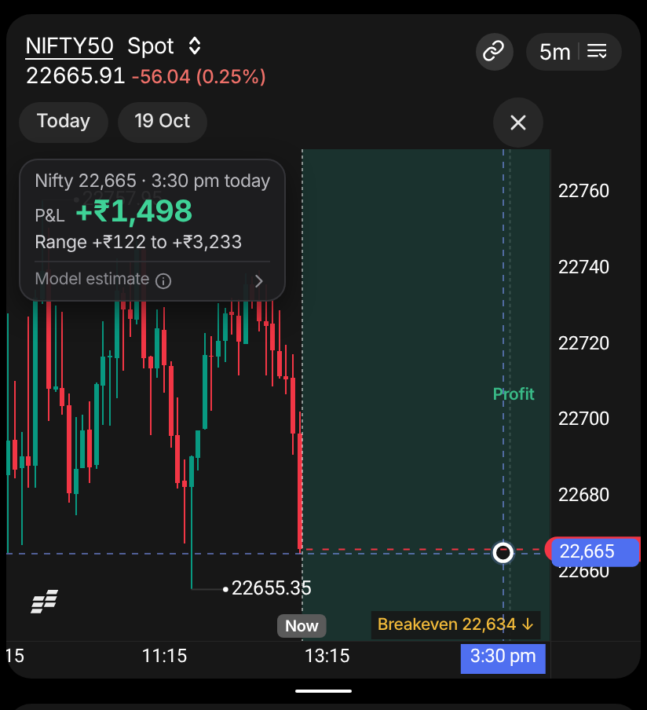
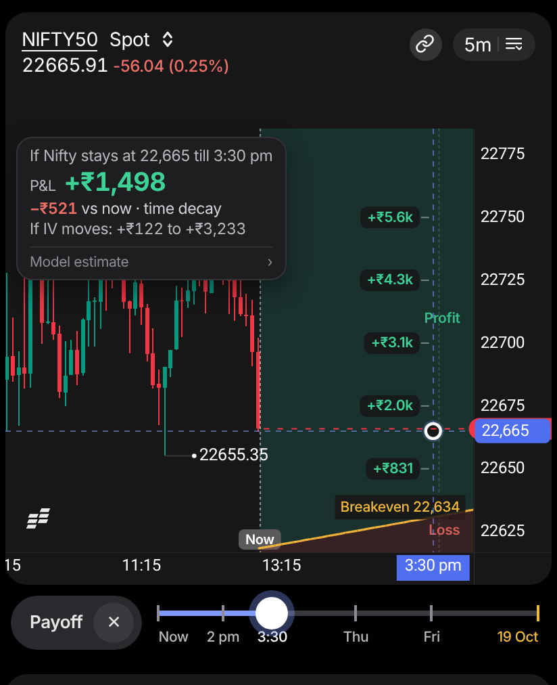
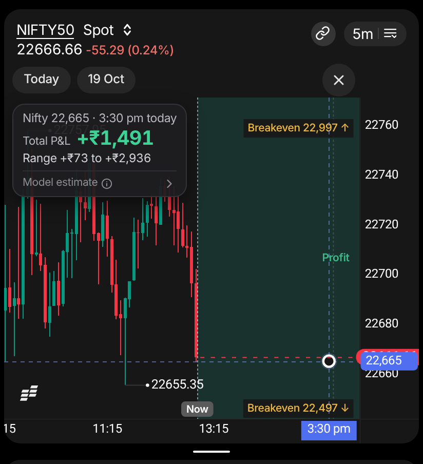
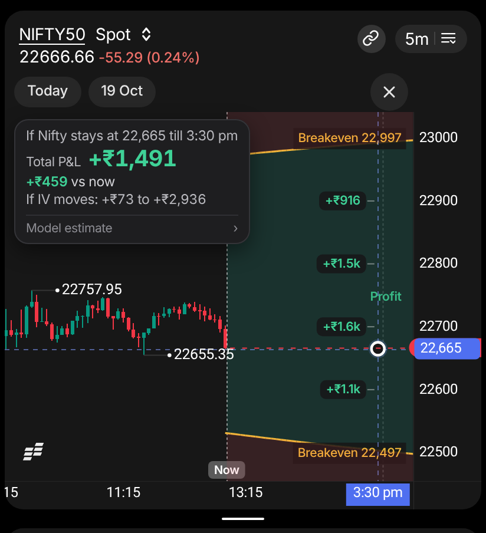

# Sahi Payoff (Mobile): UX research and suggestions
*Research note on Payoff for the mobile Option Scalper. It covers what measuring the prototype shows, what other trading apps and published research suggest, and what to change in PRD v1.0 before design and the usability test.*

**Version:** v1.1 · **Date:** 10 Nov 2026 · **Status:** Draft for review · **Owner:** Suhas

**Reviewed:** Payoff (Mobile) PRD v1.0 (`docs/sahi-payoff-mobile-prd.md`) and the prototype in `prototype/payoff-mobile/`, as merged in commit `8df01ce`.

> No trader has tested any of this yet; section 4 is the plan for that. The mock-up images were made by changing the prototype in the browser for a screenshot. None of the suggestions is built.
>
> v1.1 adds a review of the concept (section 6), what Payoff tells the holder of each kind of position (section 7), and four suggestions that follow from them (UX-18 to UX-21).

## Summary
- **The chart rarely shows where profit turns to loss when Payoff opens.** We tested 33 cases: 11 position sets at 9:30 am, 12:59 pm and 3:05 pm. A breakeven line was on screen in only 11 of them.
  - The 5-minute chart spans 130 to 224 Nifty points from top to bottom, but the nearest breakeven was about 30 to 420 points from the current level.
  - For an iron condor, the whole future zone is green, so it reads as "profit at every level" (F-01).
- **Placing the point accurately is hard with a thumb.** One 5-minute candle is 4.3 px wide. A thumb tap lands within about ±30 dp of where the trader aims, which is ±7 candles (35 minutes). To move from the default point to "Nifty +50 at 3:00 pm" takes a 26 × 121 px drag or 16 stepper taps (F-03).
- **Controls are hard to reach, and several are smaller than the PRD's own rules allow.** The horizon chips and close button sit 13% of the way down the screen. The chips are 26 px tall, against the PRD's 48 dp minimum. "Model estimate" is 10.5 px, the smallest text on screen (F-04).
- **The numbers have nothing to compare against.** The readout doesn't:
  - say the default point means "if Nifty stays here";
  - compare it with now (in the sample position, holding to 3:30 pm at the same level costs ₹521 of time decay);
  - say the range comes from changes in IV (F-05).
- **Other apps set price and time separately, and show amounts as well as zones.**
  - Robinhood, Dhan, moomoo, OptionStrat and Groww set the date with a slider, a row of dates or a drag along the time axis.
  - Indian payoff tools draw the P&L curve or a table. On tastytrade's phone app, which shows only profit and loss zones, a trader asked for "an actual P/L curve".
- **Payoff matters most where time moves fastest.** At the prototype's IV, an at-the-money call bought at 1:00 pm on expiry day needs Nifty up 20 points by 2:00 pm, and 42 by 3:00 pm, just to break even. A 50-point rise pays ₹1,743 a lot if it comes within 15 minutes and ₹439 if it takes two hours. Three sessions before expiry an hour's wait costs about ₹3 a unit, so there Payoff is mostly a quick calculator (section 7).
- **Payoff is the stronger half of the concept; the wheel is a fast way in for people who already know it.** Hold-and-slide is proven in pro tools and games and is new to trading apps. Its speed only pays for actions used many times a session, and nobody has measured that for chart settings (section 6).
- **What to do first (UX-01 to UX-05, UX-18 to UX-20):**
  - fit the breakevens into view and shade the loss side;
  - add plain-language anchors to the readout ("If Nifty stays…", "vs now", "If IV moves");
  - set time with a rail and the level by dragging;
  - move Payoff's controls into a strip between the charts that names the mode;
  - add a visible way into Payoff for traders who hold a position;
  - say what the position needs ("Needs Nifty above 22,677 by 3:30 pm") and the most it can lose;
  - open the point 30 minutes ahead for intraday and expiry-day positions.

## 1. Scope and method
| Method | What was done | Limits |
|---|---|---|
| Expert walkthrough | Ran the four usability tasks from PRD section 12, plus two more: "Is this iron condor in profit at every level?" and "What does waiting until 3:30 pm cost if Nifty doesn't move?". Also checked against Sahi's own targets (NFR-04) and common usability heuristics | One reviewer, no traders |
| Measurements | Ran the merged prototype in headless Chromium on four phone sizes: 412 × 915, 360 × 800, 390 × 844 and 430 × 932. Ran 11 position sets at 3 clock times. Measured the opening view, breakeven visibility, touch targets, text sizes, list fit and steps per task | The prototype is not the app. It uses one day of data (14 Oct 2026, Nifty about 22,665). 5-minute charts unless stated. The test scripts stayed in the session's scratch folder |
| Model illustrations | Worked out what each of the 11 sample position sets gains or loses with time and with a 50 or 100-point move, plus an expiry-day example, using the prototype's pricing engine | Black-Scholes on trading time, with IV held at today's level (about 13.6%). Expiry-day IV moves in real markets, so these show the shape of each position, not a forecast |
| Desk research | Reviewed 10 trading apps in India and the US; human-computer interaction (HCI) and data-visualisation studies; Android and iOS guidelines; SEBI's FY26 study and recent cost rules | The apps weren't opened. This session's network blocked most sites, so competitor details come from help pages and forums as returned by web search. Check them in the apps before quoting them |

## 2. Findings
### 2.1 Measured in the prototype
| # | Finding | Evidence | Why it matters |
|---|---|---|---|
| F-01 | Breakevens are usually off screen when Payoff opens | A breakeven was visible in 11 of 33 cases anywhere in view, and in 8 of 33 at the point's time. It was never visible (0 of 18) for: sold put, weekly plus monthly book, iron condor, calendar, futures plus put, intraday plus carry-forward. In the sample long call, the 3:30 pm breakeven (22,631) is 34 points below Nifty but 11 points below the bottom of the chart | The core job of a payoff view is showing where profit turns to loss. Today that needs a pan, a price-axis zoom, or reading an edge label. The iron condor's zone is all green |
| F-02 | Shading shows where you're in profit, not how much | Only the profit side is shaded, in one colour. To see the P&L at another level, the trader has to drag | "What if Nifty goes up 50 rather than down 50?" is the hold-or-exit question. It can't be answered at a glance |
| F-03 | Time is hard to set precisely, and how hard depends on the timeframe | On the 5m chart, the future zone is 130 px (38% of the pane) for 2.5 hours: 4.32 px per candle and 12 px per 5 index points. A thumb tap can land about ±30 dp from the aim (Parhi et al.), which is ±7 candles or ±12 points. "+50 at 3:00 pm" from the default point is a 26 px left, 121 px up drag, or 16 stepper taps. On 15m the zone is 43 px (13% of the pane). On 1m the session end is off screen, so the point opens at 2:07 pm | Time is the harder axis to place, and its precision depends on whichever timeframe the trader happened to have open |
| F-04 | Controls are out of reach, and targets and text are too small | **Reach:** horizon chips and the close button sit 13% down the screen; the readout's centre is 21% down. **Targets:** the chips are 57 × 26 px. Below 44 px: position chip (128 × 22), other-charts chip (144 × 22), Retry (26 px tall) and B1's close button (40 × 40). B1's steppers are 44 × 44 px: iOS size, but under Android's 48 dp. **Text:** "Model estimate" is 10.5 px; the "P&L" label, 11 px; the time line and range, 11.5 px | NFR-04 requires 48 dp targets. About half of observed phone use is one-handed (Hoober). The compliance label is the smallest text on screen |
| F-05 | The readout has nothing to compare against | In the sample long call, P&L now is +₹2,018 and at 3:30 pm at the same level is +₹1,498. The readout shows only the second. "Range +₹122 to +₹3,233" doesn't say it is what happens if IV moves. In S3, the sample book's range ends at its own value (+₹12,242 to +₹12,403) | The cost of waiting is the problem the PRD sets out to solve (section 1), yet the trader has to subtract two numbers shown in different places |
| F-06 | S2 doesn't name the mode | The Payoff bar shows "Today", "19 Oct" and ×; the word Payoff appears nowhere on S2. Two × buttons are on screen, and the top-left one closes the Scalper | The trader may not notice the chart is in a special mode, or may close the wrong thing |
| F-07 | S2 shows the same P&L twice | The readout and the option chart's 220 × 83 px point card both lead with the same P&L | That space on the option chart could show what the option itself will be worth |
| F-08 | S3 hides the option chart | The Payoff list replaces the option chart, so the order panel, which opens from it, can't be reached. On a 360 × 800 phone the iron condor list shows 2 of its 4 legs before scrolling (3 of 4 on 412 × 915) | Scalpers holding two or more positions lose the surface they trade from |
| F-09 | The way in is hidden | Payoff opens in one of two ways: hold the 61 × 24 px timeframe button and slide to slot 7, or tap three times (chart menu, Quick actions, Payoff). Until then, nothing on the Scalper shows Payoff exists | A hold gesture is a hidden affordance, and people skip tips (2.3) |
| F-10 | Chart labels show through the readout | The day-high label is readable through the readout's 94%-opaque background | Minor polish |

**What already works and should stay:**
- B1 has no scrim, so the chart stays live while the trader steps the point.
- The readout is docked away from the finger, with level and time tags on the axes.
- The point has a 52 px target and an 8 dp slop.
- Haptics at breakevens and expiries are neutral: they inform without celebrating.
- There is no buy button, and every value says "Model estimate".
- The default point is the session end at the current level, which is the flat case.
- The option chart's premium marker has a range bar and an "If Nifty stays at…" line.
- Status banners grey out values when prices are stale.

### 2.2 How other apps do it
| App | How P&L at a price and time works | What to borrow |
|---|---|---|
| Robinhood: Simulated returns (US, UK) | A price slider or dial sits under the chart, and the trader drags along the chart to change time (the US and UK help pages word this differently). Pre-trade simulation is on the mobile app only. Index options are priced with Black-Scholes. Labelled as possible returns, not actual returns | Separate controls for price and time; pre-trade on the phone |
| Dhan: payoff graphs and Position Analyser (Options Trader app, and the Dhan app's Positions tab) | Three lines: P&L at expiry, today and on a target date. Sliders below the chart set the target price and date. Super Order target and stop lines can be dragged on Dhan's TradingView charts | The three lines; sliders below the chart |
| Sensibull (in Kite) | A payoff chart and a payoff table by price, for a chosen target date. Shows 1 SD and 2 SD ranges, fixed or for the target date. Traders on TradingQnA have called the target-date curve wrong | The table; market-implied context; managing trust in estimates |
| Groww: Advance Payoff, charts | A row of dates under the payoff chart picks the target date. Stop and target lines can be dragged on the contract chart | Dates as stops on one control |
| moomoo: Options P/L curve | Sliders below the chart set the date and IV. The current P/L curve merges into the expiry curve as expiry nears. (From the tutorial; the phone layout isn't confirmed) | Shows IV as a cause |
| tastytrade (mobile) | Curve mode on mobile shows profit and loss zones. A trader wrote that the iPhone curve view shows the zones, but "an actual p/l curve would be even better" | Zones alone aren't enough |
| OptionStrat | A table of P&L by price and date, with a slider for days until expiration. Values in money or percent | A price-by-time table |
| Fyers: Positions P&L curve | Plots intraday P&L against a zero line: green above, red below. Shows max drawdown, plus daily rupee target and stop lines (Smart Exit) | Loss shaded as clearly as profit; exits in rupees |
| Upstox: Options Strategy Builder (Android) | Payoff graphs, breakeven, risk-reward and probability of success | Nothing beyond what others do |
| Sahi: Options Strategy Builder and Option Scalper | The Strategy Builder simulates multi-leg strategies with payoff graphs and probability of profit. The Scalper sets stop loss and take profit from the chart | One pricing model across both, with links between them |

**Patterns across these apps:**
1. **Time has its own one-dimensional control:** a slider, a row of dates or a drag along the time axis. Price is read off the chart or set separately. None asks for a 2-D tap on a small chart.
2. **Most show the amount** as a curve or a table, not only where profit is.
3. **Uncertainty has a stated cause:** IV sliders (moomoo), SD ranges (Sensibull) or a probability (Sahi's Strategy Builder, Upstox). PRD v1.0's "Range" is the only one that doesn't say what drives it.
4. **Stops and targets are dragged on the chart** (Groww, Dhan), which matches Payoff's Later release.

### 2.3 What research and regulation say
| Topic | Finding | What it means for Payoff |
|---|---|---|
| Touch precision | Targets of about 9–10 mm (around 60 dp) are needed for reliable one-handed thumb use (Parhi, Karlson and Bederson, 2006) | A 4.3 px candle can't be tapped; any tap in the zone is a rough placement |
| Occlusion | Showing the area under the finger in a callout cut errors on small targets (Vogel and Baudisch, 2007, Shift) | Keep the docked readout. Consider relative drag so the point sits beside the finger, not under it |
| Grip | 49% of observed phone users held and used the phone with one hand, 67% of them with the right thumb; 36% cradled it (Hoober, 2013) | Controls 13% down from the top are a stretch for about half of users |
| Fine scrubbing | iOS media sliders slow down as the finger moves away from the track: hi-speed, half, quarter and fine | Use variable-speed scrubbing on a time rail |
| Marking menus | Novices use the visible menu; experts move to the gesture, and fall back to the menu when unsure (Kurtenbach and Buxton, 1994) | The wheel is the experts' path; discovery needs a visible one |
| Tutorials | Users who read app tutorials did no better than those who skipped them (91% vs 94% task success), and rated the tasks harder (NN/g) | Teach in place rather than relying on the N1 tip |
| Hidden gestures | Long-press is the textbook hidden affordance. GhostUI (2026) catalogued 1,970 hidden interactions in 81 popular apps | Same as above |
| Uncertainty on phones | Quantile dotplots helped people judge probabilities on a phone (Kay et al., 2016) and make better decisions (Fernandes et al., 2018) | If a likelihood is ever shown (UX-13), use countable displays |
| Scenario numbers | Under the EU's PRIIPs rules, readers took the "moderate" scenario as the most likely one. Scenarios without probabilities can mislead, and very wide ranges lose meaning | Name the range's cause, and don't present what-if rows as likely outcomes |
| Haptics | Less is more. Prefer clear, crisp effects to buzzy ones, and use the system's effects consistently (Android) | Keep BR-31; add detents only at meaningful stops |
| Accessible charts | Audio Graphs let VoiceOver users hear a chart (iOS) | UX-15 |
| Losses and costs | **SEBI FY26 study.** 82.1% of individual F&O traders lost money before costs and 87.7% after. Costs were about ₹25,000 crore, and 35% of loss-makers' gross losses. About 92% of losses came from options. About 89% of traders under 30 lost money. About two-thirds of traders are from beyond the top 30 cities | Make loss as visible as profit, consider showing charges (UX-10), and keep the wording plain (UX-16) |
| Charges | STT on option sales rose to 0.15% of premium from 1 Apr 2026. Sahi charges ₹10 per F&O order. Standard payoff charts leave charges out | For one lot bought at ₹208.80 and sold at ₹231.84, charges are about ₹58 (UX-10) |
| Gamification | Robinhood removed its confetti in March 2021, after Massachusetts regulators cited it as gamification | Keep feedback neutral, as BR-31 does |

## 3. Suggestions
| ID | Suggestion | Fixes | Impact | Effort | When |
|---|---|---|---|---|---|
| UX-01 | Fit the breakevens into view; shade the loss side | F-01, F-02 | High | S–M | Now |
| UX-02 | Add anchors to the readout: "If Nifty stays…", "vs now", "If IV moves" | F-05 | High | S | Now |
| UX-03 | Set time with a rail; drag the point to set the level | F-03 | High | M | Now, as a test variant |
| UX-04 | A Payoff strip between the charts; 48 dp targets; larger text | F-04, F-06 | Medium–high | M | Now |
| UX-05 | A visible way in for traders who hold a position | F-09 | Medium–high | S–M | Now |
| UX-06 | P&L ruler along the point's time | F-02 | High | M | Next |
| UX-07 | Type a level, time presets, magnetic stops | F-03 | Medium | M | Next |
| UX-08 | What-if table in B1 | F-02 | Medium | S–M | Next |
| UX-09 | Keep the option chart one tap away in S3 | F-08 | Medium | M | Next |
| UX-10 | Show charges | Costs (2.3) | Medium | M | Next |
| UX-11 | One pricing model with the Strategy Builder, linked | Trust | Medium | S–M | Next |
| UX-12 | Teach in place on first use | F-09 | Medium | S | Next |
| UX-13 | Market-implied move band, optional | F-02 | Unknown | M | Later, needs a product and compliance decision |
| UX-14 | Alert at this level | Goal 2 | Medium | M | Later |
| UX-15 | Audio graph and TalkBack summary | NFR-04 | Medium | M | Later |
| UX-16 | Hindi and other languages | 2.3 | Medium | M–L | Later |
| UX-17 | Tidy S2: one P&L, opaque readout | F-07, F-10 | Low | S | Now |
| UX-18 | Say what the position needs: breakeven as a distance and a deadline | Section 7 | High | S | Now |
| UX-19 | Open the point at the trader's horizon | Section 7 | Medium–high | S | Now, as a test variant |
| UX-20 | Show the most the position can lose | Section 7 | Medium | S | Now |
| UX-21 | Compare two strikes before buying | Section 7 | Unknown | M | Later, needs a product and compliance decision |

**Mock-ups of the first suggestions.** The mock-up applies UX-01, UX-02 and UX-06 to the same moment as "now", 12:59 pm on Wed 14 Oct with Nifty at 22,665. The one-position mock-up also shows the UX-03 and UX-04 strip. The first-run hint is hidden in both.

| One position (bought 19 Oct 22500 CE), now | Mock-up |
|---|---|
|  |  |

| Iron condor, now | Mock-up |
|---|---|
|  |  |

### UX-01 Fit the breakevens into view, and shade the loss side
- **Change:**
  - **When to fit:** when Payoff opens, and when the point's time moves by a chip or the rail.
  - **How far:** widen the index chart's price scale to show the nearest breakeven above and below the current level at the point's time, plus 10% padding.
  - **Cap:** stop widening once the day's candles would take less than 40% of the pane's height (Assumption).
  - **Beyond the cap:** keep the edge label ("Breakeven 22,997 ↑") and add the distance ("+332 pts"). Make the label a 48 dp button that fits the scale.
  - **Loss shading:** shade the loss side too, lighter than the profit side (about 10% red), and keep the words "Profit" and "Loss" in the zone so colour is never the only cue.
  - **On close:** restore the price scale, as BR-24 restores the time axis.
- **Why:** F-01, where 22 of 33 opening views showed no breakeven and the iron condor read as all profit. Fyers shades both sides of its P&L curve, and every payoff tool reviewed shows where losses start.
- **Trade-off:** candles get flatter. The iron condor's fitted scale spans 586 points instead of 130. The cap and the edge-label button handle this.
- **PRD:**
  - BR-24: add a price-scale rule and the restore.
  - BR-07: shade both sides.
  - BR-26 and BR-35: edge label as a button with a distance.
  - S2 and S3 components, and NFR-04.
- **Check:** ask "Where does this position start losing at 3:00 pm?" and "Is this iron condor in profit at every level?", and count answers given without panning.

### UX-02 Add anchors to the readout
- **Change:** three wording changes to the readout, the point card, B1 and the S3 footer, plus a pre-trade variant.
  - **Say what the point means.**
    - At the current level: "If Nifty stays at 22,665 till 3:30 pm".
    - Anywhere else: "If Nifty is at 22,715 at 3:00 pm".
    - This replaces "Nifty 22,665 · 3:30 pm today".
  - **Add the change from now under the P&L.**
    - At the current level: "−₹521 vs now · time decay".
    - At another level, B1 splits it into move and time. Sample long call, Nifty +50 by 3:00 pm: P&L is +₹3,923 (+₹1,905 vs now), of which +₹2,276 is from the move and −₹371 from time.
    - For a seller the sign flips: the iron condor gains +₹459 by 3:30 pm if Nifty stays.
  - **Name the cause of the range:** "If IV moves: +₹122 to +₹3,233". When the range ends at the value itself, say "If IV moves: down to +₹12,242".
  - **Pre-trade:** "If you buy now at ₹240.10" replaces "vs now".
- **Why:**
  - F-05. The PRD's problem statement is that traders can't see time decay, and today they have to subtract the top bar's P&L from the readout's.
  - PRIIPs research found that scenario numbers shown without their cause get misread.
- **PRD:**
  - FR-08 and BR-30: readout content.
  - BR-10 and BR-11: wording.
  - S2, S3 and B1 wording.
  - Compliance wording: Open item 12.
- **Check:** "What does waiting until 3:30 pm cost if Nifty stays here?", timed and checked for correctness, with and without the "vs now" line.

### UX-03 Set time with a rail; drag the point to set the level
- **Change:**
  - **The rail:** a slider from Now to the axis end.
    - Today's remaining session takes about a third of its width; each later session gets an equal share.
    - It stops at every hour, at 3:20 pm when any position is intraday, at 3:30 pm, at each session end and at each expiry held. Each stop gives a selection haptic.
    - Holding and sliding the thumb away from the rail slows it for fine moves.
    - The horizon chips become labelled stops on the rail.
  - **On the chart:**
    - Dragging the point moves only its level.
    - A tap in the zone still moves both level and time, as a rough jump.
    - B1 keeps the steppers.
  - **Moving the rail** scrolls the charts so the point stays in view. The point keeps its time when the trader changes timeframe.
- **Why:**
  - F-03: the time axis gives 4.3 px per 5-minute candle and changes with the timeframe, and a 2-D drag mixes the errors on both axes.
  - Robinhood, Dhan, moomoo, OptionStrat and Groww all set time with its own control.
  - Parhi et al. and iOS scrubbing support a large, one-dimensional control that can be slowed down.
- **Risk:** it adds a control, and dragging the point no longer moves time. Test it against today's 2-D drag before choosing (section 4).
- **PRD:**
  - FR-09, FR-14, BR-16, BR-25, BR-28 and BR-29.
  - The section 1.4 row for horizon chips.
  - A new shared component in section 7.

### UX-04 Put Payoff's controls in a strip between the charts
- **Change:**
  - **The strip:** replace the Payoff bar at the top of the index chart with a strip in the gap between the two charts, about halfway down the screen. It holds:
    - a "Payoff ✕" pill that names the mode and closes it;
    - the time rail (UX-03).
  - **Space:** this frees the 34 px bar at the top for the chart.
  - **Targets:** make every Payoff target 48 dp: chips, position chip, other-charts chip, Retry, B1's close button and the steppers. Use invisible padding where the visible shape must stay small.
  - **Text:** at 100% text size, secondary text at least 12 px and the model label at least 11 px. BR-35 still covers larger text sizes.
- **Why:**
  - F-04 and F-06, with Hoober's grip data and NFR-04.
  - The strip also shows that the point's time applies to both charts.
- **PRD:**
  - S2 and S3 layout.
  - BR-23: close from the strip.
  - BR-30: the readout docks under the legend once the bar is gone.
  - BR-35, NFR-04 and section 7.

### UX-05 A visible way in
- **Change:**
  - **Where it shows:** when the trader holds an option or futures position on the charted index, show "Payoff" on the option chart's position pill ("Bought 65 at ₹208.80 · Payoff ›"), or as an icon button in the index chart header next to the timeframe button.
  - **Existing routes stay:** slot 7 of the wheel stays the fast route and Quick actions the list route.
  - **The tip:** point N1 at the visible control rather than the timeframe button.
- **Why:**
  - F-09. The marking-menu research shows people learn a gesture after using a visible route.
  - It also settles Open item 7: a direct entry if the wheel ships late.
- **Risk:** compliance may see a prompt next to a position as a nudge. It opens a read-only view, adds no order button, and shows only for positions already held.
- **PRD:** FR-01, FR-02, FR-04, S1, N1, BR-23 and Open item 7. Add "share of opens by route" to section 1.1.

### UX-06 P&L ruler along the point's time
- **Change:**
  - **The ruler:** along the dashed line through the point, show the P&L at round levels: every 25, 50 or 100 points, depending on zoom. For the sample long call that reads +₹5.6k, +₹4.3k, +₹3.1k, +₹2.0k and +₹831 above the breakeven.
  - **Collisions:** hide labels near a breakeven label or the point.
  - **Alternative to test:** a sideways P&L curve along the price axis, drawn like a volume profile.
- **Why:**
  - F-02 and tastytrade's zones-only phone view. The Indian tools reviewed all show amounts.
  - The trader can compare levels without dragging.
- **PRD:** FR-07, the S2 and S3 components, and BR-35 (drop the ruler first on 360 dp phones and at 200% text).
- **Check:** the premium-guessing test from goal 1.

### UX-07 Fine control without sixteen taps
- **Change:**
  - **In B1:**
    - Tap the level to type it on a numeric keypad; it snaps to 5 points.
    - Quick steps of ±25, ±50 and ±100.
    - Time presets: "In 15 min", "In 1 hr", "3:00 pm", "Close" and each expiry.
  - **On the chart:**
    - Magnetic stops at strikes held, breakevens, round 50s and 100s, the day's high and low, and the current level. A light haptic plays as the point snaps; BR-31's limit of one every 50 ms still applies.
    - Relative drag: once a drag starts, the point follows the finger's movement instead of jumping under it.
- **Why:** F-03. "+50 at 3:00 pm" takes 16 taps today. With a typed level and a preset it takes two: type 22,715 and tap "3:00 pm".
- **PRD:** B1, BR-16, BR-29 and BR-31.

### UX-08 A what-if table in B1
- **Change:** under the point's values in B1, add a small table:
  - **Rows:** P&L at −100, −50, 0, +50 and +100 index points.
  - **Columns:** the point's time, the close and the first expiry.
  - **Rules:** mark the current level. Use the same model and IV rule, colour by sign only, and show no probabilities.

  Sample long call at 12:59 pm, Nifty 22,665:

  | Nifty at | 3:00 pm today | 3:30 pm today | Expiry, Mon 19 Oct |
  |---|---|---|---|
  | 22,565 (−100) | −₹2,530 | −₹2,642 | −₹9,347 |
  | 22,615 (−50) | −₹555 | −₹663 | −₹6,097 |
  | 22,665 (now) | +₹1,600 | +₹1,498 | −₹2,847 |
  | 22,715 (+50) | +₹3,923 | +₹3,829 | +₹403 |
  | 22,765 (+100) | +₹6,400 | +₹6,316 | +₹3,653 |

- **Why:**
  - Sensibull's and OptionStrat's tables answer "what if it goes the other way?" without moving the point.
  - The expiry column shows the decay the PRD is about: at today's level, the position loses ₹2,847 by expiry.
  - Following the PRIIPs findings, don't label rows favourable or unfavourable, or suggest they are likely.
- **PRD:** B1 components; BR-35 (on 360 dp phones and at 200% text, the table drops to one column).

### UX-09 Keep the option chart one tap away in S3
- **Change:**
  - **Bottom card:** add a "List | Chart" switch to its header, defaulting to List. In Chart, the option chart shows with its position pill, and the order panel works as in S2.
  - **Alternative:** let the list collapse to its total row (about 56 dp) with the option chart behind it.
  - **Leg tags:** show a status tag only when a leg isn't live, instead of "Live" on every leg.
- **Why:** F-08. The scalper persona trades from the option chart.
- **PRD:** S3, FR-12, FR-28, BR-32 and BR-36.

### UX-10 Show charges
- **Change:**
  - **In B1 and the S3 footer:** add "After charges ≈ +₹1,440": the estimated brokerage, STT, exchange charges, SEBI fee, stamp duty and GST for closing at the point.
  - **Realised today:** show it after today's charges.
  - **Breakevens:** keep them before charges by default, with a setting to include them (BR-07, Open item 29).
- **Example:** one lot (65) bought at ₹208.80 and sold at the point's ₹231.84. The exchange rate assumed is 0.0350% of premium; check every rate against the current schedule before build.

  | Charge | Amount |
  |---|---|
  | Brokerage (₹10 × 2 orders) | ₹20.00 |
  | STT | ₹22.60 |
  | Exchange charges | about ₹10.03 |
  | GST | ₹5.41 |
  | Stamp duty | ₹0.41 |
  | SEBI fee | ₹0.03 |
  | **Total** | **about ₹58** |

  - That is ₹0.90 a unit, which moves this breakeven by 1 to 2 Nifty points.
  - It is small per trade, but a scalper doing 20 round trips a day pays about ₹1,170.
- **Why:** in SEBI's FY26 study, costs turned many gross winners into net losers (82.1% losing before costs, 87.7% after), and standard payoff charts leave charges out.
- **PRD:** BR-07, FR-19, B1 and S3. Adds a dependency on a charges service.

### UX-11 One pricing model with the Strategy Builder, linked
- **Change:**
  - **Same model:** use the same pricing model and IV inputs as Sahi's Options Strategy Builder, or move both onto one pricing service.
  - **Link:** add "Open in Strategy Builder" to B1 and the S3 list header, for Greeks and deeper analysis.
- **Why:**
  - Sahi's Strategy Builder already shows payoff graphs and probability of profit.
  - Traders noticed when Sensibull's app and website disagreed (PRD references). Two Sahi numbers for the same position would undermine goal 8.
- **PRD:** BR-08 ("the same model as desktop and the Strategy Builder"), B1, S3 and the dependencies in section 1.3.

### UX-12 Teach in place
- **Change:**
  - **First open:** play a 3-second demo in the chart. The point slides from Now to the session end while the breakeven line rises, with one line: "Above the line you're in profit. It moves as time passes."
  - **The rail:** nudge the rail's thumb once to show it moves.
  - **The text hint:** drop the long hint over the zone, which covers the area it describes.
- **Why:** F-09, and NN/g's finding that tutorials don't help.
- **PRD:** Flow 5, N1 and the S2 hint wording.

### UX-13 (Later) A market-implied move band
- **Change:**
  - **What it shows:** an optional, off-by-default faint band at the point's time, showing the ±1 standard-deviation move implied by current IV.
  - **Label:** "Option prices imply ±N points by 3:30 pm. Not a forecast."
  - **Format:** if it's shown, prefer counts ("about 2 in 3 days stay inside") over percentages (Kay et al.).
- **Why:**
  - It would temper hopes of "+300 by 3 pm", which ties to the guardrail on far out-of-the-money expiry-day buys.
  - Sensibull shows SD ranges for a target date, and Sahi's own Strategy Builder already shows probability of profit.
- **Risk:** it can read as a forecast, which conflicts with the PRD's non-goal "forecasting where the index will go". It needs a product and compliance decision before any design.

### UX-14 (Later) Alert at this level
- **Change:**
  - **The alert:** in B1, "Alert me if Nifty reaches 22,715"; with several positions, "Alert me if total P&L reaches −₹X". Use Sahi's alerts if they exist.
  - **Why first:** it gives a planned exit without a new order type, so it can ship before the Later release's target, stop and timed exit.
- **Why:** goal 2 (planned exits). Fyers' Smart Exit draws rupee targets and stops on its P&L curve.
- **PRD:** B1 (MVP if alerts exist), and the order of FR-31 and FR-32.

### UX-15 (Later) Hear the chart
- **Change:**
  - **iOS:** an Audio Graph of P&L across levels at the point's time.
  - **Android:** a TalkBack summary, for example "At 3:30 pm: breakeven 22,631, profit above it, +₹1,498 at 22,665".
  - **Motion:** follow Reduce motion for the opening scroll and the UX-12 demo.
- **Why:** Apple's Audio Graphs. NFR-04 already makes the point adjustable.

### UX-16 (Later) Languages
- **Change:** if Sahi adds app languages, translate Payoff's wording into Hindi first. Numbers and ₹ formatting stay as they are.
- **Why:** in SEBI's FY26 study, about two-thirds of derivatives traders were from beyond the top 30 cities.

### UX-17 (Now, polish) Tidy S2
- **Point card:** have the option chart's point card lead with the premium ("₹231.84 at 3:30 pm · if IV moves ₹210.67 to ₹258.53") instead of repeating the P&L (F-07).
- **Readout background:** make it opaque so chart labels don't show through (F-10).
- **Close buttons:** with UX-04, the strip's pill is the only Payoff close button, so the Scalper's × is the only other one on screen (F-06).

### UX-18 Say what the position needs
- **Change:**
  - **Breakeven labels:** add the distance from the current level: "Breakeven 22,631 · 34 below".
  - **Readout:** when the P&L at the point is a loss, or before a buy, add the level needed at the point's time: "Needs Nifty above 22,677 by 3:30 pm (+12)". For a put it says "below".
  - **Sellers:** the same line reads as room: "In profit above 22,374 at 3:30 pm · 291 away".
- **Why:**
  - Section 7: the number that differs most between positions is how far Nifty must move, and by when. The sample call needs +12 by the close and +75 by expiry. The expiry-day call 100 points away needs +37 by 2:00 pm and +83 by 3:00 pm.
  - Buyers ask "how many points do I need?". Today they subtract the breakeven label from the current level themselves.
- **PRD:** FR-07 (labels), BR-30 (readout), S2 and S3 wording, and compliance wording (Open item 12).
- **Check:** "How many points does this need by 2:00 pm to break even?", timed.

### UX-19 Open the point at the trader's horizon
- **Change:**
  - **Default time:** when every position is intraday or expires today, open the point 30 minutes ahead (Assumption), snapped to the candle. Otherwise open it at the session end, as now.
  - **Other horizons:** with the rail (UX-03), the close and each expiry stay one tap away.
- **Why:**
  - 59% of individuals' index-option turnover is in contracts expiring that day (SEBI FY26), and scalpers hold for minutes.
  - At 3:30 pm on expiry day the readout can only say what the option is worth at expiry. That is a fair warning for a position held in hope, but it doesn't answer "what if I give this 20 more minutes?".
  - In the expiry-day example (7.1), 15 minutes costs ₹2.49 a unit and an hour costs ₹10.94. Those are the numbers a scalper acts on.
- **Risk:** the session-end default is the stronger warning against holding to expiry. Test both defaults (section 4).
- **PRD:** BR-28 (default point) and BR-24 (opening view).

### UX-20 Show the most the position can lose
- **Change:**
  - **Bought options (S2 and B1):** "Most you can lose: ₹13,572, the premium paid."
  - **Sold options and futures:** "Loss isn't capped", with the level where the loss starts at expiry ("below 22,285").
  - **Defined-risk books:** FR-24 already gives max profit and max loss in S3; show them in the first line of the list's footer.
- **Why:**
  - It is the simplest risk number there is, and section 7 shows how much it differs: ₹6,809 for the bought put, ₹12,142 for the iron condor, uncapped for the sold put.
  - A cheap expiry-day option looks like a small ticket. The rupee figure for the whole lot, next to what it needs, says what is at stake.
- **PRD:** FR-24 (extend to S2 and B1), S2 and B1.

### UX-21 (Later) Compare two strikes before buying
- **Change:** before a buy, B1 offers "Compare with 22600 CE", the next strike out. It shows two columns for the same point: the cost of one lot, the P&L at the point, the level needed at the point's time, and the P&L at expiry. Nothing is ranked or highlighted.
- **Why:** the expiry-day example (7.1). The call 100 points away costs less than a third as much, but a 50-point rise by 3:00 pm pays +₹439 on the at-the-money call and loses ₹598 on the cheaper one. This is the guardrail in PRD 1.1: far out-of-the-money buys on expiry day.
- **Risk:** a comparison can read as a recommendation, which BR-19 rules out. It needs a product and compliance decision.
- **PRD:** B1 (pre-trade), BR-14 and BR-19.

## 4. How to check these with traders
**Usability test** (launch criterion 5):
- **Variants:** A is PRD v1.0 as built; B adds UX-01 to UX-06 and UX-18. Within B, half the participants get the point 30 minutes ahead on expiry-day tasks (UX-19).
- **Gaming:** note whether each participant plays mobile games, and compare how fast the two groups learn the wheel (6.5).
- **Participants:** 8 to 10 expiry-day buyers and 4 sellers, using their own phones one-handed, with the variant order counterbalanced.
- **After each task:** ask the Single Ease Question (SEQ, a 1 to 7 ease rating) and a 1 to 7 confidence rating.

| Task | Measure | Pass bar (Assumption) |
|---|---|---|
| Find the P&L at 3:00 pm if Nifty rises 50 points | Time, accuracy (within 5 points and 1 candle), taps | 80% within 30 s |
| Where does the position start losing at 1:00 pm? | Correct within 10 points; whether panning was needed | 80% without panning |
| Is this iron condor in profit at every level? | Correct yes or no | 90% |
| What does waiting until 3:30 pm cost if Nifty stays here? | Correct within ₹50 | 80% |
| How many points does this position need by 2:00 pm to break even? | Correct within 5 points; time | 80% within 20 s |
| Would you hold or exit at 1:30 pm? (think aloud) | Whether the reasons mention time decay and levels | Qualitative |
| First visit, holding a position, no hints: find Payoff | Found within 60 s; which route | 70% |
| Guess the option's premium at a level and time (goal 1) | Error, with and without Payoff | Set from the baseline |

**Quick unmoderated check for UX-05:** a first-click test on a Scalper screen with a held position: "Where would you see what your option is worth at 3 pm?"

**Beta events to add** (no prices in the payload):
- whether a breakeven was on screen at open;
- the route in (wheel, Quick actions or the visible control);
- how the point was moved (rail, drag, tap, stepper or typed level);
- time to the first point move.

**Prototype:** a `?ux=b` switch would let both variants run from one link in the test.

## 5. PRD changes if accepted
| PRD item | Change | From |
|---|---|---|
| 1.4 | Horizon chips become a time rail, and the Payoff bar becomes a strip between the charts | UX-03, UX-04 |
| 1.1 | Add metrics: share of opens by route; share of opens with a breakeven on screen | UX-05, UX-01 |
| FR-01, FR-02, FR-04, N1 | Add the visible way in on the position pill; N1 points at it | UX-05 |
| FR-07, BR-07 | Shade the loss side; add the P&L ruler | UX-01, UX-06 |
| FR-08, BR-30 | Readout wording: "If Nifty stays…", "vs now", "If IV moves" | UX-02 |
| FR-09, BR-16, BR-29 | Dragging the point sets the level; time comes from the rail; magnetic stops; relative drag | UX-03, UX-07 |
| FR-14 | Chips become stops on the rail | UX-03 |
| BR-24 | Fit the breakevens into the price scale, with a cap, and restore it on close | UX-01 |
| BR-35, NFR-04 | 48 dp targets everywhere; minimum text sizes | UX-04 |
| B1 | Typed level, time presets, what-if table, "after charges", alert | UX-07, UX-08, UX-10, UX-14 |
| S3, BR-36 | "List \| Chart" switch, so the order panel stays reachable | UX-09 |
| BR-08 | The same model as desktop and the Strategy Builder | UX-11 |
| FR-07, BR-30 | Breakeven labels carry a distance; the readout says what the position needs | UX-18 |
| BR-28 | The point opens 30 minutes ahead for intraday and expiring-today positions | UX-19 |
| FR-24 | The most a single position can lose, in S2 and B1 | UX-20 |
| Section 13 | New open items: the fit cap (40%), the rail layout, the set of magnetic stops, the charges rates, whether alerts exist, the default horizon (30 minutes), and the decisions on the implied-move band and on comparing strikes | All |

## 6. Review of the concept
*The concept has two parts: the Quick Action Wheel, which is the way in, and Payoff mode. This section gives a view on the interaction, how new it is, whether traders need it, what it could change, and the reasoning that quick-action menus from pro tools and games suit traders.*

### 6.1 The interaction
| Part | What works | What doesn't yet |
|---|---|---|
| **Quick Action Wheel:** hold the timeframe pill, slide, release | One continuous gesture, so eyes stay on the chart. Novices wait and read; experts flick in a remembered direction. Sliding back cancels. It takes no existing chart gesture, and it changes chart settings only, never an order | Nothing on screen shows it exists (F-09). The index chart's pill is about 128 mm from where a right thumb pivots, and the quarter fan's targets are 6.6 mm (placement PRD v1.1). Its speed only pays for actions used many times a session, and that hasn't been measured |
| **Payoff mode** | P&L sits on the price axis the trader already reads, so there is no second diagram to translate. Time is on the chart: the breakeven line moves as time passes, which shows time decay without a number. It prices the trader's own positions, and it adds no buy button | Breakevens are off screen in 22 of 33 opening views (F-01). The point is hard to place (F-03). The numbers have nothing to compare against (F-05). It opens at the session end, further ahead than a scalper looks (UX-19) |

**View:** Payoff is the stronger half. The wheel is a good fast route for people who already know it and a poor only route for people who don't (UX-05).

### 6.2 Is it new?
- **The wheel's technique is old and proven; in trading apps it is new.**
  - In the 1988 study, pie menus were about 15% faster than lists. In field use, experts' marks were about 3.5 times faster than picking from the menu (placement PRD, section 3).
  - Autodesk's Maya and Fusion 360 use marking menus, and games use weapon and emote wheels.
  - Of the 18 trading apps reviewed for the placement PRD, none opens a menu with hold-and-slide. MetaTrader 5's radial chart menu, opened by a tap, is the closest.
- **Payoff's parts exist; the combination wasn't found anywhere.**
  - A TradingView community script, Options Price Mapper, marks expiry breakevens on the price chart.
  - tastytrade shows profit and loss zones. OptionStrat has a price-by-date table. Robinhood's Simulated returns has a time drag and a price slider on its own chart.
  - No tool found draws the breakeven as it moves over time on the live chart, for the trader's own positions, with a point to ask "what if". The search was limited (section 1), so this means "not found", not "doesn't exist".
- **Being new has a cost.** No trader arrives knowing what a future zone is, so the first minute has to teach it (UX-12).

### 6.3 Do traders need it?
**Evidence that they do:**
- **Buyers are confused by exactly this.** TradingQnA has threads titled "Why does the Nifty sometimes go up while, at the same time, the price of call options is decreasing?" and "Call options declining even when the market was gaining". A broker's explainer says beginners often get confused when a premium falls as the price rises.
- **Individuals trade where time decay is fastest.** 59% of their index-option turnover is in contracts expiring that day, and about 97% within seven days of expiry (SEBI FY26).
- **Most lose.** 87.7% of individual F&O traders lost money after costs in FY26.
- **Traders ask for payoff on the phone.** A Kite user asked for the payoff table in the mobile app, and Dhan built its Position Analyser into its apps.

**Limits:**
- **The need is concentrated.**
  - Three sessions before expiry, an at-the-money call loses about ₹3 a unit in an hour, and a 50-point move is worth about ₹23. Payoff is a quick calculator there.
  - On expiry day at 1:00 pm, the same hour costs ₹10.94, 23% of the premium, and timing matters as much as direction (7.1).
  - So Payoff earns its place on expiry day, on holds longer than about 15 minutes, on losing positions, for sellers and multi-leg books, and before a buy.
- **It is needed more than it is wanted.** Traders ask "why did I lose?"; they don't ask for a time-decay view. It will be used only if it is one visible tap away at the moment of decision (UX-05).
- **The wheel's need is unproven.** It depends on how often traders change timeframe and indicators in a session. Sahi's analytics can answer that before anything is built: taps on the timeframe pill, and indicator toggles, per Scalper session.

### 6.4 What could the impact be?
*These are hypotheses until the beta. PRD section 1.1 has the metrics.*
- **For traders:** fewer losing positions held into expiry afternoon, fewer far out-of-the-money buys on expiry day, and more trades with a planned exit. It won't make most traders profitable: 82.1% lost money even before costs.
- **For Sahi:** a difference that shows in five seconds on a phone. Two limits apply. SEBI's proposed advertisement code restricts projections in marketing (PRD 1.3). And at ₹10 an order, fewer impulsive trades means fewer orders (PRD 1.3).
- **What could go wrong:** traders trust the estimates more than a held-IV model deserves, or Payoff makes buying feel safer and they trade more. The guardrails in PRD 1.1 watch for both.
- **Where it would be largest:** expiry-day sessions with a position held longer than about 15 minutes. For most quick scalps it will be small.

### 6.5 The pro-tools and games reasoning
*The reasoning: quick-action menus are common in tools like AutoCAD and in games, and much the same people trade, so the wheel should suit them.*

**Where it holds:**
- **The technique comes from those places.** Autodesk's Maya and Fusion 360 use marking menus. Game wheels work the same way: on console, PUBG's emote wheel is hold, point, release.
- **The audiences overlap.**
  - About half of India's gamers were aged 18 to 30 in Lumikai's FY23 report, and 60% were outside the metros in its 2025 survey.
  - Under-30s were 43% of F&O traders in SEBI's FY24 study, and about two-thirds of traders are from beyond the top 30 cities.

**Where it breaks:**
- **Repetition.** Marking menus pay off through hundreds of uses a day. If a trader changes chart settings five times a session, the directions never become memory and the wheel stays a slow menu.
- **What's on the wheel.** A game's wheel carries the game's main actions. Here the main actions are buy, sell and exit, and they are rightly kept off it. That keeps the wheel safe, and it limits how much the wheel can matter.
- **Stakes.** Games teach by letting players fail for free. Traders avoid unfamiliar gestures near money, so the tutorial should say the wheel never places an order.
- **Framing.** Faster chart control and clearer understanding help the trader. "Easier to trade" doesn't, when 87.7% lose, and anything that feels like a game invites the criticism Robinhood drew for its confetti. Present the wheel as pro-tool ergonomics.

**Two things to take from games:**
- PUBG Mobile lets players show voice commands as a wheel or as a list. That supports testing the V6 list beside the wheels, or offering both as a setting.
- Ask each test participant whether they play mobile games, and compare how fast the two groups learn the wheel (section 4).

## 7. Payoff by position
*What Payoff tells the holder of each kind of position, and how that speeds up a decision. Every value comes from the prototype's pricing engine: Black-Scholes on trading time, IV held at today's level (about 13.6%), one lot of 65. The values show the shape of each position; they are not forecasts.*

### 7.1 The option buyer on expiry day
A call bought at 1:00 pm on expiry day, with Nifty at 22,500:

| | 22500 CE (at the money) | 22600 CE (100 away) | 22700 CE (200 away) |
|---|---|---|---|
| Premium (one lot) | ₹48.54 (₹3,155) | ₹14.80 (₹962) | ₹2.61 (₹170) |
| Lost in the next hour if Nifty doesn't move | ₹10.94 a unit (23%) | ₹7.37 (50%) | ₹2.02 (77%) |
| Rise needed to break even by 1:15 pm | +5 | +9 | +13 |
| … by 2:00 pm | +20 | +37 | +55 |
| … by 3:00 pm | +42 | +83 | +130 |
| … at expiry | +49 | +115 | +203 |
| A 50-point rise pays, if it comes by 1:15 pm | +₹1,743 | +₹743 | +₹180 |
| … by 2:00 pm | +₹1,252 | +₹240 | −₹20 |
| … by 3:00 pm | +₹439 | −₹598 | −₹167 |
| … only at expiry | +₹95 | −₹962 | −₹170 |

What this means for the buyer:
- **Timing matters as much as direction.** The same 50 points pays ₹1,743 within 15 minutes and ₹439 two hours later.
- **The cheap option needs the most.** The call 100 points away can be right about direction, by 50 points, and still lose everything.
- **A buyer has three questions,** and Payoff should answer each at a glance:
  1. Before buying: how far must Nifty move, and by when?
  2. In profit: what do I give back by waiting?
  3. In loss: what do I need to get back to even, and is there time?
- **Away from expiry, time matters much less over an hour.** Three sessions before expiry, an at-the-money call at ₹143.87 loses ₹3.42 in an hour and needs +7 points.

### 7.2 Each kind of position
*The sample positions at 12:59 pm on Wed 14 Oct 2026, with Nifty at 22,665. "If Nifty stays" means it stays at 22,665.*

| Position | The trader's question | What Payoff shows | The decision it speeds up | Still missing |
|---|---|---|---|---|
| **Bought call, in profit** 19 Oct 22500 CE, paid ₹13,572 | Book it or hold? | +₹2,018 now. If Nifty stays: +₹1,498 at the close, −₹2,847 at expiry. Breakeven 22,618 now, 22,631 at the close, 22,709 at expiry | The breakeven line climbs towards the price, so holding is a bet that Nifty outruns it. A 50-point move by 2:00 pm leaves +₹4,108 or −₹342 | "vs now" (UX-02), ruler (UX-06) |
| **Bought put, in loss** 19 Oct 22500 PE, paid ₹6,809 | Cut it, or wait for the fall? | −₹1,323 now. Needs Nifty below 22,608 now, 22,586 by the close, 22,395 at expiry. If Nifty stays: −₹6,809 at expiry, all of it | "It'll come back" becomes a distance and a deadline: 57 points now, 79 by the close, 270 by expiry | "Needs" line (UX-18), most it can lose (UX-20) |
| **Not holding, about to buy** 22500 CE at ₹239.85, ₹15,590 a lot | What has to happen for this to pay? | Needs 22,670 by 2:00 pm, 22,677 by the close, 22,740 at expiry. A 50-point move by 2:00 pm: +₹2,090 or −₹2,360. If Nifty stays: −₹521 by the close | The only view that answers before the money is spent | A way in with no position (the header button in UX-05), compare strikes (UX-21) |
| **Buying on expiry day** | How far, and how fast? | See 7.1 | Timing as well as direction | Horizon (UX-19), "needs" line (UX-18) |
| **Sold put** 19 Oct 22500 PE, received ₹13,956 | How much room do I have, and what does waiting earn? | +₹8,470 now, and +₹542 more by the close if Nifty stays. Breakeven 22,388 now (277 below), 22,285 at expiry (380 below). A 100-point fall by the close takes back ₹1,877 | Room and daily earnings at a glance, on the chart where the trader watches support levels | The breakeven is off screen (UX-01); "loss isn't capped" (UX-20) |
| **Short straddle** 19 Oct 22500 | Which side is closer? | +₹3,045 now, and +₹1,062 more by the close if Nifty stays. Breakevens 22,225 and 22,770 now; 22,129 and 22,871 at expiry. A 100-point rise by the close costs ₹1,977 | Both breakevens against the live price: the upper one is 105 points away | Breakevens off screen and no loss shading (UX-01) |
| **Iron condor** max profit ₹7,358, max loss ₹12,142 | Am I inside, and how wide is it today? | +₹1,031 now, and +₹459 more by the close. Breakevens 22,531 and 22,971 now; 22,387 and 23,013 at expiry | Today a 134-point fall is already a loss, though the expiry breakeven is 278 below. A payoff diagram at expiry hides that | The zone opens all green (UX-01) |
| **Long straddle** 19 Oct 22500 | What does waiting cost, and how big a move do I need? | −₹536 now, and −₹1,062 more by the close if Nifty stays. By the close it needs Nifty above 22,723 or below 22,273; at expiry, 22,832 or 22,168 | The cost of each day of waiting, and the move that pays for it | "vs now" (UX-02), "needs" line (UX-18) |
| **Calendar** sold 19 Oct, bought 27 Oct 22500 CE | Is this about time or about IV? | +₹2,502 now, and +₹170 more by the close. If IV moves: +₹1,582 to +₹3,950 at the close | The IV range is 14 times the day's time decay, so IV decides this position | Name the range's cause (UX-02) |
| **Weekly + monthly book** 3 legs, 2 expiries | What happens to the whole book? | +₹11,825 now, and +₹579 more by the close. Breakeven 22,451, 214 below. A 100-point move by the close: +₹16,909 or +₹7,160 | One total across expiries, with each leg in the list | Breakeven off screen (UX-01); the option chart is hidden (UX-09) |
| **Futures + protective put** 27 Oct | What does the protection cost, and where is the floor? | +₹3,468 now, −₹351 by the close. A 100-point move by the close: +₹7,393 or −₹708. If Nifty stays to expiry: −₹6,250 | The put limiting the fall, and what it costs in decay | Nothing specific |
| **Intraday call + carry-forward sold put** | What's left after 3:20 pm? | +₹5,701 now. A 50-point move by 2:00 pm: +₹8,986 or +₹2,409. After the 3:20 pm square-off only the sold put remains, with its breakeven at 22,455 at expiry | The book changes shape at 3:20 pm, and the future zone shows it | Nothing specific |

### 7.3 What follows
- **Buyers:** Payoff serves them best when it says what the position needs (UX-18), at the horizon they trade on (UX-19), with the most they can lose in view (UX-20).
- **Sellers and multi-leg books:** it serves them only if the breakevens are on screen when it opens (UX-01).
- **Before a buy:** this is where Payoff is most useful and hardest to reach (UX-05).

## 8. Sources
**Trading apps**
- Robinhood: [Simulated returns (US)](https://robinhood.com/us/en/support/articles/simulated-returns/) and [Simulated returns (UK)](https://robinhood.com/gb/en/support/articles/simulated-returns)
- Dhan: [Introducing payoff graphs on Dhan](https://madefortrade.in/t/introducing-pay-off-graphs-on-dhan/2223), [Position Analyser on the Options Trader app](https://madefortrade.in/t/introducing-position-analyser-on-options-trader-app/60969) and [Super Orders](https://blog.dhan.co/?p=5675)
- Sensibull: [Standard deviation on Strategy Builder](https://blog.sensibull.com/2022/05/10/did-you-know-we-had-standard-deviation-on-strategy-builder/), [Payoff table](https://blog.sensibull.com/2023/07/06/payoff-table-on-strategy-builder-analyse-widgets/) and [TradingQnA: payoff graphs wrong on target date](https://tradingqna.com/t/sensibull-payoff-graphs-wrong-on-target-date/92019)
- Zerodha Kite: [TradingQnA: Analyze tab in Kite mobile](https://tradingqna.com/t/analyze-tab-in-kite-mobile/153056)
- Groww: [Advance Payoff](https://groww.in/updates/advance-payoff-options-strategy) and [Groww Charts update](https://groww.in/updates/groww-charts)
- moomoo: [Options P/L curve tutorial](https://www.moomoo.com/us/learn/options-p-l-curve-tutorial-simulate-your-options-trade-to-visualize-potential-profit-and-loss)
- tastytrade: [Where can I see the profit and loss zone of a trade](https://tastyworks.freshdesk.com/support/solutions/articles/43000472386-where-can-i-see-the-profit-and-loss-zone-of-a-trade-i-am-placing-) and [r/tastytrade thread on the curve view](https://www.reddit.com/r/tastytrade/comments/1e5ok0m/)
- OptionStrat: [Options profit calculator tutorial](https://optionstrat.com/blog/options-profit-calculator-tutorial) and [Options Builder tutorial](https://optionstrat.com/tutorials/options-builder)
- Fyers: [What is the Positions P&L curve](https://support.fyers.in/portal/en/kb/articles/what-is-the-positions-p-l-curve) and [Positions P&L curve: your trading day, explained](https://fyers.in/community/t/positions-p-l-curve-your-trading-day-explained/12255)
- Upstox: [Options Strategy Builder](https://upstox.com/?p=25696)
- TradingView community script: [Options Price Mapper](https://in.tradingview.com/script/d1ewVOFN-Options-Price-Mapper-Pt/) (expiry breakevens on the price chart)
- MetaTrader 5 and the other apps reviewed for the wheel: placement PRD v1.1, section 16 (`docs/sahi-quick-action-wheel-placements-prd.html`)
- Sahi:
  - [App listing (Strategy Builder with payoff graphs and probability of profit)](https://appgoblin.info/apps/com.aaritya.sahi_trade_app)
  - [Options Scalper key features](https://faq.sahi.com/support/solutions/articles/1060000096932-what-are-the-key-features-of-the-options-scalper-on-sahi-)
  - [Pricing](https://www.sahi.com/pricing)
  - [Trading charges FAQ](https://faq.sahi.com/support/solutions/articles/1060000096923-what-are-the-trading-investing-charges-for-sahi-)

**Research and guidelines**
- Parhi, Karlson and Bederson, [Target size study for one-handed thumb use on small touchscreen devices](https://dx.doi.org/10.1145/1152215.1152260), MobileHCI 2006
- Vogel and Baudisch, [Shift: a technique for operating pen-based interfaces using touch](https://projects.csail.mit.edu/hci-reading/papers/chi2007-vogel.pdf), CHI 2007
- Hoober, [How do users really hold mobile devices?](https://www.uxmatters.com/mt/archives/2013/02/how-do-users-really-hold-mobile-devices.php), UXmatters, 2013
- [How to scrub through audio and video slowly in iOS](https://www.howtogeek.com/254608/how-to-scrub-through-audio-and-video-slowly-in-ios/), How-To Geek
- Kurtenbach and Buxton, [User learning and performance with marking menus](https://billbuxton.com/MMUserLearn.html), CHI 1994
- Callahan, Hopkins, Weiser and Shneiderman, An empirical comparison of pie vs. linear menus, CHI 1988 (via the placement PRD, section 3)
- Marking menus in pro tools: [Autodesk Maya hotbox](https://help.autodesk.com/cloudhelp/2025/ENU/Maya-Basics/files/GUID-06174D85-0B39-4EAD-B814-D1E06C3344AE.htm) and [Fusion 360 marking menu (Noble Desktop)](https://www.nobledesktop.com/learn/cad/efficient-tool-access-in-fusion-360-marking-menu-toolbox-and-customization)
- Wheels in games: [PUBG emote wheel (GamesRadar)](https://www.gamesradar.com/uk/pugb-emotes-player-unknowns-battlegrounds) and [PUBG Mobile voice commands as wheel or list (Alphr)](https://www.alphr.com/pubg-mobile-how-to-change-voice-commands/)
- NN/g, [mobile tutorials study](https://www.nngroup.com/articles/mobile-tutorials/)
- [GhostUI: hidden interactions in mobile apps](https://arxiv.org/html/2601.19258), arXiv, 2026
- Kay, Kola, Hullman and Munson, [When(ish) is my bus?](https://idl.uw.edu/papers/when-ish-is-my-bus), CHI 2016
- Fernandes et al., [Uncertainty displays using quantile dotplots or CDFs improve transit decision-making](https://mucollective.northwestern.edu/project/uncertainty-bus), CHI 2018
- PRIIPs performance scenarios:
  - [Deloitte](https://www2.deloitte.com/lu/en/pages/investment-management/articles/priips-performance-scenario.html)
  - [Unipol comment to EIOPA](https://register.eiopa.europa.eu/Publications/Comments/PRIIPS_KID/Unipol%20Group.pdf)
  - [Consumer testing summary, 2020](https://service.betterregulation.com/sites/default/files/upload/2020-02/200227-consumer-testing-services-summary_en.pdf)
- Android, [Haptics design principles](https://developer.android.com/develop/ui/views/haptics/haptics-principles)
- Apple, [Representing chart data as an audio graph](https://developer.apple.com/documentation/accessibility/representing-chart-data-as-an-audio-graph)

**Market and regulation**
- SEBI FY26 study:
  - [Study](https://www.sebi.gov.in/sebi_data/attachdocs/aug-2026/1787233506209.pdf) and [press release via TaxGuru](https://taxguru.in/?p=1072039)
  - [Outlook Money on costs](https://www.outlookmoney.com/invest/sebi-futures-options-study-transaction-costs-traders-losses-fy26)
  - [Free Press Journal on young traders](https://www.freepressjournal.in/business/89-of-young-fo-traders-lose-money-finds-sebi-study)
  - [5paisa on traders beyond the top 30 cities](https://www.5paisa.com/news/young-fo-traders-face-steep-losses-as-89-of-under-30-investors-lose-money)
- [NiftyTrader on SEBI's FY26 trading-behaviour study](https://www.niftytrader.in/markets/?p=31328) (59% of turnover in same-day expiries, about 97% within seven days)
- SEBI FY24 study, [press release via TaxGuru](https://taxguru.in/sebi/sebi-study-shows-93-percent-individual-fo-traders-incur-losses.html) (under-30s 43% of F&O traders)
- Lumikai's India gaming reports, via [GameDev Reports](https://gamedevreports.substack.com/p/lumikai-and-google-the-indian-gaming) and [Storyboard18](https://www.storyboard18.com/gaming-news/women-make-up-45-percent-of-indias-gamers-mostly-18-30-and-beyond-metros-lumikai-83700.htm)
- TradingQnA: [Why does the Nifty sometimes go up while, at the same time, the price of call options is decreasing?](https://tradingqna.com/t/why-does-the-nifty-sometimes-go-up-while-at-the-same-time-the-price-of-call-options-is-decreasing/158117) and [Call options declining even when the market was gaining](https://tradingqna.com/t/call-options-declining-even-when-the-market-was-gaining/76608)
- Pocketful, [Time decay in options](https://www.pocketful.in/blog/trading/time-decay-in-options)
- ICICI Direct, [STT changes in Budget 2026](https://www.icicidirect.com/ilearn/futures-and-options/articles/stt-changes-in-budget-2026-what-f-o-traders-should-know)
- Alice Blue, [How to use payoff diagrams](https://aliceblueonline.com/blog/options-payoff-diagrams-risk-guide) (standard payoff charts leave charges out)
- CNBC, [Robinhood gets rid of confetti feature amid scrutiny over gamification](https://www.cnbc.com/2021/03/31/robinhood-gets-rid-of-confetti-feature-amid-scrutiny-over-gamification.html), 31 Mar 2021
